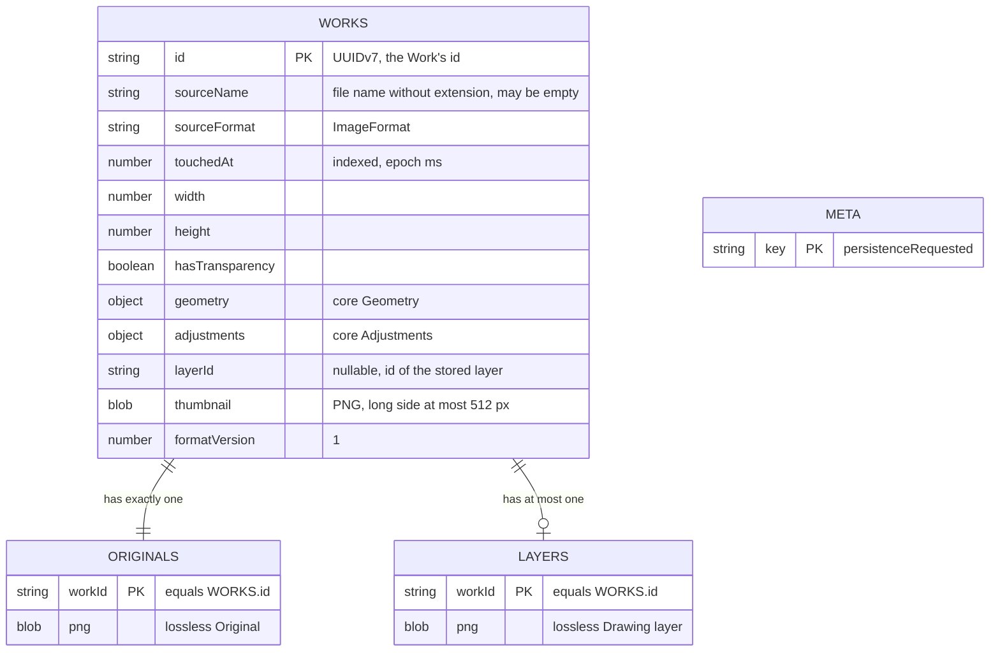

# Data model — gallery

The Gallery is the first feature that writes the `imgly` IndexedDB database. This document fixes
the exact shape that [ADR-0002](adr/0002-store-each-work-as-a-small-record-plus-separate-original-and-layer-blob-stores.md)
left to this stage. The conventions come from repo ADR 0003 and `docs/architecture-map.md`
§Migrations, and the repo already follows them: IndexedDB through `idb`, forward-only versioned
upgrade steps in `src/infra/db/migrations/NNNN-<name>.ts`, UUIDv7 ids from `newId()`, images as
`Blob`s and never data URLs, camelCase fields, and inline `keyPath`s. The repo has no SQL. The staged
"migrations" are TypeScript upgrade steps in the repo's own format, and the
[audit](_audit/data-model-2026-10-13.md) lists them.

Schema version: **v1 → v2**. Step `0002-gallery` reshapes `works` and adds `originals`, `layers`
and `meta`.

## ER diagram



`META` stands alone. It is app-wide and belongs to no Work.

## Entities

IndexedDB has no column types, `NOT NULL`, foreign keys or `CHECK`s. The "Type" column below is the
TypeScript type in `src/infra/db/schema.ts`. The constraints that matter are enforced in two places:
when writing, by the `works` repository's single read-write transaction (ADR-0004), and when
reading, by `validateStoredWork` in `src/core/gallery/`, which treats stored data as untrusted
(sad.md §8). A record that fails either check is a damaged Work (AC-08, `WORK_DAMAGED`).

### Aggregate: Work (root `works`)

A Work is the aggregate root. `originals` and `layers` are parts of it, keyed by its id. They are
never written, read for display or deleted on their own. Every write and every delete, including
eviction, spans all three stores in one transaction (ADR-0002, ADR-0004).

#### `works`

Object store, `keyPath: 'id'`, one small record per Work. The Gallery lists from this store alone
(AC-08: listing checks only what an entry shows).

| Field | Type | Constraints | Notes |
|---|---|---|---|
| `id` | `string` | PK, UUIDv7 from `newId()` | A new id for every successful open, even of a file opened before (AC-09). A reopen keeps it |
| `sourceName` | `string` | required, may be `''` | The file name without its image extension (`WorkSource.sourceName`). The UI shows `''` as "Untitled" (AC-03). It is only ever rendered as text (§6.1) |
| `sourceFormat` | `ImageFormat` | one of `'jpeg' \| 'png' \| 'gif' \| 'webp' \| 'avif' \| 'heic'` | Picks the next Export's default format (AC-04). Validated on reopen |
| `touchedAt` | `number` | required, epoch ms, indexed | When the Work was last opened, reopened or changed (Step, Undo, Redo). It orders the Gallery, picks eviction candidates and feeds the "N minutes ago" label (AC-03, AC-09). It comes from the injectable clock (sad.md §8) |
| `width` | `number` | integer ≥ 1, ≤ 4096 | The Original's width after the Downscale limit. The decoded PNG must match it (AC-08) |
| `height` | `number` | integer ≥ 1, ≤ 4096 | As `width` |
| `hasTransparency` | `boolean` | required | `Original.hasTransparency` (export AC-15). Stored, not recomputed, so reopen doesn't scan 12 MP |
| `geometry` | `Geometry` | Crop inside the turned image, Straighten −450…450, Rotation ∈ {0, 90, 180, 270} | A structured clone of `core/geometry` `Geometry`. All of its fields are integers or booleans |
| `adjustments` | `Adjustments` | each field within `ADJUSTMENT_RANGES` | A structured clone of `core/adjust` `Adjustments` (seven integers) |
| `layerId` | `string \| null` | `null` ⇔ no `layers` entry | The id of the Drawing layer whose PNG is stored. On save, the repository rewrites the `layers` Blob only when this differs from the open Work's layer id or the entry is missing (ADR-0003, AC-21) |
| `thumbnail` | `Blob` (`image/png`) | required | Rendered by `renderThumbnail` with all edits, long side ≤ 512 px (ADR-0005). A fresh one is written on every save, so it always matches the stored state (AC-01, AC-03) |
| `formatVersion` | `number` | `1` for this layout | The record layout's version, separate from the database version. Later migration steps convert records by it, and `validateStoredWork` rejects unknown values (AC-18). The constant lives in `src/core/gallery/` (`STORED_WORK_FORMAT = 1`) |

**Aggregate root:** root.
**Access patterns:** list newest first → index `touchedAt`; get, put and delete one Work → PK `id`;
read every record inside the store transaction to pick evictions → full scan of at most 21 records.
**Constraints:** PK `id`. One record per Work, so the cap of 20 (21 during a save) is a count of
this store, enforced by the eviction rule in `core/gallery`, not by the database.

**Removed in v2:** the v1 fields `name` and `updatedAt` and the `updatedAt` index. Nothing ever wrote
them (architecture map, Datastores). `createdAt` is deliberately **not** stored, although ADR-0002
lists it: spec §6.1 lists exactly what may be stored, a creation time is not on that list, and
nothing reads `Work.createdAt` (owner, 2026-10-13). On reopen, the in-memory Work's `createdAt` and
`updatedAt` are set from `touchedAt`.

#### `originals`

Object store, `keyPath: 'workId'`. It holds one entry per Work, written once at the Work's first
save, or again when another tab evicted the Work (AC-21). It is never rewritten after that.

| Field | Type | Constraints | Notes |
|---|---|---|---|
| `workId` | `string` | PK, equals `works.id` | The "foreign key" is the primary key, so it is indexed by construction |
| `png` | `Blob` (`image/png`) | required | The lossless Original, encoded in the codec worker (ADR-0003). It decodes to `width × height` |

**Aggregate root:** `works`.
**Access patterns:** reopen loads by `workId` (Flow 2). A save checks whether the entry exists
(`getKey`) before writing the Original (Flow 1, Flow 7). Delete and evict remove it by `workId`
(Flow 4, Flow 1).
**Invariant:** a `works` record exists ⇔ its `originals` entry exists.

#### `layers`

Object store, `keyPath: 'workId'`. It holds at most one entry per Work: the applied Drawing layer.

| Field | Type | Constraints | Notes |
|---|---|---|---|
| `workId` | `string` | PK, equals `works.id` | As in `originals` |
| `png` | `Blob` (`image/png`) | required | The lossless Drawing layer at the Original's size. It decodes to `width × height` |

**Aggregate root:** `works`.
**Access patterns:** reopen loads it by `workId` when `layerId !== null`. A save writes it when the
layer changed or is missing, and deletes it when the applied layer became `null` (Undo, Clear).
Delete and evict remove it by `workId`.
**Invariant:** a `layers` entry exists ⇔ `works.layerId !== null`. A violation at reopen is a
damaged Work (AC-08).

### Standalone: `meta`

Object store, `keyPath: 'key'`. It holds app-wide flags.

| Field | Type | Constraints | Notes |
|---|---|---|---|
| `key` | `'persistenceRequested'` | PK, a union that grows with later flags | The entry's presence is the marker, and it has no other fields (§6.1: "one app-wide marker") |

**Aggregate root:** none (app-wide).
**Access patterns:** the save transaction reads `persistenceRequested`. When it is absent, the app
calls `navigator.storage.persist()` and writes the marker in the same transaction (AC-14). The marker
lives in the same database, so it disappears whenever the browser clears the Gallery, and the app
asks again at the next first save.

### `schema.ts` after v2

```ts
import type { DBSchema } from 'idb'
import type { Adjustments, Geometry, ImageFormat } from '../../core'

/** A Work's small record (gallery ADR-0002); its Original and layer live in their own stores. */
export interface WorkRecord {
  id: string
  sourceName: string
  sourceFormat: ImageFormat
  touchedAt: number
  width: number
  height: number
  hasTransparency: boolean
  geometry: Geometry
  adjustments: Adjustments
  layerId: string | null
  thumbnail: Blob
  formatVersion: number
}

export interface WorkBlobRecord {
  workId: string
  png: Blob
}

export interface MetaRecord {
  key: 'persistenceRequested'
}

export interface ImglyDb extends DBSchema {
  works: { key: string; value: WorkRecord; indexes: { touchedAt: number } }
  originals: { key: string; value: WorkBlobRecord }
  layers: { key: string; value: WorkBlobRecord }
  meta: { key: MetaRecord['key']; value: MetaRecord }
}
```

**Required type change in `migrations/index.ts`:** `Migration.upgrade` must take the **untyped**
`IDBPDatabase` and `IDBPTransaction<unknown, string[], 'versionchange'>`, and `open-db.ts` passes the
typed handles through a cast. Without that change, the released `0001-init` step stops compiling:
`idb` types `createIndex` against the *current* schema's index names, and `'updatedAt'` is no longer
one of them. The change keeps 0001's body untouched, so "never edit a released step" still holds,
and every later step stays free to name stores and indexes that the latest schema has dropped.

## Indexes

| Index | Store · key | Query it serves |
|---|---|---|
| PK `id` | `works` · `id` | Reopen `loadWork(id)` (Flow 2), the delete transaction (Flow 4), the record `put` in `storeWork` (Flow 1, Flow 7) |
| `touchedAt` | `works` · `touchedAt` | Listing newest first: `getAllFromIndex('works', 'touchedAt')`, reversed (Flow 3, AC-03) |
| PK `workId` | `originals` · `workId` | Reopen load (Flow 2), the "Original if missing" `getKey` check (Flow 1, Flow 7), delete and evict (Flow 1, Flow 4) |
| PK `workId` | `layers` · `workId` | Reopen load when `layerId` is set (Flow 2), layer rewrite or removal (Flow 1), delete and evict (Flow 1, Flow 4) |
| PK `key` | `meta` · `key` | The first-save marker check inside the save transaction (Flow 1, AC-14) |

The eviction choice adds no index. `storeWork` reads every `works` record (at most 21) inside its
transaction, and the pure `core/gallery` rule orders them: damaged first, then by oldest
`touchedAt`, never the Work open in this tab (ADR-0004). The dropped v1 index `updatedAt` served no
query.

## Seeds

None. IndexedDB has no bootstrap or lookup data here. The only app-wide entry, the `meta` marker, is
written at runtime by the first save.

## Test fixtures

These are factory functions in the repo's style (compare `src/features/editor/testing.ts`), not
part of any migration step. `implement` writes them in `src/infra/db/testing.ts`.

- `workRecordFixture(overrides?)` builds a valid `WorkRecord`: a `newId()` id, `sourceName: 'test-photo'`, `sourceFormat: 'jpeg'`, a 4 × 3 size, `identityGeometry`, `NEUTRAL_ADJUSTMENTS`, `layerId: null`, a tiny PNG `thumbnail`, `formatVersion: 1` and `touchedAt` from the test clock.
- `storedWorkFixture(overrides?)` builds `{ record, original, layer }`, with matching `workId`s and tiny valid PNG Blobs at the record's size, so the codec's size check passes. With `layer: null`, `layerId` is set to `null`.
- `damagedWorkFixture(kind)` returns a stored Work broken in one way: `'missing-original'`, `'layer-without-record-id'`, `'size-mismatch'`, `'bad-geometry'` or `'unknown-format-version'` (AC-08 and `validateStoredWork` cases).

The fixtures contain no real-looking personal data: the Source names are `test-photo` or `''`.
