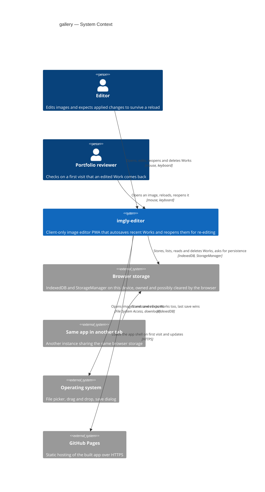
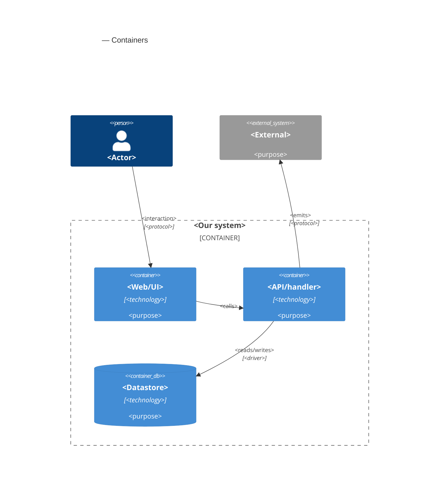

# Software Architecture Document — gallery

<!-- 12 Arc42 sections. Empty section → <!-- N/A: <one-line reason> -->. -->
<!-- C4 Context (L1) lives inline in §3. C4 Container (L2) lives inline in §5. -->
<!-- Numbers in §10 come VERBATIM from spec.md §6 NFR — no inventing, no rounding. -->

## 1. Introduction and goals

**Intent.** The Gallery keeps the Editor's recent Works in this browser, so a reload, a closed tab, a crash or opening another image never loses an applied change (spec §1, §2). Autosave stores the open Work's applied state, which is its Original, Source name, Source format, Geometry, Adjustments and Drawing layer. It stores it once the image has replaced the open Work, and again after every Step, Undo and Redo. It never stores an open tool's Draft, the View or the Edit history (CONTEXT: Autosave). The Gallery lists at most 20 Works, most recently opened or changed first. It appears on the start screen next to the "Open image" drop zone, and in an overlay that the "Gallery" action in the top bar opens while a Work is open (ux-flows SCR-01, SCR-03). Reopening a Work gives back exactly the stored Work, and each of its parts can still be edited on its own. The Gallery evicts a Work when a 21st arrives or when the browser's storage is full. It never evicts the Work open in this tab, and every Work that leaves is named in a notice. The feature turns repo ADR [0003](../../adr/0003-persist-works-in-indexeddb-as-original-plus-params-plus-layer.md)'s schema into a working store, implements the answer to roadmap D2 that the spec chose, and narrows open-and-view's replace confirmation to Unsaved edits that Autosave has not stored (spec §1 ¶4).

**Top-3 quality goals (1-liners; full scenarios in §10):**

1. **Integrity of stored Works**: every Work in the Gallery is either in its last fully stored state or absent, never half stored. The Work open in this tab is never evicted, and no Work leaves the Gallery without a notice (spec AC-07, AC-19, §6).
2. **Exact reopen**: a reopened Work's full-size PNG Export differs by 0 per channel from the Export of the same Work made before the reload, on Chromium, Firefox and WebKit and across app updates, and each part stays editable on its own (spec AC-04, AC-18, §6).
3. **Editing stays responsive while Autosave runs**: the longest interface freeze is ≤ 200 ms. A Work is stored within p95 ≤ 3 s of its first Preview, ≤ 300 ms of a Crop or Adjustment Step and ≤ 1.5 s of a drawing Step. A reopen reaches its first Preview within p95 ≤ 1.5 s (spec §6).

A fourth goal is a correctness rule rather than a quality trade-off, and §10 covers it as QG-4: the app stays honest about storage. The storage line follows the browser's current answer, every eviction and failed save is named in a notice, and the replace confirmation asks exactly when the open Work's Unsaved edits are not stored (spec §2, AC-13, AC-16, AC-17).

**Stakeholders.**

| Role | Interest | Sign-off owner? |
|---|---|---|
| Editor | Never loses an applied change. Reopens yesterday's Work and changes its Crop, a slider or one mark separately, and is told plainly where Works are kept and when one left the Gallery | No |
| Portfolio reviewer | Finds the Gallery on the start screen and sees an edited Work come back after a reload on the first try (spec US-07, AC-05) | No |
| Tech Lead | SAD approval. The feature is the first to write IndexedDB, adds a module, and changes the editor store's replace path that open-and-view, crop-rotate, adjust, draw and undo-redo rely on | Yes |
| Security Lead | Spec §6.1 requires a security review: confidential photos and file names are kept at rest in the browser for the first time, and deleting or evicting a Work must leave no stored part behind | Yes |

<!-- Decision overrides (¶4) — populated by the critic resolution loop, empty otherwise. -->

## 2. Constraints

**Technical.**
- TypeScript 5.9 (`strict`), Node 24 toolchain and pnpm, per repo ADR [0001](../../adr/0001-build-a-client-only-vue-pwa.md)
- Vue 3.5 (Composition API, `<script setup>`), Pinia 4 setup stores, Vite 8 and vite-plugin-pwa 2. The app is a client-only PWA with no backend, so Works can only be stored in the browser (ADR 0001, spec §3)
- IndexedDB through `idb` 8, with forward-only, versioned upgrade steps in `src/infra/db/migrations/` and UUIDv7 IDs (repo ADR [0003](../../adr/0003-persist-works-in-indexeddb-as-original-plus-params-plus-layer.md)). Schema v1 has one `works` store (`{id, name, createdAt, updatedAt}`, keyPath `id`, index `updatedAt`, `src/infra/db/migrations/0001-init.ts`) that nothing reads or writes yet, so no user's browser holds a stored Work today
- The Original is an `ImageBitmap` that is already oriented, converted to sRGB and reduced to the Downscale limit of 4096 px (open-and-view ADR-0004). The Drawing layer is one 2D `OffscreenCanvas` the size of the Original: up to 4096 × 4096 × 4 B = 64 MB raw, and 50 331 648 B on the 4096 × 3072 reference Work (draw ADR-0001). The Work is an immutable value that the `editor` store swaps on every change, and it tracks Unsaved edits as `revision !== cleanRevision` (open-and-view ADR-0005, undo-redo ADR-0003, `src/core/document.ts`)
- The Preview and every Export draw from one shared WebGL2 program (geometry, Adjustments, Drawing layer), so the same Original, parameters and layer always give the same pixels (repo ADR [0004](../../adr/0004-render-adjustments-on-webgl2-and-drawing-on-canvas2d.md), crop-rotate ADR-0002, draw ADR-0003)
- Workers sit behind a client factory that takes `createWorker`, and their message handling lives in a separately tested `worker-handler.ts`. The export runs each job in a fresh worker that is terminated afterwards (export ADR-0002). The start-up gate already requires `createImageBitmap` and OffscreenCanvas 2D inside a worker (`src/render/capabilities.ts`)
- Architecture convention: a functional core with feature folders (repo ADR [0002](../../adr/0002-organize-code-as-functional-core-with-feature-folders.md)). `src/core/` is pure TypeScript. `infra` may call pure `core` functions but never Vue, Pinia or a feature. Features never import each other, they coordinate through the `editor` store, and there is no event bus
- Browser behaviour the design relies on:
  - An IndexedDB transaction is atomic: it commits all its writes or none, including when the page dies mid-way.
  - A transaction also commits on its own as soon as no request is pending, so any slow preparation (encoding, reading pixels) must finish before the transaction opens.
  - `navigator.storage.persist()` and `persisted()` ask for and report persistent storage.
  - `beforeunload` lets the page ask the browser to show its own leave warning.

**Organisational.**
- Owner: Blazheiko, working alone with the SDD pipeline
- Size M (`.size`) and route `standard` (`.route`): one to two sprints and 5–15 PRs, per the size matrix
- No deadline. The roadmap orders steps by dependency and gives no dates. Gallery is step 8, the last step of the editing story (`docs/roadmap.md`)
- A security review is required before ship, because the feature adds personal data at rest (spec §6.1)

**Conventions.**
- `CLAUDE.md` (module boundaries, conventions, decisions) and `docs/architecture-map.md` §Conventions
- Errors: `core` and `infra` return `Result<T, AppError>`. New codes are added to the `AppErrorCode` union in `src/core/result.ts`, and their text goes in the owning feature's `messages.ts`. The UI shows errors only through the `useNotices` boundary
- IDs come from `newId()` (UUIDv7, `src/shared/ids.ts`)
- Persistence: only `src/infra/db/*` touches IndexedDB, through repository functions that return `Result`. Images are stored as `Blob`s, never as data URLs. Each schema change is a new `src/infra/db/migrations/NNNN-<name>.ts` step, appended to `migrations/index.ts`, never edited after release, and covered by a `fake-indexeddb/auto` test
- Resource lifetime: call `closeBitmap()` before dropping an `ImageBitmap` and `releaseLayer()` before dropping a Drawing layer. The DEV and e2e ledger counts both (`src/shared/bitmap-ledger.ts`)
- UI: plain CSS with `<style scoped>`, only `var(--…)` tokens from `src/shared/styles/tokens.css`, `src/shared/ui/` primitives first, and every new primitive registered in `docs/design-system.md`
- Tests: Vitest next to the source. e2e only for what happy-dom can't do, which here means real persistence across a reload, offline use, WebGL pixel comparison and the browser's leave warning

**Regulatory / external.**
- Spec §6.1: the data is confidential, and it is now kept at rest in this browser. Only the fields §6.1 lists are stored. The Original carries no embedded metadata (capture location, camera) because it is pixels only. Deleting or evicting a Work removes every stored part of it, and nothing leaves the device
- No compliance regime applies. There is no server, no account and no third party, and the data stays on the person's own device
- The browser's storage policy is outside the app's control. Storage that is not persistent may be cleared when space runs low, and WebKit (Safari) can delete a website's script-written storage after 7 days without use unless the app is installed. This is why the Gallery always says whether the browser may clear it and that an Export is the durable copy (spec AC-13)

## 3. Context and scope

The Gallery adds memory to an editor that had none. Until now the open Work lived only in the tab's memory, and an Export was the only way to keep anything. From this step on, the app keeps its recent Works in the browser's own storage, reopens them on request and tells the Editor plainly how safe they are there. Everything still happens on the Editor's device. The feature adds no server, no account and no network call, and the only new outside party is the browser's storage, which the browser owns and may clear.

<!-- brownfield: Vue 3 + Pinia client-only PWA with a functional core (src/core), infra adapters (db, platform, image-decode), a shared WebGL2 renderer and feature folders coordinated through the editor store; IndexedDB has a v1 schema that nothing reads or writes yet (docs/architecture-map.md, reflects 3f248c2 + the undo-redo update 41dbfc3). -->

**External systems (in / out):**

| Actor or system | Type | Interaction |
|---|---|---|
| Editor | Person | Opens and edits images. Every applied change is autosaved. Lists, reopens and deletes Works in the Gallery |
| Portfolio reviewer | Person | Same actions as the Editor. Checks on a first visit that an edited Work comes back after a reload (spec US-07) |
| Browser storage | System (external, owned by the browser) | IndexedDB holds the stored Works and the "asked for persistent storage" marker. The StorageManager answers whether storage is persistent, and the browser may ask the person once at the first save (SCR-07). The browser may clear non-persistent storage, refuse to open it (blocked site data), or report it full. **Trust boundary:** whatever is read back is treated as untrusted and checked before it is used (spec §6.1, AC-08) |
| Same app in another tab | System (another instance of this app) | Shares the same browser storage. It may store, evict or delete the Work this tab has open, and the last save wins (spec AC-21, §8) |
| Operating system | System (external) | File picker and drag and drop for opening images, and the save dialog for Exports. Unchanged by this feature |
| GitHub Pages | System (external) | Serves the static app over HTTPS. After the first load the app works offline, and the Gallery must too (spec §6). Unchanged by this feature |

Out of scope on purpose: no server, sync, cloud backup, accounts or sharing (spec §3, ADR 0001). A Work never leaves the device.

**C4 Context (L1):**



## 4. Solution strategy

**Target surface.** `[web-frontend]` (frontmatter `target_surfaces`). The app is a client-only SPA (ADR 0001), the spec's actors are people at a desktop browser (spec §4), and ux-flows inventories seven screens (SCR-01 to SCR-07). The PNG codec worker of choice 3 runs inside the same deployable, like the existing decode and export workers, so it is not a `worker` surface: it consumes no events and has no lifecycle of its own. One surface, so the decision stays inline.

**UI architecture (web-frontend).** The existing single-view SPA stays, with no router. The Gallery has two homes, both mounted through new `EditorView` slots that `App.vue` fills with gallery components, as it already does for the tools. With no Work open, it sits on the start screen next to the "Open image" drop zone (SCR-01). With a Work open, the "Gallery" top-bar action shows it as a modal overlay over the canvas area (SCR-03), and Esc or "Close" returns to the Work unchanged. The owner chose the overlay in ux-flows on 2026-10-13. A router (a hash route such as `#/gallery` under `/imgly/`) was the alternative: it would give the Gallery a URL and let Back close it, at the cost of a new dependency and a change to how the app starts. The choice is reversible in days and touches only the shell, so it stays inline. State stays in Pinia setup stores, with no server cache.

**Top strategic choices (the seeds for ADRs):**

1. **Autosave and reopen belong to the editor store, and the gallery feature is the UI** ([ADR-0001](adr/0001-own-autosave-and-reopen-in-the-editor-store-and-keep-the-gallery-feature-to-the-ui.md)). Every trigger of Autosave already starts in the editor store: replacing the Work, a counting Apply (`edits.commit`), Undo and Redo. So does the replace gate that must wait for a running save and ask only when the latest state is not stored (spec AC-16, AC-17). A composed `autosave.ts`, like `edit-history.ts` (undo-redo ADR-0004), keeps the triggers, the "saving / stored" state and the gate in one place with a fixed order of events. Reopening is a new way to replace the Work, so `reopenWork(id)` sits beside `openImage` and follows the same rules: it reads the Work in full before the gate, latest open wins, and it is refused while exporting or confirming (AC-08, AC-15, AC-17). The new `gallery` feature lists, deletes and shows the Works, and reaches the editor only through its public store API. This serves quality goal 1 (one owner for the save order) and QG-4 (the gate asks exactly when edits are not stored).
2. **A Work is stored as a small record plus separate blob stores** ([ADR-0002](adr/0002-store-each-work-as-a-small-record-plus-separate-original-and-layer-blob-stores.md)). The `works` store holds one small record per Work, including its thumbnail. The heavy Original and Drawing layer Blobs live in their own `originals` and `layers` stores, and a `meta` store holds the persistent-storage marker. Listing reads only `works`, which serves the 500 ms Gallery target and the rule that listing checks only what an entry shows (AC-08). An Adjust or Crop Step rewrites only the record, which serves the 300 ms target, and the Original is written once per Work. This refines repo ADR 0003's single `works` store without contradicting it: the storage is still IndexedDB, holding original plus parameters plus layer.
3. **The Original and the Drawing layer are encoded losslessly as PNG in a worker** ([ADR-0003](adr/0003-encode-the-original-and-the-drawing-layer-as-png-in-a-fresh-worker.md)). PNG is the only lossless format that a canvas encodes in all three engines, and it is a stable format that a later app version can always read (AC-18). Encoding a 12 MP image takes too long for the main thread's 200 ms freeze budget, so it runs in a new `infra/work-codec` module that starts a fresh worker for each job, as the export does (export ADR-0002). The same module decodes stored PNGs on reopen. The Original is encoded once per Work and the layer once per applied layer. The open Work's encoded Blobs stay in memory, so a later save can put them back if another tab evicted the Work (AC-21). This serves quality goals 2 and 3.
4. **Eviction and storing happen in one IndexedDB transaction, retried on a full quota** ([ADR-0004](adr/0004-evict-and-store-in-one-indexeddb-transaction-and-retry-on-a-full-quota.md)). All encoding finishes before the transaction opens, because a transaction commits on its own once no request is pending (§2). One read-write transaction over `works`, `originals`, `layers` and `meta` then picks the eviction candidates with a pure `core` rule, deletes every part of them, and writes the new state. If the browser reports the quota full, the whole transaction rolls back, and the save retries with one more Work evicted. If the Work does not fit even alone, nothing is evicted and the earlier stored state stays. That is a deliberate refinement of AC-10's wording (§11). Eviction notices are raised only after the commit. This is the core of quality goal 1 (AC-09, AC-10, AC-19).

Each tactical decision in later sections should trace to one of these seeds. Tactical decisions that *contradict* a strategic choice are red flags — surface them in §11.

## 5. Building block view

<!-- 🎯 Why: INTERNAL DECOMPOSITION — modules, containers, datastores. The static topology: who
     may talk to whom. Without §5, §6 (the flows) has no vocabulary of participants.
     📋 Write: 1 ¶ on the style (layered / hexagonal / clean / event-driven) + a folder tree + a
     C4Container block.
     📌 Draw ONE Container per declared `target_surface` (frontmatter): a fullstack
     [backend-service, web-frontend] = a backend-API container + a web/SPA container; a
     [backend-service, mobile-app] = the API + the mobile app. The Container(web, …) line below is
     just one surface's container — swap/add per what was declared in §4. → _shared/surfaces.md
     📌 e.g. «web app, content API, media worker, datastore, object store, CDN». -->

<One paragraph: layered / hexagonal / clean / event-driven, and why.>

**Internal decomposition:**

```
<e.g. modules/<feature>/>
├── domain/       <entities + sentinel errors>
├── app/          <use cases / services>
├── infra/        <repository + integration impl>
├── ports/        <handlers, DTOs, error mapping>
└── wiring        <self-wiring entry point>
```

**C4 Container (L2):** <!-- syntax → references/c4-mermaid-syntax.md. Real names, no <placeholder> stubs. ONE Container per declared target_surface (frontmatter); the web container below is one example surface. -->



## 6. Runtime view

<!-- 🎯 Why: the RUNTIME FLOW of 1–2 critical scenarios — who talks to whom, when, in what order.
     Without §6, §5 is just boxes with no life.
     📋 Write: a Mermaid sequenceDiagram. Participants are names from §5 (don't invent new ones).
     Messages are semantic («saves a draft»), NO HTTP verbs / paths / status codes — endpoint-level
     sequences arrive at the `api` stage.
     📌 e.g. «author → web: composes draft → web → content API: save». Seed the primary flow(s) here;
     the `sequences` stage then covers every §5 AC (no cap). Never N/A for M+; XS/S keeps ≥1 happy-path flow. -->

**Critical flow 1: <flow name>**

```mermaid
sequenceDiagram
    actor Actor
    participant Web
    participant Service
    participant Store
    Actor->>Web: <action>
    Web->>Service: <call>
    Service->>Store: <write>
    Store-->>Service: ok
    Service-->>Web: result
    Web-->>Actor: confirmation
```

**Critical flow 2: <e.g. async event propagation>** — <if applicable, otherwise N/A>.

## 7. Deployment view

<!-- 🎯 Why: the TOPOLOGY DevOps must know without reading the deploy charts — how many replicas,
     where the background worker lives, AT WHAT NUMBERS we scale.
     📋 Write: 2–3 sentences on topology + monitoring + concrete threshold numbers.
     📌 e.g. «500 authors → partition by quarter» (not «we'll think about scale later»).
     🎯 N/A allowed for XS/S that reuses an existing deployment unit with no change.
     Deployment-diagram scaffold → templates/deployment.md. -->

<Topology in 2–3 sentences. Where it runs, replicas, scaling thresholds.>

**Monitoring:**
- <Metrics — e.g. `<metric_name>`>
- <Alerts — e.g. «worker lag > 10 min → page on-call»>
- <Tracing — e.g. spans on the request boundary>

**Scaling thresholds:**
- <e.g. comfortable in one table up to N rows/year>
- <e.g. partition by quarter above N rows/year>

<!-- For XS/S with no deployment change: <!-- N/A: reuses existing deployment unit, no infra change --> -->

## 8. Crosscutting concepts

<!-- 🎯 Why: CROSS-CUTTING PATTERNS spanning several modules: logging, errors, authorization, ID
     strategy, events, caching. ⭐ The second-densest section. A pattern inside one module is NOT
     here; a project-wide convention belongs in the convention file.
     📋 Write: a table — concept / convention / where defined. One row per concept.
     📌 e.g. «sortable time-based IDs generated in the app layer» as a default from the convention file. -->

| Concept | Convention | Where defined |
|---|---|---|
| Logging | <e.g. structured, fields `module=<name>`> | <convention file §X or here> |
| Authentication | <e.g. token-based via middleware> | <convention file §X> |
| Error handling | <e.g. domain sentinel → ports error mapping → JSON> | <convention file §X> |
| ID strategy | <e.g. sortable time-based ID in the app layer> | <convention file §X> |
| Internationalisation | <e.g. N/A, single language> | — |
| Observability | <e.g. tracing on the request boundary> | — |
| Events | <module-specific patterns, if any> | <here> |

## 9. Architecture decisions

<!-- 🎯 Why: the REVERSE INDEX onto the adr/ folder. `ls adr/` gives the files; §9 gives the
     semantics — why they exist, which SAD section they attach to, what status.
     📋 Write: a 4-column table, one row per ADR. Mixed status is fine.
     📌 e.g. «0001 | Store content as a table of typed blocks | Accepted | §4». -->

| # | Title | Status | Section |
|---|---|---|---|
| [0001](adr/0001-own-autosave-and-reopen-in-the-editor-store-and-keep-the-gallery-feature-to-the-ui.md) | Own Autosave and reopen in the editor store, and keep the gallery feature to the UI | Accepted | §4 |
| [0002](adr/0002-store-each-work-as-a-small-record-plus-separate-original-and-layer-blob-stores.md) | Store each Work as a small record plus separate Original and layer blob stores | Accepted | §4 |
| [0003](adr/0003-encode-the-original-and-the-drawing-layer-as-png-in-a-fresh-worker.md) | Encode the Original and the Drawing layer as PNG in a fresh worker | Accepted | §4 |
| [0004](adr/0004-evict-and-store-in-one-indexeddb-transaction-and-retry-on-a-full-quota.md) | Evict and store in one IndexedDB transaction, and retry on a full quota | Accepted | §4 |

ADR files live under `docs/features/gallery/adr/NNNN-<title>.md`.

## 10. Quality requirements

<!-- 🎯 Why: the QUALITY TREE — take a goal from §1 and break it into concrete leaves: tests,
     metrics, configs, drills. ⭐ Without §10, §1 is a manifesto. With §10 each declaration maps
     to something PROVABLE.
     📋 Write: per §1 goal — When / Then / How-verify. Numbers from spec §6 NFR VERBATIM (don't
     round ≤250ms to ≤300ms — that's a critic F6 hit).
     📌 e.g. «p95 ≤ 500 ms on a block update, verified by a 100 req/s load test». -->

Each top-3 goal from §1 expanded into a full scenario:

**QG-1. <quality attribute>**
- **When:** <trigger condition>
- **Then:** <expected behaviour with numbers from spec §6 NFR>
- **How verify:** <test / chaos drill / load test / metric>

**QG-2. <quality attribute>**
- **When:** <trigger>
- **Then:** <expected>
- **How verify:** <how>

**QG-3. <quality attribute>**
- **When:** <trigger>
- **Then:** <expected>
- **How verify:** <how>

## 11. Risks and technical debt

<!-- 🎯 Why: ⭐ collects EVERYTHING that can break — not only the technical. Without §11 risks get
     discussed at standups and lost; debt lives only in the head of whoever accepted it.
     📋 Write: a risk/debt table — severity — mitigation — owner. Accepted debt in its own block.
     📌 The first risk is often a product risk, not a technical one. That's normal. -->

<!-- Severity literals: Low / Medium / High for regular risks; "Open question" for rows created by
     a Save-as-OQ resolution during the Socratic walk (see references/socratic.md). -->

| Risk / debt | Severity | Mitigation | Owner |
|---|---|---|---|
| <e.g. Worker lag may reach hours during a downstream outage> | Medium | <alert >10 min, on-call playbook, retry backoff> | <DevOps> |
| <e.g. No event-schema versioning in v1> | Medium | <ADR-NNNN planned for v2, tolerate unknown fields> | <Backend> |
| Open architectural decision: <decision-headline> | Open question | Resolve before <stage trigger or YYYY-MM-DD>; <inline rationale from the Save-as-OQ> | <owner> |

**Accepted debt (acceptable in v1, plan to fix later):**
- <e.g. the entity is immutable / unversioned — OK for v1, may need audit versioning in v2>

## 12. Glossary

<!-- 🎯 Why: ⭐ the DOMAIN GLOSSARY that ends arguments a year later («checkpoint — weekly or
     biweekly? quarter — calendar or fiscal?»).
     📋 Write: a term / meaning table. Business + technical terms mixed.
     📌 e.g. «Lesson | a unit inside a course made of blocks (text, video)». -->

| Term | Meaning |
|---|---|
| <e.g. domain object A> | <its meaning in this domain> |
| <e.g. domain object B> | <its meaning> |
| <e.g. domain invariant name> | <the rule, in plain language> |
