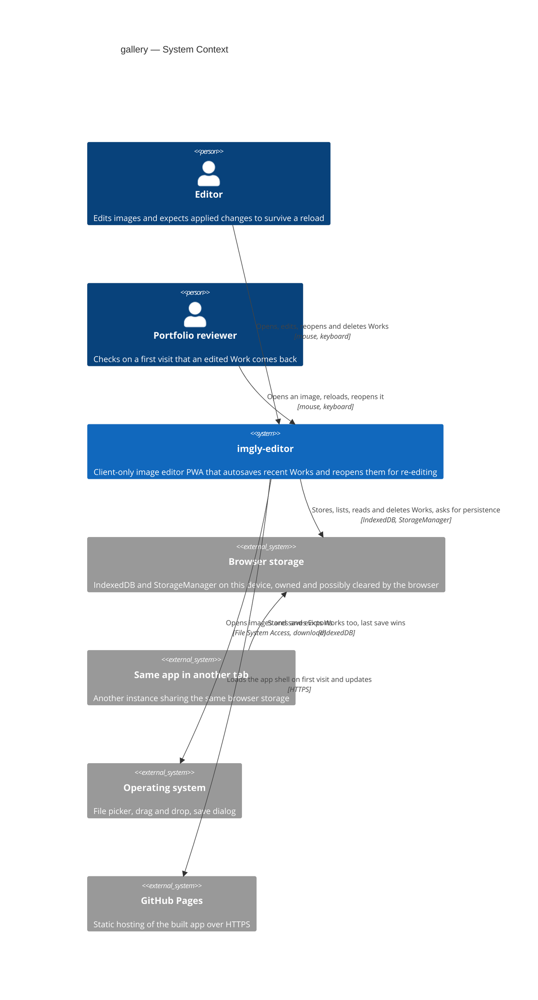
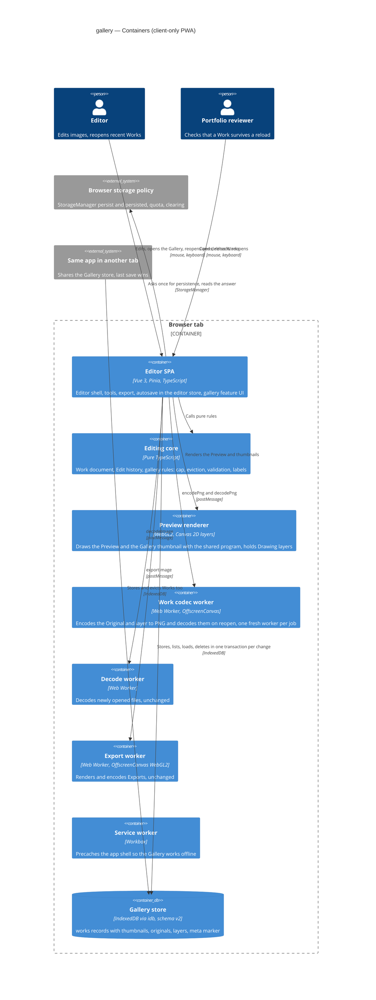
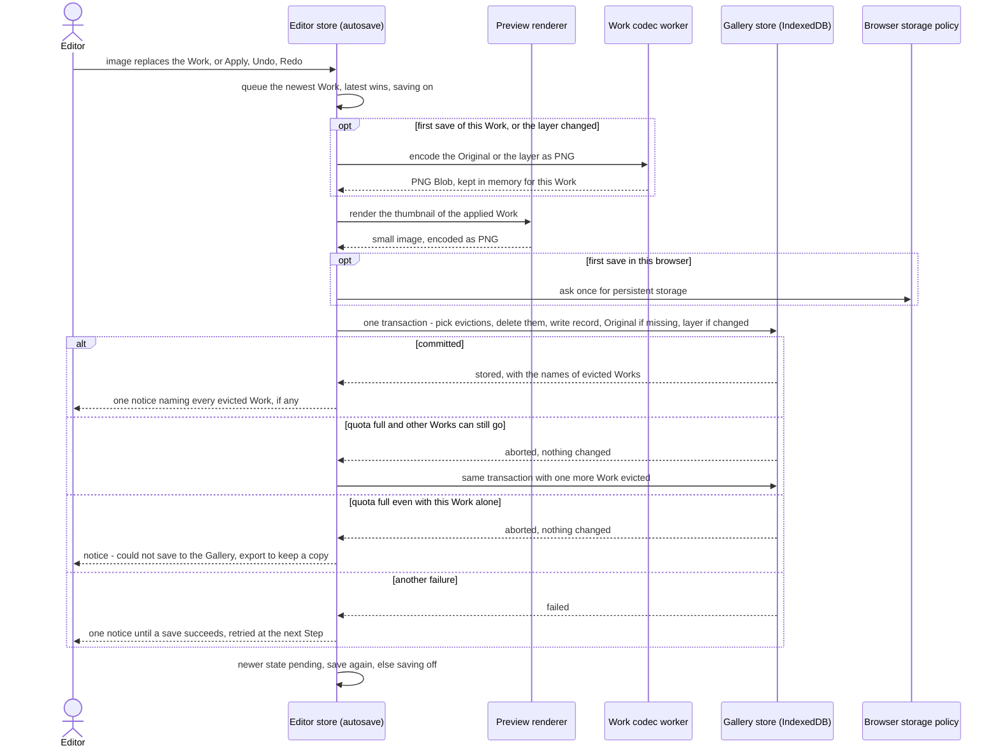
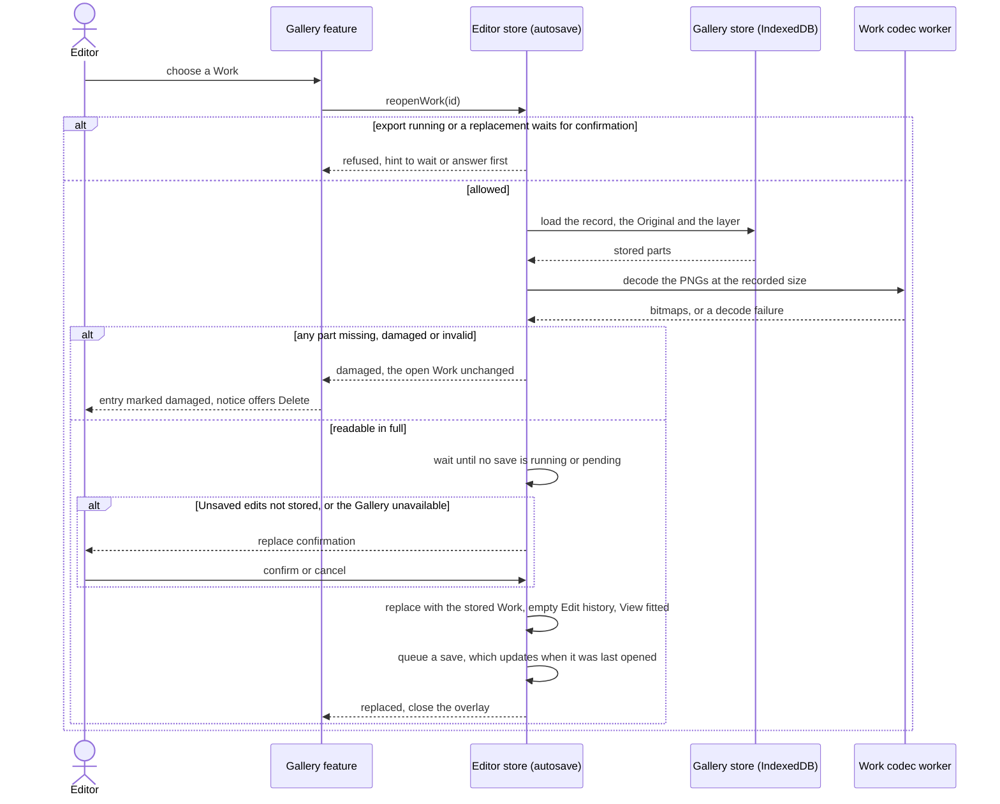
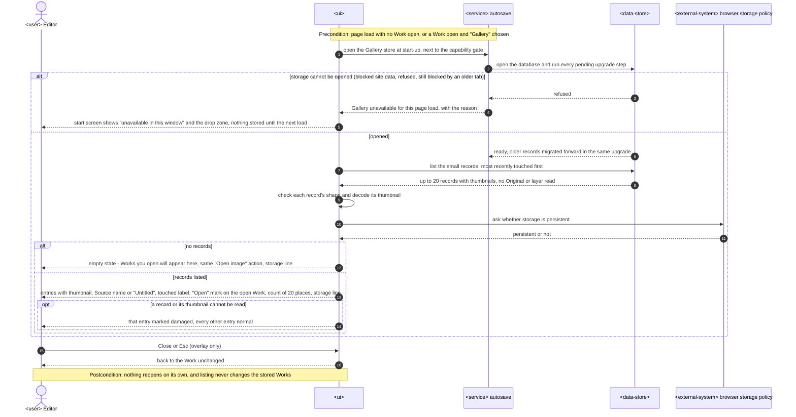
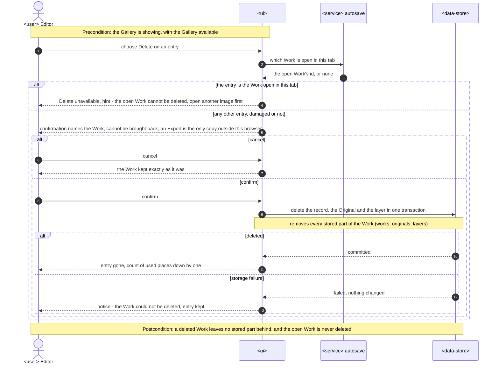
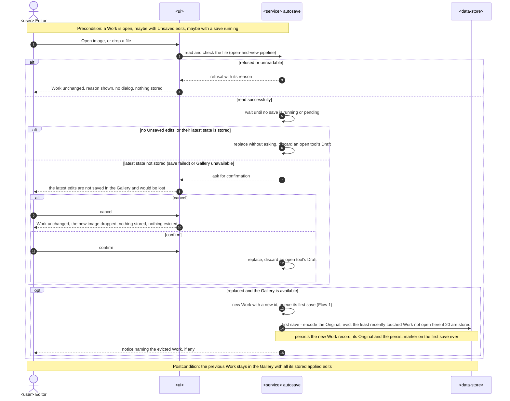
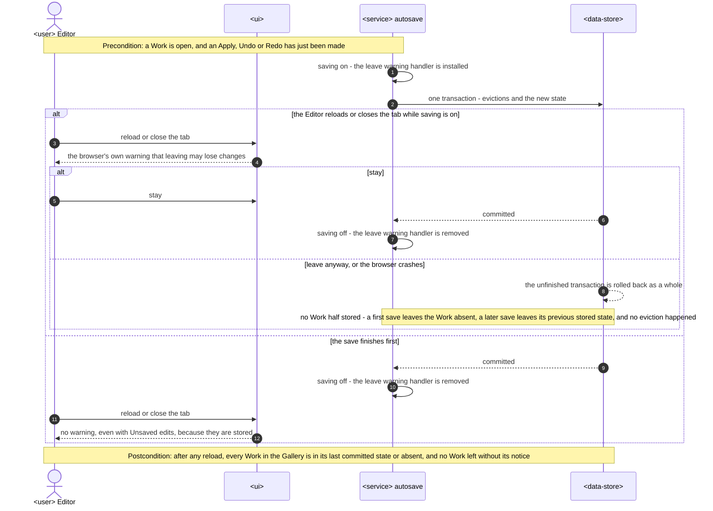
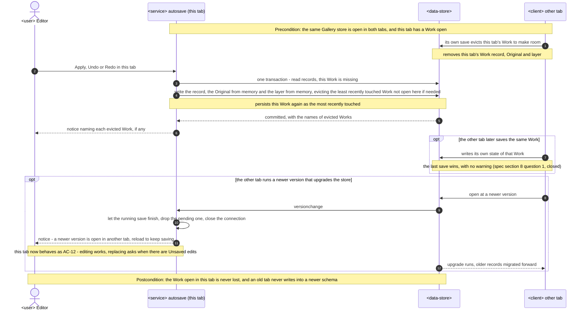

# Software Architecture Document — gallery

<!-- 12 Arc42 sections. Empty section → <!-- N/A: <one-line reason> -->. -->
<!-- C4 Context (L1) lives inline in §3. C4 Container (L2) lives inline in §5. -->
<!-- Numbers in §10 come VERBATIM from spec.md §6 NFR — no inventing, no rounding. -->

## 1. Introduction and goals

**Intent.** The Gallery keeps the Editor's recent Works in this browser, so a reload, a closed tab, a crash or opening another image never loses an applied change (spec §1, §2). Autosave stores the open Work's applied state, which is its Original, Source name, Source format, Geometry, Adjustments and Drawing layer. It stores it once the image has replaced the open Work, and again after every Step, Undo and Redo. It never stores an open tool's Draft, the View or the Edit history (CONTEXT: Autosave). The Gallery lists at most 20 Works, most recently opened or changed first. It appears on the start screen next to the "Open image" drop zone, and in an overlay that the "Gallery" action in the top bar opens while a Work is open (ux-flows SCR-01, SCR-03). Reopening a Work gives back exactly the stored Work, and each of its parts can still be edited on its own. The Gallery evicts a Work when a 21st arrives or when the browser's storage is full. It never evicts the Work open in this tab, and every Work that leaves is named in a notice. The feature turns repo ADR [0003](../../adr/0003-persist-works-in-indexeddb-as-original-plus-params-plus-layer.md)'s schema into a working store, implements the answer to roadmap D2 that the spec chose, and narrows open-and-view's replace confirmation to Unsaved edits that Autosave has not stored (spec §1 ¶4).

**Top-3 quality goals (1-liners; full scenarios in §10):**

1. **Integrity of stored Works**: every Work in the Gallery is either in its last fully stored state or absent, never half stored. The Work open in this tab is never evicted, and no Work leaves the Gallery without a notice (spec AC-07, AC-19, §6).
2. **Exact reopen**: a reopened Work's full-size PNG Export differs by 0 per channel from the Export of the same Work made before the reload, on Chromium, Firefox and WebKit, and each part stays editable on its own. After an app update the Work opens with exactly its stored data, and its Export is identical too when the update did not change how a Work is drawn (spec AC-04, AC-18, §6).
3. **Editing stays responsive while Autosave runs**: the longest interface freeze is ≤ 200 ms. A Work is stored within p95 ≤ 3 s of its first Preview, ≤ 300 ms of a Crop or Adjustment Step and ≤ 1.5 s of a drawing Step. A reopen reaches its first Preview within p95 ≤ 1.5 s (spec §6).

A fourth goal is a correctness rule rather than a quality trade-off, and §10 covers it as QG-4: the app stays honest about storage. The storage line follows the browser's current answer, every eviction and failed save is named in a notice, and the replace confirmation asks exactly when the open Work's Unsaved edits are not stored (spec §2, AC-13, AC-16, AC-17).

**Stakeholders.**

| Role | Interest | Sign-off owner? |
|---|---|---|
| Editor | Never loses an applied change. Reopens yesterday's Work and changes its Crop, a slider or one mark separately, and is told plainly where Works are kept and when one left the Gallery | No |
| Portfolio reviewer | Finds the Gallery on the start screen and sees an edited Work come back after a reload on the first try (spec US-07, AC-05) | No |
| Tech Lead | SAD approval. The feature is the first to write IndexedDB, adds a module, and changes the editor store's replace path that open-and-view, crop-rotate, adjust, draw and undo-redo rely on | Yes |
| Security Lead | Spec §6.1 requires a security review: confidential photos and file names are kept at rest in the browser for the first time, and deleting or evicting a Work must leave no stored part behind | Yes |

<!-- Decision overrides (¶4) — populated by the critic resolution loop, empty otherwise. -->

**Decision overrides:**

- Decision override: spec AC-10 — when the open Work does not fit even once every other Work would be evicted, nothing is evicted, the earlier stored state of the open Work stays, and the "could not save, export to keep a copy" notice is shown — rationale: removing Works that cannot make room helps no one, and keeping the save as one transaction keeps quality goal 1 (owner, 2026-10-13, ADR-0004). AC-10's wording is to be updated (§11).
- Decision override: spec §6.1 abuse case and AC-12 example ("private windows store nothing") — where a private window can open IndexedDB, the Gallery works for that window's life with the non-persistent storage line, and the browser discards it when the window closes. Browsers expose no reliable private-mode signal, so the app does not try to detect it — rationale: honest to how current engines behave, no fragile detection; needs Security Lead sign-off in the §6.1 security review (§11).
- Decision override: repo ADR 0003's "one `works` store" wording — the Gallery keeps ADR 0003's decision (IndexedDB through `idb`, Original plus parameters plus Drawing layer, Blobs, forward-only migrations, UUIDv7) but splits a Work across `works`, `originals`, `layers` and `meta` stores — rationale: the 300 ms and 500 ms targets of spec §6 (ADR-0002). ADR 0003 stays Accepted and is refined, not superseded.

## 2. Constraints

**Technical.**
- TypeScript 5.9 (`strict`), Node 24 toolchain and pnpm, per repo ADR [0001](../../adr/0001-build-a-client-only-vue-pwa.md)
- Vue 3.5 (Composition API, `<script setup>`), Pinia 4 setup stores, Vite 8 and vite-plugin-pwa 2. The app is a client-only PWA with no backend, so Works can only be stored in the browser (ADR 0001, spec §3)
- IndexedDB through `idb` 8, with forward-only, versioned upgrade steps in `src/infra/db/migrations/` and UUIDv7 IDs (repo ADR [0003](../../adr/0003-persist-works-in-indexeddb-as-original-plus-params-plus-layer.md)). Schema v1 has one `works` store (`{id, name, createdAt, updatedAt}`, keyPath `id`, index `updatedAt`, `src/infra/db/migrations/0001-init.ts`) that nothing reads or writes yet, so no user's browser holds a stored Work today
- The Original is an `ImageBitmap` that is already oriented, converted to sRGB and reduced to the Downscale limit of 4096 px (open-and-view ADR-0004). The Drawing layer is one 2D `OffscreenCanvas` the size of the Original: up to 4096 × 4096 × 4 B = 64 MB raw, and 50 331 648 B on the 4096 × 3072 reference Work (draw ADR-0001). The Work is an immutable value that the `editor` store swaps on every change, and it tracks Unsaved edits as `revision !== cleanRevision` (open-and-view ADR-0005, undo-redo ADR-0003, `src/core/document.ts`)
- The Preview and every Export draw from one shared WebGL2 program (geometry, Adjustments, Drawing layer), so the same Original, parameters and layer always give the same pixels (repo ADR [0004](../../adr/0004-render-adjustments-on-webgl2-and-drawing-on-canvas2d.md), crop-rotate ADR-0002, draw ADR-0003)
- Workers sit behind a client factory that takes `createWorker`, and their message handling lives in a separately tested `worker-handler.ts`. The export runs each job in a fresh worker that is terminated afterwards (export ADR-0002). The start-up gate already requires `createImageBitmap` and OffscreenCanvas 2D inside a worker (`src/render/capabilities.ts`)
- Architecture convention: a functional core with feature folders (repo ADR [0002](../../adr/0002-organize-code-as-functional-core-with-feature-folders.md)). `src/core/` is pure TypeScript. `infra` may call pure `core` functions but never Vue, Pinia or a feature. Features never import each other, they coordinate through the `editor` store, and there is no event bus
- Browser behaviour the design relies on:
  - An IndexedDB transaction is atomic: it commits all its writes or none, including when the page dies mid-way.
  - A transaction also commits on its own as soon as no request is pending, so any slow preparation (encoding, reading pixels) must finish before the transaction opens.
  - `navigator.storage.persist()` and `persisted()` ask for and report persistent storage.
  - `beforeunload` lets the page ask the browser to show its own leave warning.

**Organisational.**
- Owner: Blazheiko, working alone with the SDD pipeline
- Size M (`.size`) and route `standard` (`.route`): one to two sprints and 5–15 PRs, per the size matrix
- No deadline. The roadmap orders steps by dependency and gives no dates. Gallery is step 8, the last step of the editing story (`docs/roadmap.md`)
- A security review is required before ship, because the feature adds personal data at rest (spec §6.1)

**Conventions.**
- `CLAUDE.md` (module boundaries, conventions, decisions) and `docs/architecture-map.md` §Conventions
- Errors: `core` and `infra` return `Result<T, AppError>`. New codes are added to the `AppErrorCode` union in `src/core/result.ts`, and their text goes in the owning feature's `messages.ts`. The UI shows errors only through the `useNotices` boundary
- IDs come from `newId()` (UUIDv7, `src/shared/ids.ts`)
- Persistence: only `src/infra/db/*` touches IndexedDB, through repository functions that return `Result`. Images are stored as `Blob`s, never as data URLs. Each schema change is a new `src/infra/db/migrations/NNNN-<name>.ts` step, appended to `migrations/index.ts`, never edited after release, and covered by a `fake-indexeddb/auto` test
- Resource lifetime: call `closeBitmap()` before dropping an `ImageBitmap` and `releaseLayer()` before dropping a Drawing layer. The DEV and e2e ledger counts both (`src/shared/bitmap-ledger.ts`)
- UI: plain CSS with `<style scoped>`, only `var(--…)` tokens from `src/shared/styles/tokens.css`, `src/shared/ui/` primitives first, and every new primitive registered in `docs/design-system.md`
- Tests: Vitest next to the source. e2e only for what happy-dom can't do, which here means real persistence across a reload, offline use, WebGL pixel comparison and the browser's leave warning

**Regulatory / external.**
- Spec §6.1: the data is confidential, and it is now kept at rest in this browser. Only the fields §6.1 lists are stored. The Original carries no embedded metadata (capture location, camera) because it is pixels only. Deleting or evicting a Work removes every stored part of it, and nothing leaves the device
- No compliance regime applies. There is no server, no account and no third party, and the data stays on the person's own device
- The browser's storage policy is outside the app's control. Storage that is not persistent may be cleared when space runs low, and WebKit (Safari) can delete a website's script-written storage after 7 days without use unless the app is installed. This is why the Gallery always says whether the browser may clear it and that an Export is the durable copy (spec AC-13)

## 3. Context and scope

The Gallery adds memory to an editor that had none. Until now the open Work lived only in the tab's memory, and an Export was the only way to keep anything. From this step on, the app keeps its recent Works in the browser's own storage, reopens them on request and tells the Editor plainly how safe they are there. Everything still happens on the Editor's device. The feature adds no server, no account and no network call, and the only new outside party is the browser's storage, which the browser owns and may clear.

<!-- brownfield: Vue 3 + Pinia client-only PWA with a functional core (src/core), infra adapters (db, platform, image-decode), a shared WebGL2 renderer and feature folders coordinated through the editor store; IndexedDB has a v1 schema that nothing reads or writes yet (docs/architecture-map.md, reflects 3f248c2 + the undo-redo update 41dbfc3). -->

**External systems (in / out):**

| Actor or system | Type | Interaction |
|---|---|---|
| Editor | Person | Opens and edits images. Every applied change is autosaved. Lists, reopens and deletes Works in the Gallery |
| Portfolio reviewer | Person | Same actions as the Editor. Checks on a first visit that an edited Work comes back after a reload (spec US-07) |
| Browser storage | System (external, owned by the browser) | IndexedDB holds the stored Works and the "asked for persistent storage" marker. The StorageManager answers whether storage is persistent, and the browser may ask the person once at the first save (SCR-07). The browser may clear non-persistent storage, refuse to open it (blocked site data), or report it full. **Trust boundary:** whatever is read back is treated as untrusted and checked before it is used (spec §6.1, AC-08) |
| Same app in another tab | System (another instance of this app) | Shares the same browser storage. It may store, evict or delete the Work this tab has open, and the last save wins (spec AC-21, §8) |
| Operating system | System (external) | File picker and drag and drop for opening images, and the save dialog for Exports. Unchanged by this feature |
| GitHub Pages | System (external) | Serves the static app over HTTPS. After the first load the app works offline, and the Gallery must too (spec §6). Unchanged by this feature |

Out of scope on purpose: no server, sync, cloud backup, accounts or sharing (spec §3, ADR 0001). A Work never leaves the device.

**C4 Context (L1):**



## 4. Solution strategy

**Target surface.** `[web-frontend]` (frontmatter `target_surfaces`). The app is a client-only SPA (ADR 0001), the spec's actors are people at a desktop browser (spec §4), and ux-flows inventories seven screens (SCR-01 to SCR-07). The PNG codec worker of choice 3 runs inside the same deployable, like the existing decode and export workers, so it is not a `worker` surface: it consumes no events and has no lifecycle of its own. One surface, so the decision stays inline.

**UI architecture (web-frontend).** The existing single-view SPA stays, with no router. The Gallery has two homes, both mounted through new `EditorView` slots that `App.vue` fills with gallery components, as it already does for the tools. With no Work open, it sits on the start screen next to the "Open image" drop zone (SCR-01). With a Work open, the "Gallery" top-bar action shows it as a modal overlay over the canvas area (SCR-03), and Esc or "Close" returns to the Work unchanged. The owner chose the overlay in ux-flows on 2026-10-13. A router (a hash route such as `#/gallery` under `/imgly/`) was the alternative: it would give the Gallery a URL and let Back close it, at the cost of a new dependency and a change to how the app starts. The choice is reversible in days and touches only the shell, so it stays inline. State stays in Pinia setup stores, with no server cache.

**Top strategic choices (the seeds for ADRs):**

1. **Autosave and reopen belong to the editor store, and the gallery feature is the UI** ([ADR-0001](adr/0001-own-autosave-and-reopen-in-the-editor-store-and-keep-the-gallery-feature-to-the-ui.md)). Every trigger of Autosave already starts in the editor store: replacing the Work, a counting Apply (`edits.commit`), Undo and Redo. So does the replace gate that must wait for a running save and ask only when the latest state is not stored (spec AC-16, AC-17). A composed `autosave.ts`, like `edit-history.ts` (undo-redo ADR-0004), keeps the triggers, the "saving / stored" state and the gate in one place with a fixed order of events. Reopening is a new way to replace the Work, so `reopenWork(id)` sits beside `openImage` and follows the same rules: it reads the Work in full before the gate, latest open wins, and it is refused while exporting or confirming (AC-08, AC-15, AC-17). The new `gallery` feature lists, deletes and shows the Works, and reaches the editor only through its public store API. This serves quality goal 1 (one owner for the save order) and QG-4 (the gate asks exactly when edits are not stored).
2. **A Work is stored as a small record plus separate blob stores** ([ADR-0002](adr/0002-store-each-work-as-a-small-record-plus-separate-original-and-layer-blob-stores.md)). The `works` store holds one small record per Work, including its thumbnail. The heavy Original and Drawing layer Blobs live in their own `originals` and `layers` stores, and a `meta` store holds the persistent-storage marker. Listing reads only `works`, which serves the 500 ms Gallery target and the rule that listing checks only what an entry shows (AC-08). An Adjust or Crop Step rewrites only the record, which serves the 300 ms target, and the Original is written once per Work. This refines repo ADR 0003. It keeps that ADR's decision (IndexedDB holding original plus parameters plus layer) but departs from its "one `works` store" wording, as the §1 ¶4 override records.
3. **The Original and the Drawing layer are encoded losslessly as PNG in a worker** ([ADR-0003](adr/0003-encode-the-original-and-the-drawing-layer-as-png-in-a-fresh-worker.md)). PNG is the only lossless format that a canvas encodes in all three engines, and it is a stable format that a later app version can always read (AC-18). Encoding a 12 MP image takes too long for the main thread's 200 ms freeze budget, so it runs in a new `infra/work-codec` module that starts a fresh worker for each job, as the export does (export ADR-0002). The same module decodes stored PNGs on reopen. The Original is encoded once per Work and the layer once per applied layer. The open Work's encoded Blobs stay in memory, so a later save can put them back if another tab evicted the Work (AC-21). This serves quality goals 2 and 3.
4. **Eviction and storing happen in one IndexedDB transaction, retried on a full quota** ([ADR-0004](adr/0004-evict-and-store-in-one-indexeddb-transaction-and-retry-on-a-full-quota.md)). All encoding finishes before the transaction opens, because a transaction commits on its own once no request is pending (§2). One read-write transaction over `works`, `originals`, `layers` and `meta` then picks the eviction candidates with a pure `core` rule, deletes every part of them, and writes the new state. If the browser reports the quota full, the whole transaction rolls back, and the save retries with one more Work evicted. If the Work does not fit even alone, nothing is evicted and the earlier stored state stays. That is a deliberate refinement of AC-10's wording (§11). Eviction notices are raised only after the commit. This is the core of quality goal 1 (AC-09, AC-10, AC-19).

Each tactical decision in later sections should trace to one of these seeds. Tactical decisions that *contradict* a strategic choice are red flags — surface them in §11.

## 5. Building block view

The feature follows the repo's functional core with feature folders (repo ADR 0002), with no divergence. Pure rules go in `src/core/gallery/`: the cap, eviction candidates, validation of a stored Work, the relative-time label and the storage-line choice. IndexedDB access goes in `src/infra/db/`, PNG encoding and decoding in a new `src/infra/work-codec/`, and the persistent-storage API in `src/infra/platform/`. The thumbnail is drawn by the shared WebGL2 program in `src/render/`. Autosave and reopen are composed into the `editor` store (ADR-0001), and the new `gallery` feature holds the UI. Features still never import each other. The gallery feature reads and calls the editor store's public API, and both features use the `works` repository.

**Internal decomposition:**

```
src/
├── core/
│   ├── gallery/              NEW  cap (20), evictionCandidates, validateStoredWork, touchedLabel ("Just now"…), storageLine, entryName ("Untitled")
│   └── result.ts             + STORAGE_UNAVAILABLE, STORAGE_FAILED, WORK_DAMAGED (STORAGE_QUOTA exists)
├── infra/
│   ├── db/
│   │   ├── migrations/0002-gallery.ts   NEW  originals, layers, meta stores; works reshaped, touchedAt index (ADR-0002)
│   │   ├── schema.ts         widened WorkRecord + new stores
│   │   ├── open-db.ts        + versionchange handling (§7)
│   │   └── works-repository.ts  NEW  storeWork (evict + store, one transaction, ADR-0004), listWorks, loadWork, deleteWork, persist marker
│   ├── work-codec/           NEW  client.ts, codec.worker.ts, worker-handler.ts: encodePng / decodePng in a fresh worker (ADR-0003)
│   └── platform/storage-persistence.ts  NEW  requestPersistence() / isPersisted() over navigator.storage
├── render/
│   └── preview-renderer.ts   + renderThumbnail(work, maxSide): the shared program into a small framebuffer
├── features/
│   ├── editor/
│   │   ├── autosave.ts       NEW  composed by store.ts: save queue, saving / stored revision, availability, notices (ADR-0001)
│   │   ├── store.ts          triggers after replace / commit / undo / redo; replace gate waits and asks only when unstored; reopenWork(id)
│   │   ├── EditorView.vue    + `start-screen` and `overlay` slots; beforeunload while a save runs (AC-20)
│   │   ├── components/ReplaceDialog.vue  reworded: latest edits not saved in the Gallery (SCR-05)
│   │   └── messages.ts       + eviction, could-not-save, damaged-Work and unavailable texts
│   └── gallery/              NEW  GalleryAction (top bar), GalleryList, GalleryStart (SCR-01), GalleryOverlay (SCR-03),
│                                  DeleteWorkDialog (SCR-04), store.ts (entries, overlay open, storage line), messages.ts, index.ts
└── app/
    ├── App.vue               fills the new slots; opens the Gallery database at start-up next to the capability gate
    └── test-hooks.ts         + Gallery hooks for e2e (stored records, forced reloads during a save, quota simulation)
```

**C4 Container (L2):**



**Tactical decisions in this section:**

- **Save queue: single flight, latest wins (inline).** `autosave.ts` runs at most one save at a time and holds at most one pending request, which is always the newest Work value handed to it. A newer request replaces the pending one, so states in between are skipped, and the latest applied state is stored by the shortest path without an older state overwriting a newer one. `saving` is true while a save runs or one is pending. `settled()` resolves when neither remains, and the replace gate waits on it (AC-16), and `EditorView` installs the `beforeunload` warning only while `saving` is true (AC-20). The alternatives were a strict FIFO of every state, which makes the latest state wait behind all the earlier ones, and a debounce, which adds its delay to every save and contradicts "after every Step" (CONTEXT: Autosave). The choice lives in one file and is reversible in a day, so it stays inline (blast radius 1 of 3).
- **Thumbnail: drawn by the Preview renderer** ([ADR-0005](adr/0005-render-the-gallery-thumbnail-with-the-preview-renderer.md)). `renderThumbnail(work, maxSide)` draws the Work with the shared program, with its Geometry, Adjustments and Drawing layer at fit. It draws into a small framebuffer, with a long side of at most 512 px, set exactly by `screens`. It reduces in passes of at most 2:1, reads back the small result, and encodes it as PNG with `OffscreenCanvas.convertToBlob`. Every save prepares a fresh thumbnail before its transaction (ADR-0004), so the thumbnail always matches the stored state (AC-01, AC-03).

## 6. Runtime view

Participants are the §5 building blocks. "Editor store" means the `editor` store with its composed `autosave.ts` (ADR-0001). Messages are semantic. The `sequences` stage completes coverage of every §5 AC: delete, the start screen, the unavailable Gallery, the leave warning, the two-tab case and the update path.

**Critical flow 1: Autosave after an image opens or a Step, Undo or Redo is applied (with eviction and a full quota)**



**Critical flow 2: Reopen a Work from the Gallery through the replace gate**



### Flow 3: Show the Gallery — start screen and overlay (US-03, US-05, US-07)

Covers AC-03, AC-05, AC-08 (an entry damaged at listing), AC-12, AC-13 and AC-18 (migration at the first start of a new version). Screens: SCR-01 (start screen) and SCR-03 (overlay).



### Flow 4: Delete a Work (US-04)

Covers AC-06, AC-07 and AC-08 (deleting a damaged Work). Screens: SCR-01 or SCR-03, then SCR-04.



### Flow 5: Open a new image through the replace gate (US-06, US-01)

Covers AC-09 (a new Work enters only after it replaced the old one, and a cancelled or unreadable open stores nothing), AC-12 (the Gallery is unavailable), AC-16 and AC-17. Screens: SCR-02, then SCR-05 when it asks. A reopen from the Gallery passes the same gate (Flow 2).



### Flow 6: Leaving the page, and a save interrupted by a reload or crash (US-01)

Covers AC-19 and AC-20. Screens: SCR-02, then SCR-06 (the browser's own leave warning) and SCR-01 after the reload.



### Cross-cutting: Flow 7 — another tab of the app (US-01, US-02)

Covers AC-21, plus the version-upgrade path of AC-18 (ADR-0006). No coordination between tabs: the shared store is the only contact, and the last save wins (§8).



### Coverage — user stories and acceptance criteria

| User story | Flows |
|---|---|
| US-01 Keep my work without saving | Flow 1, Flow 5, Flow 6, Flow 7 |
| US-02 Reopen and keep editing | Flow 2, Flow 7 |
| US-03 Find the right Work | Flow 3 |
| US-04 Remove a Work | Flow 4 |
| US-05 Know how safe my Works are | Flow 1 (notices), Flow 3 (storage line, unavailable) |
| US-06 Switch images without needless dialogs | Flow 5, Flow 2 (reopen through the same gate) |
| US-07 See the Gallery work on a first visit | Flow 3 (empty state, listing after reload), Flow 1, Flow 2 |

| AC | Shown by |
|---|---|
| AC-01 | Flow 1 (save on open and after each Apply), Flow 3 (listed first after reload) |
| AC-02 | Flow 1 trigger (only Steps, Undo and Redo reach Autosave, never a Draft or the View), Flow 2 (empty Edit history, fitted View) |
| AC-03 | Flow 3 `else records listed` |
| AC-04 | Flow 2 `readable in full` → replace with the stored Work |
| AC-05 | Flow 3 `no records` and postcondition (nothing reopens on its own) |
| AC-06 | Flow 4 `cancel` / `confirm` |
| AC-07 | Flow 4 `the entry is the Work open in this tab` |
| AC-08 | Flow 2 `any part missing, damaged or invalid`, Flow 3 `a record or its thumbnail cannot be read`, Flow 4 (damaged Works delete normally), Flow 1 (damaged first in eviction, ADR-0004) |
| AC-09 | Flow 5 (enters only after replace, cancel or unreadable stores nothing, eviction at 20), Flow 1 `committed` notice |
| AC-10 | Flow 1 `quota full and other Works can still go` / `quota full even with this Work alone` |
| AC-11 | Flow 1 `another failure` |
| AC-12 | Flow 3 `storage cannot be opened`, Flow 5 `Gallery unavailable` → confirmation, Flow 7 (closed for a newer version) |
| AC-13 | Flow 3 (persistent or not → storage line) |
| AC-14 | Flow 1 `first save in this browser` |
| AC-15 | Flow 2 `export running or a replacement waits for confirmation` |
| AC-16 | Flow 5 `latest state is stored` after waiting, Flow 2 (wait, then no confirmation) |
| AC-17 | Flow 5 `latest state not stored`, Flow 2 confirmation branch; an unreadable Work never asks (Flow 2) |
| AC-18 | Flow 3 (pending upgrade steps at start-up), Flow 7 (versionchange, ADR-0006), Flow 2 (migrated record reopens) |
| AC-19 | Flow 6 `leave anyway, or the browser crashes`, Flow 1 (one transaction) |
| AC-20 | Flow 6 (warning only while saving is on) |
| AC-21 | Flow 7 (this Work missing → written back in full) |

No AC is non-runtime, and none is uncovered.

**Notes for later stages (flags only):**
- **data-model** — persist and read hints from the flows:
  - the list reads `works` by `touchedAt`, newest first (Flow 3), which needs the `touchedAt` index;
  - a save reads every `works` record, at most 21, to choose evictions (Flows 1, 5 and 7), and needs no other index;
  - `originals` and `layers` are read, written and deleted by Work id only (Flows 2, 4 and 7);
  - `meta` holds a single key (Flow 1);
  - a delete or eviction removes one Work from three stores in one transaction (Flows 1 and 4).
- **screens** — Flow 4 adds a delete-failure branch ("the Work could not be deleted") that no AC names. It follows from §8 (`STORAGE_FAILED` for a delete) and needs its notice text. Flow 7 needs the "newer version open in another tab" notice text (ADR-0006).
- **Participants** — every participant in Flows 3–7 maps to a §5 element (`<client> other tab` is §5's "Same app in another tab"). No new participant and no new ADR-worthy decision. The two seed flows from `design` (Flows 1 and 2) name §5 building blocks instead of the generic vocabulary, and are left untouched.

## 7. Deployment view

Topology is unchanged. The app is one static build on GitHub Pages under `/imgly/`, deployed by the existing CI job on `main`, and the Workbox service worker precaches the app shell. Every Gallery operation (listing, reopening, Autosave, deleting) runs in the browser and works offline after the first load (spec §6). The database ships as code. Migration `0002` (ADR-0002) runs in each browser the first time the new version opens the database, with no server step and no data to convert. The new codec worker is bundled like the decode and export workers.

Two versions of the app can run at once, an old tab next to one that has updated. An upgrade needs every other connection to the database closed. The old tab therefore gives way when it is asked: it lets its running save finish, closes its connection and treats the Gallery as unavailable until it is reloaded. It also shows one notice that a newer version is open in another tab and to reload to keep saving ([ADR-0006](adr/0006-close-an-older-tabs-database-connection-when-a-newer-version-upgrades-it.md)). The current release opens no connection at runtime, so the first upgrade to v2 can't be blocked. The rule matters for every later migration (AC-18).

**Monitoring:**
- No runtime telemetry: the app is client-only and sends nothing off the device (ADR 0001, spec §6.1)
- Quality is checked before release instead. `@perf` e2e runs (`PERF=1`) on the reference machine cover the §6 time targets and the long-task trace. CI runs the e2e reload, offline, quota, delete and two-tab sets on Chromium, Firefox and WebKit (§10)
- In DEV and e2e builds, `window.__imglyTest` exposes the stored records and the bitmap and layer ledger, so the tests can assert that no part of a deleted Work remains and that no bitmap leaks (spec §6.1, §2)

**Scaling thresholds:**
- At most 20 Works by design (spec §2). At the worst case of a 4096 px Original that is about 15–30 MB as PNG, plus a layer of up to a few MB and a thumbnail of about 0.2 MB, the Gallery holds roughly 0.3–0.7 GB. That is within the per-site quota the three engines grant on a typical desktop disk
- Below that, on a small or nearly full disk, the quota retry evicts the oldest Works until the open one fits (ADR-0004). There is no byte budget of the app's own (roadmap D2, closed by the spec)
- The `works` store never holds more than 21 small records during a save, so listing and choosing evictions stay constant in cost

## 8. Crosscutting concepts

| Concept | Convention | Where defined |
|---|---|---|
| Error handling | `core` and `infra` return `Result<T, AppError>`. New codes: `STORAGE_UNAVAILABLE` (the database can't be opened, or is closed for a newer version, AC-12, ADR-0006), `STORAGE_FAILED` (a save or delete fails for another reason, AC-11) and `WORK_DAMAGED` (a stored Work can't be read in full, AC-08). The existing `STORAGE_QUOTA` means the Work doesn't fit even alone (AC-10, ADR-0004). Texts live in `src/features/editor/messages.ts` (Autosave and reopen) and `src/features/gallery/messages.ts` (list and delete) | `src/core/result.ts`, `CLAUDE.md` §Conventions |
| Notices | One `useNotices` boundary. Eviction notices are `info` and name every evicted Work, using "Untitled" for a nameless one. The failed-save notice is a `failure` notice that stays until it is dismissed. It is raised once per run of failures and withdrawn when a save succeeds (AC-11). The damaged-Work notice offers Delete, and `screens` decides between a notice action and a small dialog (ux-flows design input 5). A new primitive is registered in `docs/design-system.md` | `src/shared/notices/store.ts`, here |
| ID strategy | Every successful open creates a Work with `newId()` (UUIDv7), even for a file opened before (AC-09). A reopen keeps the stored Work's id. Each applied Drawing layer gets a new id (draw ADR-0001), and a restored layer gets a new one too. At reopen, Autosave records that new id as the stored layer and keeps the loaded PNG Blobs as the open Work's encoded copies, so the next Crop or Adjustment Step encodes nothing (ADR-0003) | `src/shared/ids.ts` |
| Time | `touchedAt` is `Date.now()` taken when the Work is opened, reopened or changed, through a clock the tests can inject. `core/gallery` turns it into "Just now", "N minutes ago" or "N hours ago", and otherwise into the date through `Intl.DateTimeFormat` in the browser's language (AC-03) | `src/core/gallery/` |
| Data read from storage | Untrusted (§3 trust boundary). Listing checks a record's shape and its thumbnail only. Choosing a Work runs `validateStoredWork` (sizes, Geometry with the Crop inside the image, Adjustment ranges, Source format, `formatVersion`) and checks each PNG's decoded size against the record (AC-08). The Source name is only ever rendered as text, and stored data is only ever shown as an image (spec §6.1) | `src/core/gallery/`, `src/infra/work-codec/` |
| Privacy | Only the fields that spec §6.1 lists are stored. Deleting or evicting a Work removes it from `works`, `originals` and `layers` in one transaction (ADR-0002, ADR-0004). Nothing is logged or sent off the device. Nothing reopens on its own at start-up (AC-05) | spec §6.1 |
| Resource lifetime | Decoded bitmaps that are superseded or rejected go through `closeBitmap`, and replaced layers through `releaseLayer`, as in §2. The open Work's encoded Blobs are dropped when it is replaced (ADR-0003). Thumbnail object URLs are revoked when the list unmounts | `src/shared/bitmap-ledger.ts`, `src/render/drawing/layer.ts` |
| Persistent storage | Requested once, at the first save, when the `meta` marker is absent. The marker is written in that save's transaction (AC-14). The storage line reads `persisted()` each time the Gallery shows (AC-13). Where the API is missing, the line uses its non-persistent wording | `src/infra/platform/storage-persistence.ts` |
| Leave warning | `EditorView` installs a `beforeunload` handler only while Autosave's `saving` is true, so reloading with a stored Work shows no warning (AC-20) | `src/features/editor/EditorView.vue` |
| Concurrency across tabs | No coordination between tabs, and no warning when the same Work is open in two of them. Each tab keeps only its own open Work from eviction, IndexedDB runs the tabs' transactions one after the other, and the last save wins. A save that finds its Work evicted writes it back in full (AC-21, ADR-0004). The Gallery reads the list each time it shows, with no live refresh. This closes spec §8 question 1 with its default (assumptions ledger A13), as the owner decided on 2026-10-13 | here, spec §8 |
| Schema evolution | Forward-only migrations (repo ADR 0003). Records carry `formatVersion`, older tabs give way on upgrade (ADR-0006), and every step has a `fake-indexeddb` test that stores a Work in the old shape and reopens it in the new one (AC-18) | `src/infra/db/migrations/` |
| Logging and observability | None at runtime, as elsewhere in the repo. The e2e hooks expose the stored records and the ledger in DEV and e2e builds only | `src/app/test-hooks.ts` |
| Internationalisation | English interface text only, as elsewhere. Dates use the browser's language | — |

## 9. Architecture decisions

<!-- 🎯 Why: the REVERSE INDEX onto the adr/ folder. `ls adr/` gives the files; §9 gives the
     semantics — why they exist, which SAD section they attach to, what status.
     📋 Write: a 4-column table, one row per ADR. Mixed status is fine.
     📌 e.g. «0001 | Store content as a table of typed blocks | Accepted | §4». -->

| # | Title | Status | Section |
|---|---|---|---|
| [0001](adr/0001-own-autosave-and-reopen-in-the-editor-store-and-keep-the-gallery-feature-to-the-ui.md) | Own Autosave and reopen in the editor store, and keep the gallery feature to the UI | Accepted | §4 |
| [0002](adr/0002-store-each-work-as-a-small-record-plus-separate-original-and-layer-blob-stores.md) | Store each Work as a small record plus separate Original and layer blob stores | Accepted | §4 |
| [0003](adr/0003-encode-the-original-and-the-drawing-layer-as-png-in-a-fresh-worker.md) | Encode the Original and the Drawing layer as PNG in a fresh worker | Accepted | §4 |
| [0004](adr/0004-evict-and-store-in-one-indexeddb-transaction-and-retry-on-a-full-quota.md) | Evict and store in one IndexedDB transaction, and retry on a full quota | Accepted | §4 |
| [0005](adr/0005-render-the-gallery-thumbnail-with-the-preview-renderer.md) | Render the Gallery thumbnail with the Preview renderer | Accepted | §5 |
| [0006](adr/0006-close-an-older-tabs-database-connection-when-a-newer-version-upgrades-it.md) | Close an older tab's database connection when a newer version upgrades it | Accepted | §7 |

ADR files live under `docs/features/gallery/adr/NNNN-<title>.md`.

## 10. Quality requirements

Each top-3 goal from §1 expanded into a full scenario. Numbers come verbatim from spec §6. The reference machine is an Apple M1 MacBook Air with the latest stable Chrome. The reference Work is 4096 × 3072 px with a Crop, a Straighten angle, all seven Adjustments away from neutral and a Drawing layer covered by marks over the whole image. Each p95 is taken over 20 runs after 2 warm-up runs, and "stored" means the Work can be read back after a reload (spec §6).

**QG-1. Integrity of stored Works**
- **When:** reloads are forced at random moments while Autosave stores a Work, the Gallery receives a 21st Work, or the browser reports its storage full
- **Then:** 0 damaged or mixed Works in 50 reloads forced at random moments during Autosave. At most 20 Works are stored at any time, and the Work open in this tab is never evicted. 0 Works leave the Gallery without a notice across the eviction, full-storage and deletion flows (spec §7 KPI)
- **How verify:** e2e on Chromium with 50 forced reloads during Autosave (`window.__imglyTest` hooks), checking every stored Work against its last committed state. A unit test of the `core/gallery` eviction rule, plus an e2e test opening 25 images. e2e for eviction and simulated full quota (ADR-0004 retry and the "nothing evicted when it can't fit alone" case), asserting one notice naming every evicted Work. e2e for deletion, asserting that the confirmation names the Work (AC-06). Both assert that no part is left in `works`, `originals` or `layers` after a reload (spec §6.1)

**QG-2. Exact reopen**
- **When:** a Work stored with a Crop, a Straighten angle, all seven Adjustments away from neutral and a drawing is reopened after a reload, or after an update of the app (AC-04, AC-18)
- **Then:** difference 0 per channel between a full-size PNG Export after reopening and the Export of the same Work made before the reload. After an app update, the Work opens with exactly the stored Original pixels, Source name, Source format, Geometry, Adjustments and Drawing layer, and the Export is identical when the update did not change how a Work is drawn (AC-18). Each part stays editable on its own, and the Work has an empty Edit history and no Unsaved edits
- **How verify:** e2e pixel comparison on Chromium, Firefox and WebKit over the reference set (Works with changes from each tool, spec §7). A `fake-indexeddb` migration test that stores a Work in the previous record shape and reopens it after the upgrade step, comparing every field. Unit tests of `validateStoredWork` and the codec's size check

**QG-3. Editing stays responsive while Autosave runs**
- **When:** an image opens, a Crop, Adjustment or drawing Step (or an Undo or Redo) is applied, a Work is reopened, or "Gallery" is chosen with 20 reference Works stored
- **Then:** from an image's first Preview to the Work being stored, p95 ≤ 3 s. From an Apply, Undo or Redo to the change being stored, p95 ≤ 300 ms for a Crop or Adjustment Step and p95 ≤ 1.5 s for a drawing Step. Longest interface freeze ≤ 200 ms during both Autosave scenarios. From choosing a Work in the Gallery to its first Preview, p95 ≤ 1.5 s. From choosing "Gallery" to every thumbnail painted, p95 ≤ 500 ms
- **How verify:** e2e `@perf` tests (`PERF=1`) on the reference machine for each target, and a long-task trace during the two Autosave scenarios. Firefox and WebKit are measured but not gated for the 3 s target until spec §8 question 2 is answered (§11)

**QG-4. Honesty about storage (correctness rule)**
- **When:** the Gallery shows, the Work is about to be replaced, or the page is about to unload
- **Then:** the storage line follows the browser's current answer (AC-13). The replace confirmation appears exactly when the open Work has Unsaved edits whose latest state is not stored, or the Gallery is unavailable (AC-16, AC-17, AC-12). The leave warning appears only while a save runs (AC-20). And 100% of Gallery listing, reopening, Autosave and deleting runs succeed offline after the first load
- **How verify:** editor store tests driving every gate branch with a fake repository and a fake clock. Component tests of the storage line. e2e for AC-16, AC-17 and AC-20 on all three engines, and the e2e set in offline mode

## 11. Risks and technical debt

<!-- Severity literals: Low / Medium / High for regular risks; "Open question" for rows created by
     a Save-as-OQ resolution during the Socratic walk (see references/socratic.md). -->

| Risk / debt | Severity | Mitigation | Owner |
|---|---|---|---|
| Encoding a reference-sized Original as PNG may not finish within the 3 s storing target in Firefox or WebKit (spec §8 question 2, ADR-0003) | Medium | A measuring spike in the first codec task on all three engines. Chrome is gated and Firefox and WebKit are measured (QG-3). Resolve before `sdd:plan-tests`, as spec §8 already requires | Tech Lead |
| A canvas holds colours premultiplied by alpha, so semi-transparent pixels of an Original may come back off by one step after the PNG round trip. Opaque pixels are exact (ADR-0003). **Resolved 2026-10-14:** Firefox's canvas encoder did drift semi-transparent pixels, so the worker now writes the PNG itself from `getImageData` bytes and every pixel is exact on all three engines (ADR-0003 amendment) | Medium | Add a PNG with partial transparency to the QG-2 reference set on all three engines. If it differs, narrow AC-04 and the §6 exactness row to opaque pixels with the owner, or store such Originals differently in a new ADR | Blazheiko |
| AC-10's wording implies that every other Work is already evicted when the open Work still doesn't fit. The design evicts nothing in that case and keeps the earlier stored state, as the owner chose on 2026-10-13 (ADR-0004) | Low | Update AC-10's wording in `spec.md` to match before `sdd:tasks`. The e2e test follows the design | Blazheiko |
| Spec §6.1 and AC-12 give a private window as an example of storage that can't be opened. Current Chromium, Firefox and WebKit private windows usually can open IndexedDB, keep it in memory, and clear it when the window closes | Medium | The Gallery works for that window's life, and its storage line shows the non-persistent wording (AC-13). Correct the example in spec §6.1 and AC-12 before `sdd:tasks`. Plan-tests checks the "storage blocked" case with blocked site data instead | Blazheiko |
| WebKit can delete a site's script-written storage after 7 days without use, so a Gallery in Safari may empty on its own (§2) | Medium | The storage line and the "Export is the durable copy" wording (AC-13). An installed app is exempt, which roadmap step 9 (install) makes easier | Blazheiko |
| Regression in the replace path. Open-and-view, crop-rotate and undo-redo tests assume "Unsaved edits → confirm", and the gate now also waits for a running save | Medium | Change the existing tests deliberately, not by loosening them. The editor store tests cover every gate branch (QG-4), and the existing e2e replace flows run unchanged on all three engines | Tech Lead |
| The thumbnail pass reads pixels back on the main thread. A slow GPU readback could eat into the 200 ms freeze budget (ADR-0005) | Low | Thumbnail long side ≤ 512 px, and the long-task trace in QG-3 | Tech Lead |
| Brownfield: `src/infra/db` has never run against a real browser. The v1 store was only ever tested with `fake-indexeddb` | Low | e2e on all three engines covers reload, quota, delete and upgrade, beyond the unit migration tests | Tech Lead |
| A crash in the instant between a save's commit and its notice loses that eviction notice (ADR-0004) | Low | Accepted. The notice is raised as soon as the commit resolves | Blazheiko |
| After another tab upgrades the database, an old tab stops storing its edits until it is reloaded (ADR-0006) | Low | One notice asks for a reload, and replacing the Work then asks for confirmation (AC-12, AC-17) | Blazheiko |
| The editor store keeps growing as the hub (architecture map, Constraints) | Low | Autosave lives in the composed `autosave.ts`, and reopen reuses `openImage`'s path (ADR-0001) | Tech Lead |

**Accepted debt (acceptable in v1, plan to fix later):**
- No warning when the same Work is open in two tabs. The last save wins (spec §8 question 1, closed in §8)
- No live refresh of the Gallery list when another tab stores or evicts a Work. The list is read each time the Gallery shows
- On a full disk, each quota retry writes the record again, and the Original when it is new, before it rolls back (ADR-0004)
- The open Work's encoded Original and layer stay in memory, about their PNG size, until the Work is replaced (ADR-0003)

## 12. Glossary

Canonical terms come from the repo-root [CONTEXT](../../../CONTEXT.md). The rows marked *design term* are introduced by this SAD and are not in CONTEXT yet. They are flagged for `/sdd:glossary`.

| Term | Meaning |
|---|---|
| Work | One image being edited: its Original, Source name and Source format plus its Geometry, Adjustments and Drawing layer (CONTEXT) |
| Original | The opened image after orientation and the Downscale limit. It is stored losslessly as PNG and never changes after open (CONTEXT, ADR-0003) |
| Gallery | The recent Works kept in this browser, at most 20, most recently opened or changed first, evicting the least recent Work that is not open in this tab (CONTEXT) |
| Autosave | Storing the open Work's applied state in the Gallery without being asked: once it has opened, and after every Step, Undo and Redo. It never stores a Draft, the View or the Edit history (CONTEXT) |
| Unsaved edits | Changes since the Work was opened, reopened or last exported. Replacing the Work asks only when they are not stored in the Gallery (CONTEXT) |
| Step, Draft, View, Edit history | As in CONTEXT. Only Steps (and Undo or Redo of them) reach Autosave |
| Drawing layer | The Work's one layer of marks. It is stored as PNG when its applied layer id changes (CONTEXT, ADR-0003) |
| Export | The durable copy of the Work, as opposed to the Gallery, which the browser may clear (CONTEXT) |
| Stored state | *Design term.* The last state of a Work whose save transaction committed. "Stored" means it can be read back after a reload (spec §6) |
| Damaged Work | *Design term.* A Gallery entry whose record, thumbnail, Original or layer can't be read or fails validation. It never replaces the open Work, still counts toward the 20 places, and is evicted first (AC-08) |
| Touched time (`touchedAt`) | *Design term.* When a Work was last opened, reopened or changed. It orders the Gallery and decides eviction (AC-03, AC-09) |
| Replace gate | *Design term.* The shared decision every replacement of the Work passes: wait for a running save, then ask only when Unsaved edits are not stored (ux-flows, ADR-0001) |
| Storage line | *Design term.* The one line in the Gallery that says where Works are kept and whether the browser may clear them, following the browser's current answer (AC-13) |
