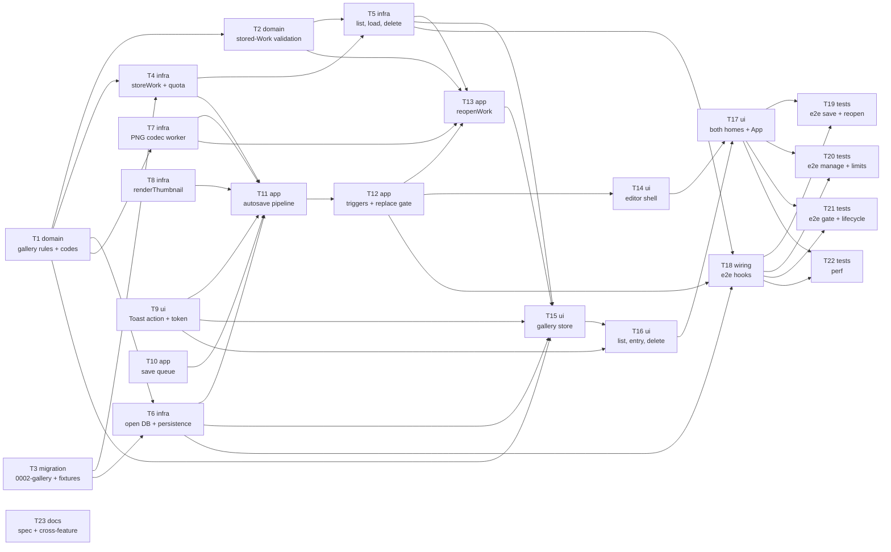

# Epic — gallery

> **Spec:** [spec.md](../spec.md) · **Design:** [sad.md](../sad.md) · **Data model:** [data-model.md](../data-model.md) · **Screens:** [screens.md](../screens.md) · **UX flows:** [ux-flows.md](../ux-flows.md) · **Test plan:** [test-plan.md](../test-plan.md) · **ADRs:** [adr/](../adr/) · API: none (client-only, no external surface)

## Goal

Ship an autosaved Gallery of the 20 most recently opened or changed Works, kept in this browser only. Every applied change reaches the Gallery moments after it is made, and reopening a Work gives back exactly that Work, still editable piece by piece. The Gallery is honest about where Works are kept and never lets a Work leave without a notice. Storage stays bounded at 20 Works, the open Work is never evicted, and editing keeps working when storage is full, refused or damaged (spec §2).

## Scope

- **In:** new `src/core/gallery/` and three `AppError` codes; the first IndexedDB writer, `src/infra/db/` (migration `0002-gallery`, schema v2, `works-repository.ts`, `openGalleryDb` with the `versionchange` hand-off); new `src/infra/work-codec/`; `src/infra/platform/storage-persistence.ts`; `renderThumbnail` in `src/render/preview-renderer.ts`; `Toast` action and `--gallery-tile-size` in `src/shared/`; `autosave-queue.ts`, `autosave.ts`, `reopenWork` and the narrowed replace gate in `src/features/editor/`; new `src/features/gallery/`; `App.vue` and the e2e hooks; `e2e/gallery/`; spec and cross-feature doc alignment.
- **Out:** keeping the Edit history across a reopen; sync, cloud backup, accounts or sharing; renaming, search, folders, tags, multi-select or bulk delete; exporting or editing a Work from the Gallery without opening it, and project files; keeping an open tool's Draft or the View; reopening the last Work automatically at start (spec §3).

## Task map

Parallel starts: **T1** (core rules), **T3** (migration), **T8** (thumbnail), **T9** (Toast action), **T10** (save queue) and **T23** (docs) begin together. T2, T4, T6 and T7 follow in wave 2; the e2e and perf tasks T19–T22 run in parallel at the end (T19–T21 share `e2e/gallery/helpers.ts`, so `implement` serializes them).

Twenty-three tasks is above the usual 8–20 band. The feature is M, but it is the first to write IndexedDB, adds two infra modules and a feature, and changes the replace path that five shipped features rely on. Each task stays one reviewable PR.

## Tasks

See [tracker.md](./tracker.md) for status. Machine contract: [tasks.json](../tasks.json).

| # | Task | Layer | Blocked by | DoD (short) |
|---|---|---|---|---|
| T1 | [Core gallery rules and the three error codes](./t01-core-gallery-rules-and-error-codes.md) | domain | — | property tests of the eviction rule; label and line boundaries |
| T2 | [Stored-Work rules: STORED_WORK_FORMAT, toStoredFields, validateStoredWork](./t02-core-stored-work-validation.md) | domain | T1 | round-trip property; every damage kind is WORK_DAMAGED |
| T3 | [Promote migration 0002-gallery, schema v2, db fixtures](./t03-migration-0002-gallery-and-fixtures.md) | migration | — | fresh and v1 databases reach v2; 0001 unchanged |
| T4 | [storeWork: evict and store in one transaction, quota retry, marker](./t04-repo-store-work-evict-and-quota.md) | infra | T1, T3 | eviction, quota retry, abort at each point, write-back |
| T5 | [listWorks, loadWork, deleteWork](./t05-repo-list-load-delete.md) | infra | T2, T4 | list checks shape only; delete removes every part |
| T6 | [openGalleryDb as a Result with versionchange, storage-persistence](./t06-open-gallery-db-and-persistence.md) | infra | T1, T3 | refused / held reasons; versionchange callback; persist pass-through |
| T7 | [work-codec: PNG encode and decode in a fresh worker](./t07-work-codec-png-worker.md) | infra | T1 | exact round trip; size check; worker terminated in every branch |
| T8 | [renderThumbnail in the Preview renderer](./t08-render-thumbnail.md) | infra | — | 320 px long side, ≤ 2:1 passes, Preview state restored |
| T9 | [Toast action, returned notice ids, --gallery-tile-size](./t09-shared-toast-action-and-tile-token.md) | ui | — | action runs and dismisses; ids withdraw; registered |
| T10 | [Autosave save queue: single flight, latest wins](./t10-editor-autosave-queue.md) | app | — | property tests of ordering, saving and settled() |
| T11 | [autosave.ts: prepare, store, persistence, versionchange, notices](./t11-editor-autosave-pipeline-and-notices.md) | app | T4, T6, T7, T8, T9, T10 | encode once; notices per outcome; unavailable is a no-op |
| T12 | [Editor store: Autosave triggers and the narrowed replace gate](./t12-editor-store-triggers-and-replace-gate.md) | app | T11 | every gate branch; triggers only on Steps, Undo, Redo, replace |
| T13 | [reopenWork(id)](./t13-editor-reopen-work.md) | app | T2, T5, T7, T12 | refusals; damaged changes nothing; exact stored Work |
| T14 | [EditorView slots, leave warning, ReplaceDialog wording](./t14-editor-shell-slots-leave-warning-replace-dialog.md) | ui | T12 | beforeunload only while saving; new dialog body |
| T15 | [Gallery store and messages](./t15-gallery-store-and-messages.md) | ui | T1, T5, T6, T9, T13 | entries, line, unavailable, choose and delete outcomes |
| T16 | [GalleryEntry, GalleryList, DeleteWorkDialog](./t16-gallery-list-entry-delete-dialog.md) | ui | T9, T15 | every SCR-01/03 list state and SCR-04 |
| T17 | [GalleryStart, GalleryAction, GalleryOverlay, App wiring](./t17-gallery-homes-action-overlay-and-app-wiring.md) | ui | T14, T16 | modal overlay; action states; DB opened at start-up |
| T18 | [Gallery e2e hooks](./t18-test-hooks-gallery.md) | wiring | T5, T6, T12 | every hook drives its seam; typed |
| T19 | [e2e: save, reopen, exactness, start screen, v1 Work](./t19-e2e-save-and-reopen.md) | tests | T17, T18 | 0 per-channel difference on three engines |
| T20 | [e2e: delete, damaged, 25 images, quota, failures, line, persist](./t20-e2e-manage-and-limits.md) | tests | T17, T18 | no part left after delete; 20 kept with notices |
| T21 | [e2e: gate, blocked storage, leave warning, 50 reloads, two pages, offline](./t21-e2e-gate-and-lifecycle.md) | tests | T17, T18 | no half-stored Work in 50 reloads |
| T22 | [@perf: the five spec §6 timing targets](./t22-perf-suite.md) | tests | T17, T18 | every p95 gated on Chromium |
| T23 | [Spec wording, open-and-view note, CONTEXT terms, architecture map](./t23-docs-spec-wording-and-cross-feature.md) | docs | — | AC-10, AC-12, §6.1 aligned; terms defined |

## Risks / Hard rules

- **One transaction per save (QG-1, ADR-0004):** all encoding and the thumbnail finish before `storeWork` opens its transaction, because an IndexedDB transaction commits on its own once no request is pending (T4, T11). Eviction notices are raised only after the commit.
- **The open Work is never evicted or deleted (AC-07):** `keep` is passed to every `storeWork` and `deleteWork` (T1, T4, T5).
- **Stored data is untrusted (sad §3, §8):** listing checks only shape and thumbnail, and choosing runs `validateStoredWork` and the codec's size check; the Source name is only rendered as text (T2, T5, T7, T16).
- **Replace-path regression (Medium, sad §11):** existing open-and-view, crop-rotate and undo-redo tests are changed deliberately in T12, never loosened.
- **Premultiplied alpha (Medium, sad §11):** T19 includes `alpha-patches.png` and `soft-edge.png`; a difference goes to the owner, the tolerance stays 0.
- **3 s first store on Firefox and WebKit (Medium, sad §11):** gated on Chromium only, measured on the others (T22, spec §8 Q2 closed).
- **Module boundaries (CLAUDE.md):** `core/gallery` is pure; `infra/*` never imports Vue, Pinia or a feature; the `gallery` feature reaches the editor only through `@/features/editor`; tokens only in CSS.
- **Never edit a released migration:** `0001-init.ts` stays byte-for-byte; `Migration.upgrade` is untyped instead (T3).
- **Spec alignment that `sad.md` §11 asked for before `tasks`:** AC-10's wording and the private-window example in AC-12 and §6.1 are not updated yet. T23 does it, and it has no deps, so it can land first.
- **Security review (spec §6.1):** required before ship. The review checks that nothing beyond §6.1's list is stored and that deleting and evicting leave no stored part behind (T5, T20).
