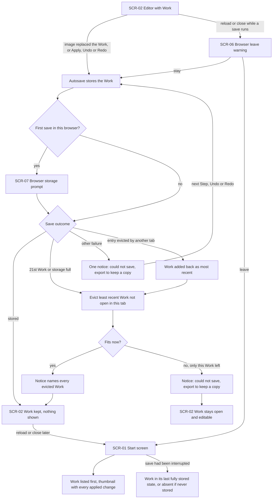
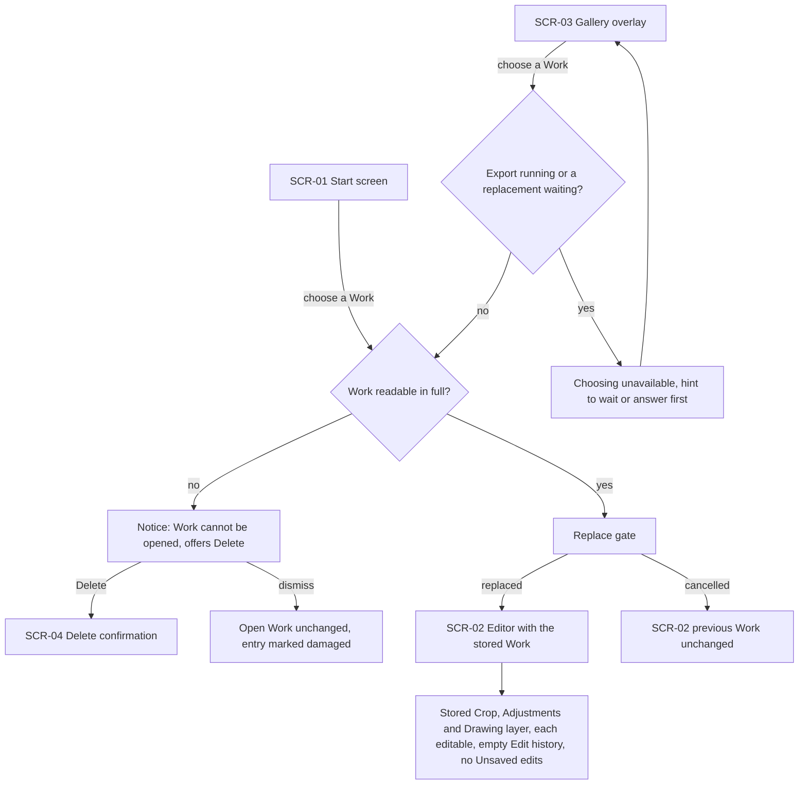
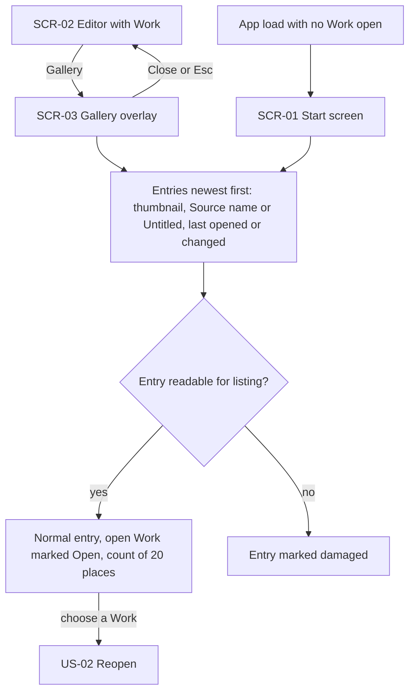
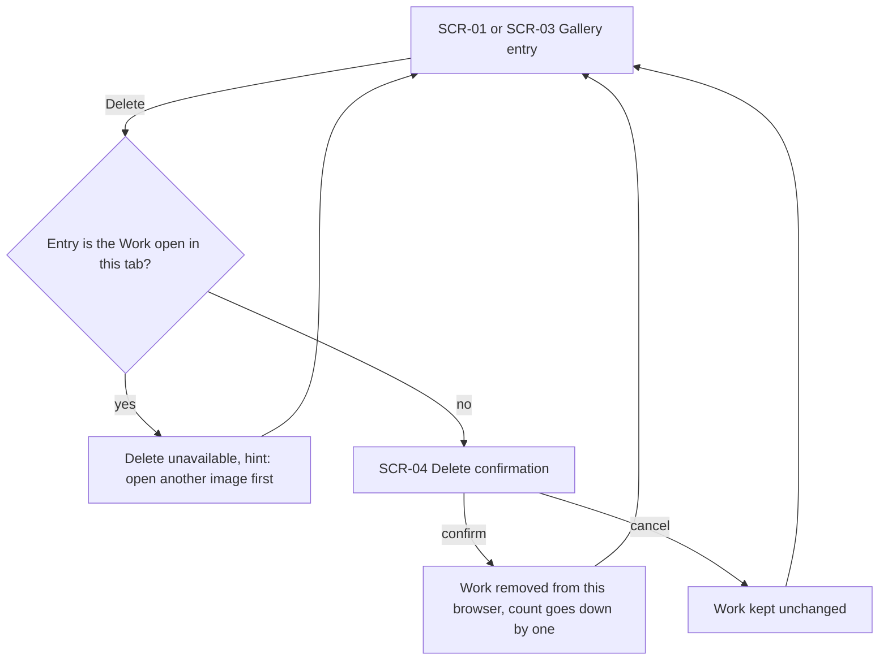
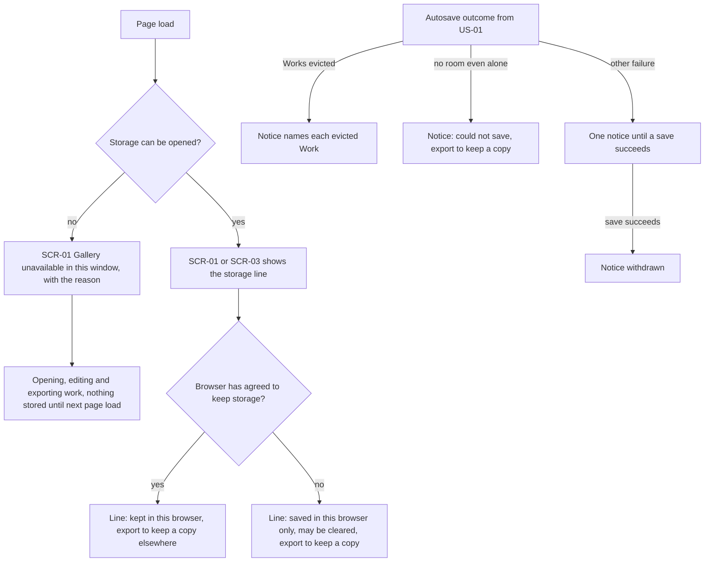
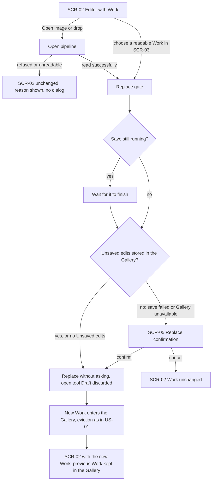
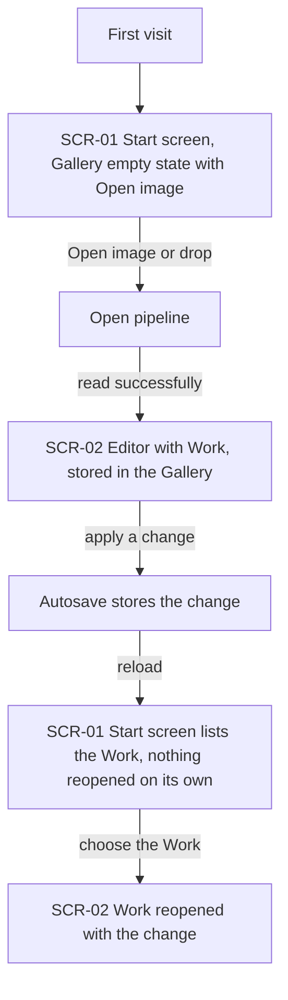

# UX flows — gallery

> User flows for every UI-touching §4 user story, produced by `ux-flows` (after `clarify`, before
> `design`) and read by `design` (evidence for the target-surface + UI-architecture decisions),
> `sequences` (UI-driven flows align on SCR ids), `screens` (details every inventory row) and
> `plan-tests` (the e2e-through-UI paths). **Always markdown + mermaid `flowchart`**, whatever the
> design tool — this artifact is flow-altitude, not visual design.

## Platform decisions

- **Posture:** desktop-first, as in `docs/design-system.md` §Platform posture. The mouse and the keyboard (Tab, Enter or Space, Esc) are the primary paths. Below 1024 px the same screens apply: the Gallery's entries reflow and stay reachable. No touch gesture is designed.
- **Navigation shape:** one editor view with no page navigation, as in every earlier feature. The Gallery has two homes. With no Work open, it sits on the start screen next to the "Open image" drop zone (SCR-01). With a Work open, the "Gallery" action in the top bar shows it as an overlay covering the canvas area (SCR-03), chosen by the owner on 2026-10-13. The top bar stays visible, and Esc or "Close" returns to the Work unchanged.
- **Modality:** the Gallery overlay (SCR-03) is modal over the editor. While it is open, the tools, Undo and Redo, and Export are unavailable, and only choosing a Work, deleting a Work or closing the overlay act. The delete confirmation (SCR-04) and the replace confirmation (SCR-05) are the only blocking dialogs the app designs. Two prompts belong to the browser and are not designed by us: the leave warning while a save is running (SCR-06), and the persistent-storage prompt that some browsers show at the first save (SCR-07).
- **Autosave is invisible on success:** a successful save shows nothing. The Editor sees Autosave only through its results (the Gallery's order, a thumbnail, a reopened Work) and through notices when something leaves the Gallery or a save fails. Every notice uses the canon's single notice boundary (spec AC-09 to AC-11).
- **Shared steps:**
  - **Open pipeline** is open-and-view's read-and-check sequence for a chosen or dropped file. It is used here as a subroutine node, with its refusals unchanged.
  - **Replace gate** is the shared decision every replacement passes, whether by opening a file, dropping one or choosing a Work in the Gallery. It waits for a running save, then asks (SCR-05) only when Unsaved edits are not stored (spec AC-16, AC-17). It is drawn in full in US-06, and other flows reference it as a node.
  - **Autosave** stores the Work after it replaces the open one and after every Step, Undo and Redo. Its outcomes (stored, room made by eviction, full, failed) are drawn in full in US-01, and US-05 draws what the Editor is told.
- **Design input (Tech Lead flag, not decided here):**
  1. Evicting to make room and storing the new state must happen as one step, so an interruption removes nothing and no Work leaves without its notice (AC-19). `design` decides how storage achieves this.
  2. Saves are ordered per Work. A replacement waits for the running save (AC-16), and the leave warning (SCR-06) is active only while a save is running (AC-20). `design` decides how saves queue and how "a save is running" is known.
  3. The first save stores the Original without any loss, within 3 s for a reference-sized image (spec §6, §8 Q2). `design` decides how and where that encoding runs without freezing editing for more than 200 ms.
  4. The Work open in this tab is never evicted here, but another tab may evict it, and this tab's next save adds it back (AC-21). `design` decides how a tab learns which Works it may evict.
  5. The damaged-Work notice offers a "Delete" action (AC-08). Today the notice primitive has no action. `screens` decides whether the notice gains one or a small dialog is used.
  6. Listing checks only what an entry shows, and choosing a Work checks all of it (AC-08). Thumbnails for 20 Works must paint within 500 ms (spec §6).

## Screen inventory

| ID | Screen | Purpose | Entry | Exit |
|---|---|---|---|---|
| SCR-01 | Start screen | open-and-view's empty editor, now with the Gallery next to the "Open image" drop zone: the stored Works newest first, or the empty state with the same "Open image" action, or the "Gallery unavailable in this window" state. Always shows the storage line and the count of used places | App load or reload with no Work open | Open pipeline (Open image or drop), SCR-02 (a Work chosen and reopened), SCR-04 (delete) |
| SCR-02 | Editor with Work | open-and-view's editor with a Work open. The top bar gains a "Gallery" action, unavailable while a tool is open, an export runs or a replacement waits for confirmation | A successful open or reopen; closing SCR-03; the end of SCR-05 | SCR-03 ("Gallery"), Open pipeline (Open image or drop), SCR-05 (Replace gate asks), SCR-06 (leave during a save) |
| SCR-03 | Gallery overlay | The Gallery over the canvas area while a Work is open: entries newest first, with the open Work's entry marked "Open", the storage line and the count of used places | "Gallery" on SCR-02 | SCR-02 (Close or Esc, unchanged), Replace gate (a Work chosen), SCR-04 (delete) |
| SCR-04 | Delete confirmation | Names the Work, says it cannot be brought back and that an Export is the only copy kept outside this browser | "Delete" on an entry that is not open in SCR-01 or SCR-03, or on the damaged-Work notice | The screen it came from, with the Work removed (confirm) or unchanged (cancel) |
| SCR-05 | Replace confirmation | open-and-view's warning before a replacement, reworded: the latest edits are not saved in the Gallery and would be lost | Replace gate when Unsaved edits are not stored | SCR-02 with the new Work (confirm), or SCR-02 unchanged (cancel) |
| SCR-06 | Browser leave warning | The browser's own "leave site?" prompt (not designed by us) | Reload or tab close on SCR-02 while a save is running | Reload (SCR-01), or SCR-02 with the save finishing (stay) |
| SCR-07 | Browser storage prompt | The browser's own persistent-storage question, shown by browsers that ask the person (not designed by us) | The first save in this browser, or the first save after the browser cleared the Gallery | SCR-02, whatever the answer |

## Flows

### Flow: US-01 — Keep my work without saving

Once an image has replaced the open Work, and after every Apply, Undo and Redo, Autosave stores the Work without the Editor doing anything. The very first save in this browser first asks the browser for persistent storage, and some browsers show their own prompt (SCR-07). Whatever the answer, saving carries on. A successful save shows nothing. If the Gallery already holds 20 Works or the browser's storage is full, the least recently opened or changed Work that is not open in this tab is evicted until the Work fits, and one notice names every evicted Work. If the Work still doesn't fit when it is the only one left, a notice says it could not be saved and to export it, and the Work stays open and editable. Any other failure shows one notice and is retried at the next Step, Undo or Redo. If another tab has evicted this Work, the next save adds it back as the most recent Work, evicting as usual. Reloading or closing the tab while a save is running brings up the browser's leave warning (SCR-06): staying lets the save finish. Once no save is running, reloading lands on the start screen (SCR-01) with the Work listed first, its thumbnail showing every applied change but no unapplied Draft. A save interrupted by a crash leaves the Work in its last fully stored state, or absent if it was never stored.

### Flow: US-02 — Reopen and keep editing

The Editor chooses a Work from the start screen (SCR-01) or from the Gallery overlay (SCR-03). From the overlay, choosing is unavailable while an export runs or a replacement waits for confirmation, and a hint says to wait or answer first. The Work is then read in full. If any part of it can't be read, the open Work stays as it was, the entry is marked as damaged, and a notice names the Work and offers to delete it, which leads to the delete confirmation (SCR-04). A readable Work passes the Replace gate (US-06). Once it has replaced the open Work, the editor (SCR-02) shows exactly what was stored: "Crop and rotate" shows the stored frame, "Adjust" shows the stored slider values, and "Draw" shows the stored Drawing layer, ready for the Brush and the Eraser. The Edit history is empty and there are no Unsaved edits. Works stored by an earlier version of the app follow the same path and open with exactly their stored data (AC-18). If the Editor cancels at the Replace gate, the previous Work stays.

### Flow: US-03 — Find the right Work

The Editor sees the Gallery on the start screen (SCR-01) after a load with no Work open, or chooses "Gallery" in the top bar (SCR-02) to cover the canvas with the overlay (SCR-03). Both show the stored Works, most recently opened or changed first. Each entry has a thumbnail with all its edits, its Source name ("Untitled" when it has none) and when it was last opened or changed ("Just now", "N minutes ago", "N hours ago", then the date). The open Work's entry is marked "Open", and the count of used places out of 20 is shown. Listing checks only what an entry shows, so an entry whose thumbnail can't be read is marked as damaged and the others list normally. Close or Esc returns to the Work unchanged, and choosing an entry continues in US-02.

### Flow: US-04 — Remove a Work

On an entry in the start screen (SCR-01) or the overlay (SCR-03), the Editor chooses "Delete". For the Work open in this tab, deleting is unavailable, and its hint says to open another image first. For any other entry, including a damaged one, the delete confirmation (SCR-04) names the Work and says it cannot be brought back and that an Export is the only copy kept outside this browser. Confirming removes it at once and lowers the count by one. Cancelling keeps it exactly as it was. Either way the Editor returns to the Gallery they came from.

### Flow: US-05 — Know how safe my Works are

When the page loads and storage can't be opened, for example in a private window, the start screen (SCR-01) says the Gallery is unavailable in this window and why. Opening, editing and exporting still work, and nothing is stored until the next page load. Otherwise, wherever the Gallery appears (SCR-01 or SCR-03), one storage line follows the browser's current answer: "kept in this browser, export to keep a copy elsewhere" when it agreed to keep the app's storage, or "saved in this browser only, the browser may clear it, export to keep a copy" when it didn't. The Editor is also told whenever Works leave or a save fails. A notice names every Work evicted to make room. A notice says when the Work could not be saved even after making room. A single notice covers other failures, is withdrawn once a save succeeds, and comes back on a later failure.

### Flow: US-06 — Switch images without needless dialogs

From the editor (SCR-02), the Editor opens or drops a file, which goes through open-and-view's Open pipeline, or chooses a readable Work in the overlay. A file that is refused or can't be read never asks anything: the Work stays and the reason is shown. Everything else reaches the Replace gate. If a save is still running, the gate waits for it to finish. If the Work has no Unsaved edits, or they are stored in the Gallery, the new image or Work replaces the open one without a dialog, and an open tool's unapplied changes are discarded with it. If the edits are not stored, because the save failed or the Gallery is unavailable, the replace confirmation (SCR-05) says the latest edits are not saved in the Gallery and would be lost. Confirming replaces the Work and cancelling keeps it. After a replacement, a newly opened image enters the Gallery as a new Work, evicting as in US-01, and the previous Work stays in the Gallery with all its applied edits.

### Flow: US-07 — See the Gallery work on a first visit

On a first visit, the Portfolio reviewer sees the start screen (SCR-01) with the Gallery's empty state next to the drop zone: plain text saying opened Works will appear here, and the same "Open image" action. They open an image, which is stored at once, and apply a change, which Autosave stores. After a reload, nothing reopens on its own. The start screen lists the Work, and choosing it reopens it with the change in the editor (SCR-02).

## AC coverage

| AC | Shown by | Notes |
|---|---|---|
| AC-01 | Flow US-01 → stored → reload → SCR-01, Work listed first | The two- and three-second windows are a §6 and plan-tests concern |
| AC-02 | Flow US-01 → SCR-01 thumbnail with every applied change; Flow US-02 → empty Edit history | The Draft, View and Edit history are never stored: the reopen shows the fitted View |
| AC-03 | Flow US-03 → entries newest first, Open mark, count | Relative-time wording on the node |
| AC-04 | Flow US-02 → Replace gate → SCR-02 with the stored Work | Exactness is checked by Export comparison (spec §6) |
| AC-05 | Flow US-07 → SCR-01 empty state → reload → reopen | Nothing reopens on its own |
| AC-06 | Flow US-04 → SCR-04 confirm or cancel | |
| AC-07 | Flow US-04 → "Work open in this tab" branch → delete unavailable | |
| AC-08 | Flow US-02 → not readable in full → notice → SCR-04; Flow US-03 → entry marked damaged | Damaged Works are evicted first (US-01 eviction node; spec AC-08) |
| AC-09 | Flow US-01 → 21st Work → evict → notice; Flow US-06 → new Work enters after replacement | A cancelled replacement stores nothing (US-06 cancel branch) |
| AC-10 | Flow US-01 → storage full → evict until it fits, or "no room even alone" notice | |
| AC-11 | Flow US-01 → other failure → retry; Flow US-05 → notice withdrawn on success | |
| AC-12 | Flow US-05 → storage can't be opened → SCR-01 unavailable state | The replace fallback is shown in Flow US-06 → "Gallery unavailable" → SCR-05 |
| AC-13 | Flow US-05 → storage line, two wordings | |
| AC-14 | Flow US-01 → first save → SCR-07 | Asked again after the browser clears the Gallery (SCR-07 entry) |
| AC-15 | Flow US-02 → export running or replacement waiting → choosing unavailable | |
| AC-16 | Flow US-06 → save running → wait → stored → replace without asking | |
| AC-17 | Flow US-06 → not stored → SCR-05 | |
| AC-18 | Flow US-02 → readable → Replace gate → SCR-02 | Same path for Works stored by an earlier version. Migration itself is not a UI flow |
| AC-19 | Flow US-01 → "save had been interrupted" branch | Atomic evict-and-store is design input 1 |
| AC-20 | Flow US-01 → reload or close while a save runs → SCR-06 | |
| AC-21 | Flow US-01 → "entry evicted by another tab" → added back → evict | |
