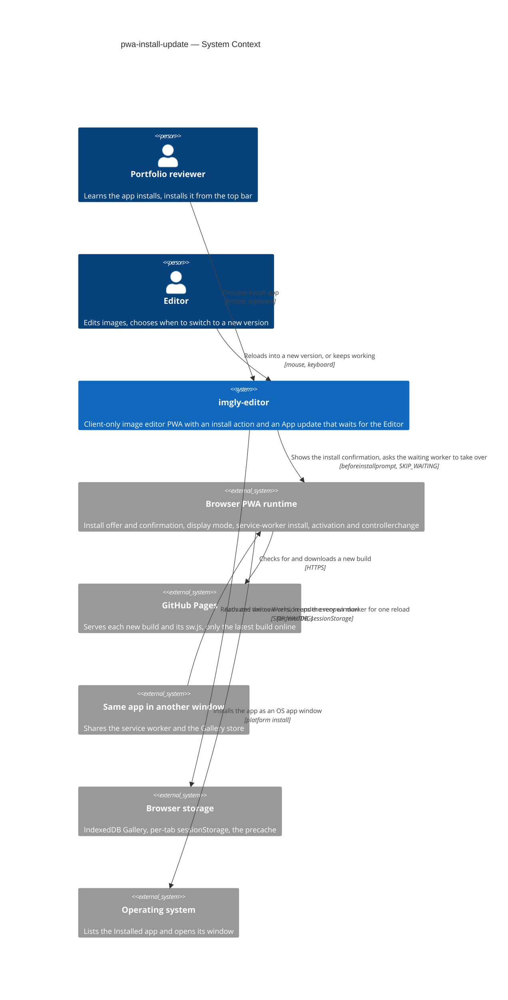
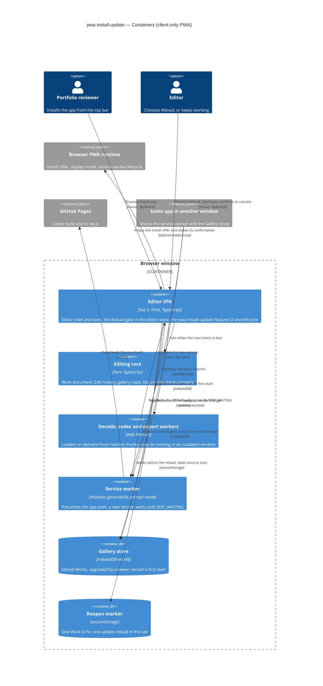
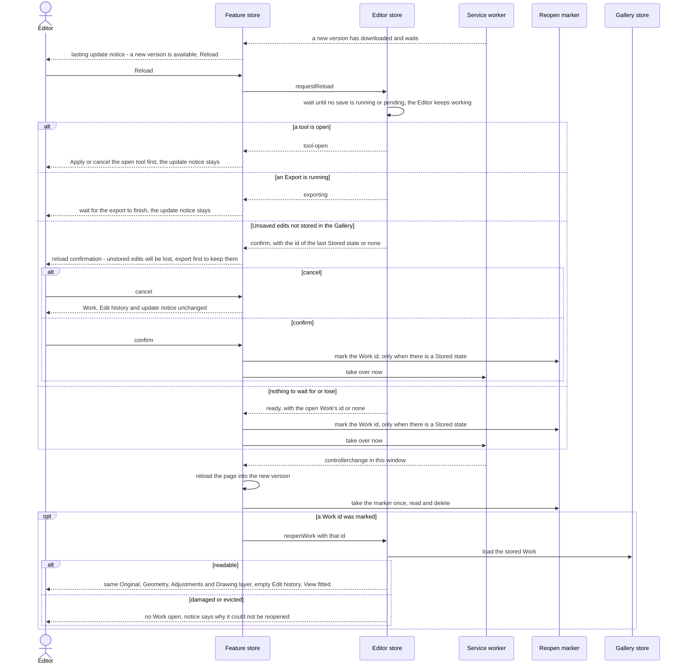
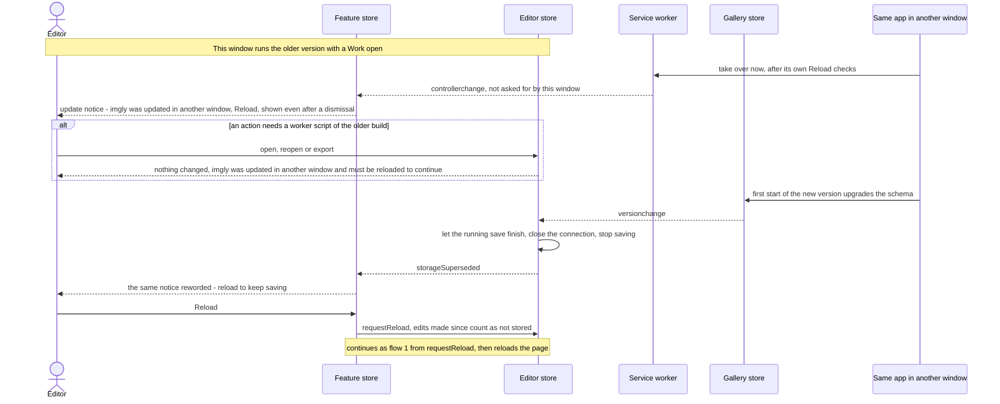
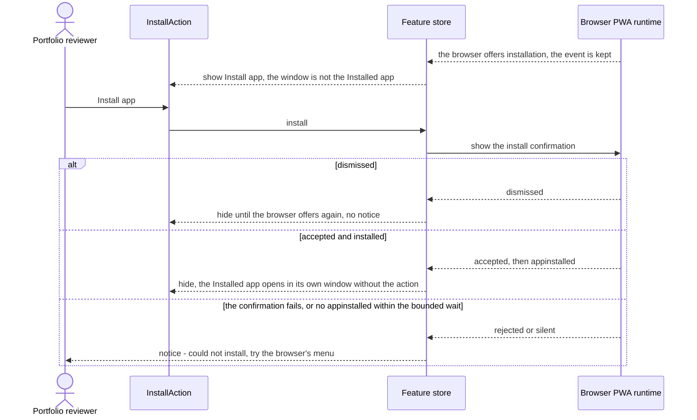
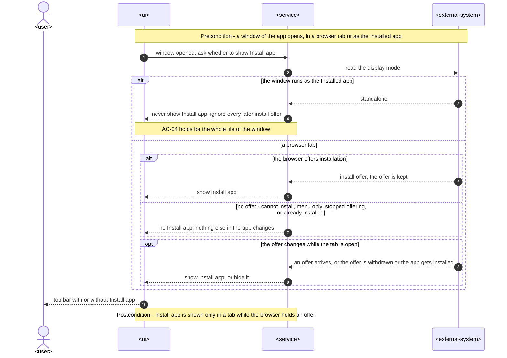
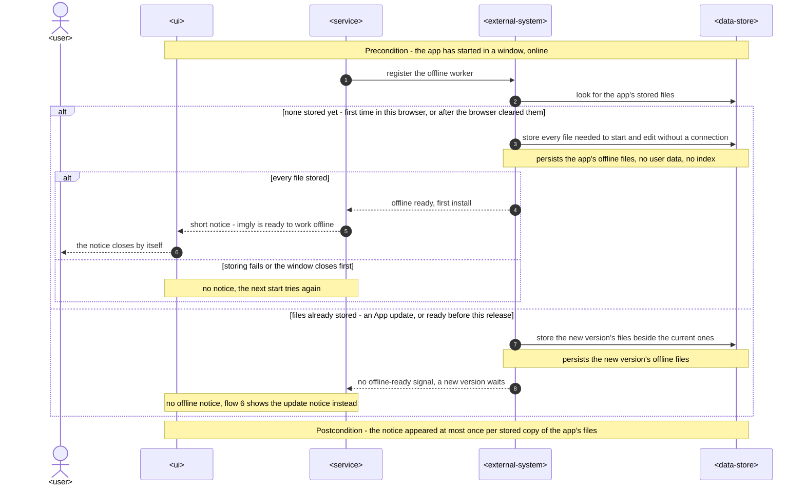
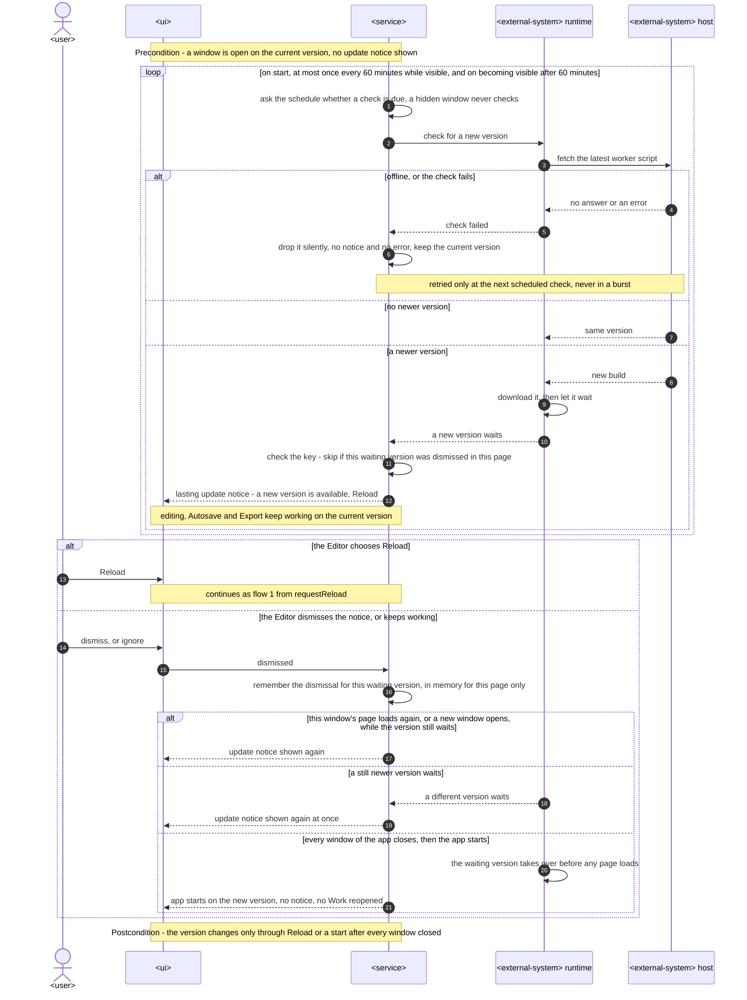

# Software Architecture Document — pwa-install-update

<!-- 12 Arc42 sections. Empty section → <!-- N/A: <one-line reason> -->. -->
<!-- C4 Context (L1) lives inline in §3. C4 Container (L2) lives inline in §5. -->
<!-- Numbers in §10 come VERBATIM from spec.md §6 NFR — no inventing, no rounding. -->

## 1. Introduction and goals

**Intent.** This feature makes the app's two PWA capabilities visible, and it makes App updates wait for the Editor (spec §1, §2). In a browser tab that offers installation, the top bar shows "Install app", which opens the browser's own install confirmation. The Installed app, and every browser that does not offer installation, shows no install action (AC-01 to AC-04). The first time the browser stores the app for offline use, a notice says so once (AC-05). When a new version has downloaded, it waits instead of taking over at once. A lasting update notice offers "Reload". The Reload checks wait for a running save, refuse while a tool is open or an Export runs, and ask for confirmation only when edits are not stored in the Gallery. After the reload, the Work that was open comes back from its Stored state (AC-06 to AC-13). When the Editor ignores the notice, the new version takes over the next time the app starts after every window has closed (AC-09). Every other window is told when one window switches versions, and a window that is still on the older version stops saving once the Gallery's storage shape has changed (AC-14). The feature turns roadmap step 9 into code, and it replaces today's silent `autoUpdate` reload (`vite.config.ts`, `src/app/pwa.ts`).

**Top-3 quality goals (1-liners; full scenarios in §10):**

1. **An update never interrupts work.** The app reloads only after the Editor chooses to, which gives 0 reloads the Editor did not choose. It loses 0 Drafts and 0 applied changes without the Editor's confirmation, across the update e2e flows on Chromium, Firefox and WebKit (spec §6, §7, AC-07 to AC-13).
2. **No window stays outdated without a notice.** An open, online window shows the update notice within ≤ 60 minutes plus the download time. Every other window learns of a switch, and an older window never writes the Gallery in an older shape (spec §6, AC-06, AC-14).
3. **The way back is fast and exact, and works offline.** From "Reload" to the reopened reference Work's first Preview takes p95 ≤ 3 s. The reopened Work's Export matches the one made before the update. 100% of starts of the Installed app succeed offline after its first load on Chromium, and editing stays within the 200 ms freeze budget while an update downloads (spec §6, AC-08).

**Stakeholders.**

| Role | Interest | Sign-off owner? |
|---|---|---|
| Portfolio reviewer | Learns from the app itself that it installs, and installs it with "Install app" plus the browser's confirmation (US-01, KPI "2 actions") | No |
| Editor | Is never reloaded mid-edit, chooses when to switch versions, gets the open Work back afterwards, and is told when another window switched (US-02 to US-06) | No |
| Tech Lead | SAD approval. The feature changes the service worker's update lifecycle that every user already runs, adds a reload gate to the `editor` store next to the Replace gate, and widens the shared notice primitive that every feature uses | Yes |
| Security Lead | Spec §6.1 light review: the marker of which Work to reopen holds only its id, lives only in this window, is gone once it is used or the window closes, and no other start reopens a Work | Yes |

<!-- Decision overrides (¶4) — populated by the critic resolution loop, empty otherwise. -->

**Decision overrides:**

- Decision override: size stays S, although spec §1 ¶4 justified S by "no new module, API or migration" and this design adds one feature folder (`src/features/pwa-install-update/`) with a pure `core/app-update` schedule and thin `infra/platform` wrappers — rationale: that is one new module out of the size matrix's three signals (no migration, no public API, and the notice primitive change is additive), which is within S's "≤1 of three". Re-run `sdd:classify-size` if `tasks` produces more than 5 PRs (owner, 2026-10-15, critic F2).

## 2. Constraints

**Technical.**
- TypeScript 5.9 (`strict`), the Node 24 toolchain and pnpm (repo ADR [0001](../../adr/0001-build-a-client-only-vue-pwa.md))
- Vue 3.5 with `<script setup>`, Pinia 4 setup stores, Vite 8, vite-plugin-pwa 2 (`generateSW`, Workbox 7) and workbox-window 7.4. The app is a client-only PWA served from `/imgly/`, and the base path, the manifest's `scope` and `start_url`, and the service worker's scope must all stay `/imgly/` (CLAUDE.md)
- Today's update behaviour, which this feature replaces:
  - `vite.config.ts` sets `registerType: 'autoUpdate'`, `injectRegister: false`, and Workbox `skipWaiting: true` and `clientsClaim: true`.
  - `src/app/pwa.ts` calls `registerSW({ immediate: true })` with no callbacks, and `src/main.ts` registers it only in production builds.
  - The precache covers `**/*.{js,css,html,png,svg,webmanifest}`, and `navigateFallback` is `/imgly/index.html`.
- Every hashed chunk is precached, including the decode, work-codec and export workers (`new Worker(new URL(…, import.meta.url))` in `src/infra/image-decode`, `src/infra/work-codec` and `src/render/export`). The app has no lazy `import()` of its own code apart from the e2e test hooks
- The `editor` store already holds every condition the Reload checks need:
  - `activeTool` tells whether a tool is open.
  - `phase === 'exporting'` lasts from `beginExport()` to the end of the save dialog.
  - Autosave's `saving` flag, `settled()` and `isStored(work)` cover the save.
  - The Replace gate in `openImage` and `reopenWork(id)` waits on `settled()` and asks only when edits are not stored (gallery ADR-0001).
- Gallery ADR-0006 already handles an IndexedDB upgrade from a newer version: Autosave lets the running save finish, closes the connection, marks the Gallery unavailable and stops saving. It then shows the info notice `infoNewerVersion()` (`src/features/editor/autosave.ts`)
- The notice boundary is `useNotices` (`src/shared/notices/store.ts`). It knows the kinds `info`, which closes itself after 6 s, and `failure`, which stays. An action always closes its notice (`src/shared/ui/Toast.vue`)
- Browser behaviour the design relies on:
  - A waiting service worker takes over only after `skipWaiting()`, or once no window uses the active one.
  - Activation fires `controllerchange` in every window it controls.
  - `beforeinstallprompt` and `appinstalled` exist only in Chromium-based browsers.
  - `(display-mode: standalone)` matches inside the Installed app.
  - `sessionStorage` belongs to one tab, survives a reload of that tab and is cleared when the tab closes.
  - GitHub Pages serves only the latest build, so an older window's hashed files are no longer on the network after a deploy.
- Architecture convention: a functional core with feature folders (repo ADR [0002](../../adr/0002-organize-code-as-functional-core-with-feature-folders.md)). Features never import each other, they coordinate through the `editor` store, and there is no event bus. `infra` calls only pure `core` functions

**Organisational.**
- Owner: Blazheiko, working alone with the SDD pipeline
- Size S (`.size`) and route `quick` (`.route`). The spec's §1 ¶4 override keeps S, because AC-14 reuses the Gallery's existing handling of a storage version change and the existing notice boundary
- No deadline. This is roadmap step 9, after the Gallery and before OS integration (`docs/roadmap.md`)
- A light security review is required before ship (spec §6.1)

**Conventions.**
- `CLAUDE.md` (module boundaries, conventions, decisions) and `docs/architecture-map.md` §Conventions. The map reflects `3f248c2`, so it predates the Gallery. This SAD reads the code at `9bcf5e0`
- Errors: `core` and `infra` return `Result<T, AppError>`. New codes go in the `AppErrorCode` union in `src/core/result.ts`, and their text goes in the owning feature's `messages.ts`. The UI shows errors only through `useNotices`
- UI: plain CSS with `<style scoped>`, only `var(--…)` tokens, `src/shared/ui/` primitives first, and every new or widened primitive recorded in `docs/design-system.md`
- Tests: Vitest next to the source, with component tests on happy-dom. e2e tests only for what happy-dom can't do, which here means the real service-worker lifecycle across two builds, offline starts of the Installed app and two-window behaviour

**Regulatory / external.**
- Spec §6.1: the data is confidential, because the reopened Work can be a personal photo. The feature adds no personal data. The only new stored value is the reopen marker, which holds one Work id for one window (ADR-0003)
- No compliance regime applies: there is no server, no account and no third party. Installation always passes the browser's own confirmation, and the browser accepts a new service worker only from the app's own origin and `/imgly/` scope

## 3. Context and scope

The app already installs and works offline, but says neither, and it takes every new version with a silent reload. This feature puts both facts in front of the person, and it moves the moment a version switches from the browser's choice to the Editor's. Everything still happens in the browser. The new outside parties are the browser's install offer and its service-worker update lifecycle. GitHub Pages, which publishes each new build, and the app's other windows already existed but now matter at runtime.

<!-- brownfield: Vue 3 + Pinia client-only PWA (functional core, infra adapters, feature folders coordinated through the editor store). vite-plugin-pwa generateSW in autoUpdate mode with skipWaiting and clientsClaim, and a silent reload. The Gallery (IndexedDB v2) shipped with a versionchange handler (gallery ADR-0006). Scanned at 9bcf5e0, since docs/architecture-map.md reflects 3f248c2. -->

**External systems (in / out):**

| Actor or system | Type | Interaction |
|---|---|---|
| Portfolio reviewer | Person | Sees "Install app" in a tab whose browser offers installation, and installs through the browser's confirmation (US-01) |
| Editor | Person | Edits, gets the update notice, chooses "Reload" or ignores it, and works in one or more windows (US-02 to US-06) |
| Browser PWA runtime | System (external, owned by the browser) | Offers installation (`beforeinstallprompt`, `appinstalled`, the install confirmation) and reports the display mode. It installs and activates service workers, and fires `controllerchange` in every window when a new one takes over. **Trust boundary:** the app never installs itself or forces a version; it only reacts to these signals and asks the browser |
| GitHub Pages | System (external) | Serves each new build, and with it a new `sw.js` that the browser downloads in the background. Only the latest build is on the network |
| Same app in another window | System (another instance of this app) | Shares the service worker and the Gallery store. Its "Reload" can activate the new version under this window, and the new version's first start can upgrade the Gallery store (AC-14) |
| Browser storage | System (external, owned by the browser) | IndexedDB holds the Gallery (unchanged). Per-tab `sessionStorage` holds the reopen marker across the update reload only (ADR-0003). The service worker's precache holds the app's files |
| Operating system | System (external) | Lists the Installed app and opens it in its own window. Unchanged otherwise |

Out of scope on purpose: no release notes, no forced updates, no install instructions for browsers without an install offer, no mobile install banners (spec §3).

**C4 Context (L1):**



## 4. Solution strategy

**Target surface.** `[web-frontend]` (frontmatter `target_surfaces`). The app is a client-only SPA (ADR 0001). The spec's actors are people at a desktop browser (spec §4), and ux-flows inventories seven screens (SCR-01 to SCR-07), five of them notices or dialogs over the editor. The service worker is generated by the build and ships in the same deployable, like the decode and export workers, so it is not a `worker` surface: it has no contract of its own. There is one surface, so the decision stays inline.

**UI architecture (web-frontend).** The existing single-view SPA with no router stays. "Install app" is one more component in `App.vue`'s `#top-bar-actions` slot, next to the tool actions. Every other part of the feature is a notice in the single `useNotices` boundary, plus one modal confirmation (SCR-06), so no new screen or route appears (ux-flows §Platform decisions). State lives in one new Pinia setup store, and the Reload checks live in the `editor` store (choice 4).

**Top strategic choices (the seeds for ADRs):**

1. **A new version waits as a waiting service worker until "Reload"** ([ADR-0001](adr/0001-hold-each-new-version-in-a-waiting-service-worker-until-the-editor-chooses-reload.md)). vite-plugin-pwa switches to `registerType: 'prompt'`, and Workbox's `skipWaiting` is dropped, so a downloaded version stays waiting while any window uses the current one. `onNeedRefresh` raises the update notice. After the Reload checks pass, "Reload" asks the waiting worker to take over (`SKIP_WAITING`), and the window reloads on `controllerchange`. An ignored notice leaves the browser's own rule in charge: the waiting worker takes over once every window has closed, which is exactly AC-09. `onOfflineReady` fires only on the first install, which gives AC-05 without a stored flag. `registration.update()` runs on the schedule of spec §6. This serves quality goals 1 and 2.
2. **Other windows learn of a switch from `controllerchange`, and of a storage change from IndexedDB's `versionchange`** ([ADR-0002](adr/0002-tell-other-windows-of-a-switch-through-controllerchange-and-of-a-storage-change-through-versionchange.md)). The browser fires `controllerchange` in every window when the new worker activates. A window that did not ask for the switch shows the "updated in another window" notice. A window that had no controller when its page loaded ignores the event, because on a first install `clientsClaim` fires it there without any version switch (AC-05). The storage case reuses gallery ADR-0006 unchanged in mechanism. Autosave stops saving on `versionchange`, but it now raises a `storageSuperseded` flag instead of its own notice, and this feature rewords the one update notice to "must reload to keep saving". No new cross-window channel appears. This serves quality goal 2.
3. **The Work to reopen is a take-once marker in this tab's `sessionStorage`** ([ADR-0003](adr/0003-keep-the-work-to-reopen-as-a-take-once-id-in-this-tabs-sessionstorage.md)). Just before an update reload, the app writes only the open Work's id, and only when that Work has a Stored state. The new version reads and deletes the marker before it calls `reopenWork(id)`. Only the update reload path writes the marker. Every start takes it, reading and deleting it, so a start with no marker opens no Work, as before (gallery AC-05). This is the §6.1 security rule made structural, and it serves quality goal 3.
4. **The `editor` store owns the Reload gate, and the new feature owns the UI and the lifecycle** ([ADR-0004](adr/0004-own-the-reload-gate-in-the-editor-store-and-the-install-and-update-ui-in-a-new-feature.md)). `requestReload()` sits beside the Replace gate and follows the same rules. It waits on `settled()`, then checks the open tool, the Export and whether the edits are stored, and it returns an outcome together with the id to mark. The new `src/features/pwa-install-update/` feature holds the install action, the update and offline notices, the reload confirmation and the check schedule. It reaches the editor only through its public store API, as gallery ADR-0001 split Autosave from the gallery UI. This serves quality goal 1.

Each tactical decision in later sections should trace to one of these seeds. Tactical decisions that *contradict* a strategic choice are red flags — surface them in §11.

## 5. Building block view

The feature follows the repo's functional core with feature folders (repo ADR 0002), with no divergence. Browser APIs are wrapped in `src/infra/platform/`: the service-worker registration, the install offer and display mode, and the reload marker. Each wrapper returns `Result` where it can fail and takes its browser objects by injection, so Vitest can drive it. The check schedule is a pure function in `src/core/app-update/`. The Reload gate is composed into the `editor` store (ADR-0004). The new feature holds one Pinia setup store and two components. `src/app/pwa.ts` stays the single registration point, and it hands the service-worker client to the feature store, the way `App.vue` hands the Gallery connection to the editor.

**Internal decomposition:**

```
src/
├── core/
│   ├── app-update/          NEW  nextCheckDue(lastCheck, now, visible): on start, ≤ 1 per 60 min while visible, on becoming visible after 60 min
│   └── result.ts            + INSTALL_FAILED, APP_PART_UNAVAILABLE
├── infra/
│   ├── platform/
│   │   ├── service-worker.ts   NEW  wraps registerSW (prompt mode): needRefresh, offlineReady, controllerchange, update(), skipWaiting-and-reload
│   │   ├── install-prompt.ts   NEW  beforeinstallprompt / appinstalled / display-mode standalone; prompt() → accepted | dismissed | INSTALL_FAILED
│   │   └── reload-marker.ts    NEW  markReopen(id), takeReopen(): string | null over sessionStorage (ADR-0003)
│   ├── image-decode/, work-codec/   a worker script that fails to load → APP_PART_UNAVAILABLE
├── render/export/              same mapping for the export worker
├── shared/
│   ├── notices/store.ts        + kind 'lasting' (no timeout), action.run may keep the notice open, slot: a newer notice in the same slot replaces the older
│   └── ui/Toast.vue            honours keep-open; registered in docs/design-system.md
├── features/
│   ├── editor/
│   │   ├── store.ts            + requestReload(): waits on settled(), then tool-open | exporting | confirm | ready { reopenId }; + storageSuperseded
│   │   ├── autosave.ts         versionchange raises storageSuperseded instead of pushing infoNewerVersion()
│   │   └── messages.ts         infoNewerVersion() moves to the new feature's wording (SCR-05, third wording)
│   └── pwa-install-update/  NEW  store.ts (install offer, update state, dismissed worker, outdated flag, check timer, resumeAfterUpdate),
│                                 InstallAction.vue (top bar), ReloadDialog.vue (SCR-06), messages.ts, index.ts
└── app/
    ├── pwa.ts                  registers the service worker in prompt mode and connects the feature store
    ├── App.vue                 mounts InstallAction and ReloadDialog; after connectGallery, calls resumeAfterUpdate()
    └── test-hooks.ts           + PWA hooks for e2e (synthetic install offer, update state, marker)
vite.config.ts                  registerType 'prompt'; workbox: skipWaiting removed, clientsClaim kept
```

**C4 Container (L2):**



**Tactical decisions in this section (inline):**

- **The notice primitive gains a lasting, slotted notice.** `NoticeInput` gains the kind `'lasting'`, which never times out. It also gains an optional `slot`: a new notice in an occupied slot replaces the one there, which gives "at most one update notice, the newest replaces the one before" (AC-14). `action.run` may return `'keep-open'`, so a refused "Reload" leaves the notice in place (AC-10, AC-12, AC-13). Existing callers are unchanged, because `info` and `failure` keep their behaviour. The change is additive and reversible in a day, but `screens` sets its look and `docs/design-system.md` records it (spec §1 cross-feature change).
- **One update notice, three wordings.** The feature store keeps one `updateNotice` state, either `none`, `available`, `updated-elsewhere` or `reload-to-save`, and renders it into the `app-update` slot. `reload-to-save` wins over `updated-elsewhere`, which wins over `available`, because a later signal never has less to say. A dismissal hides the notice until the page loads again. For `available`, the dismissal is remembered for that waiting worker only, so a still newer version shows the notice again (AC-09). `updated-elsewhere` and `reload-to-save` are shown even after the notice was dismissed (AC-14).
- **"Reload" acts according to the wording.** When a worker is waiting, "Reload" sends it `SKIP_WAITING` and reloads on `controllerchange`. When the version has already switched under this window (`updated-elsewhere`, `reload-to-save`), it reloads the page. Both go through the same `requestReload()` and write the marker first.
- **The install offer follows the browser.** The store keeps the deferred `beforeinstallprompt` event, and "Install app" shows only while one is held and the display mode is not `standalone` (AC-02, AC-04). `appinstalled` and a `dismissed` choice drop the event (AC-01, AC-03). A `prompt()` that rejects, or an `accepted` choice with no `appinstalled` within a bounded wait (default 10 s, which `tasks` may tune), raises the could-not-install notice (AC-03).
- **An outdated window reports a missing part instead of failing halfway.** The three worker clients map a worker script that fails to load to `APP_PART_UNAVAILABLE`. The decode, reopen and export paths already change nothing until their worker succeeds (open-and-view, gallery ADR-0003, export ADR-0001), so the action changes nothing. Each owner's `messages.ts` words the code as "imgly was updated in another window and must be reloaded to continue", because a hashed script of this build goes missing only after a newer build has replaced it (AC-14). Autosave starts a fresh codec worker for every save, so in an outdated window it treats `APP_PART_UNAVAILABLE` like `versionchange`. It stops saving and raises `storageSuperseded` instead of the could-not-save notice, and the one update notice then says to reload to keep saving. Later edits count as not stored, so "Reload" asks as AC-12 says.

## 6. Runtime view

Participants are the §5 building blocks. "Feature store" means the `pwa-install-update` store, and "Editor store" means the `editor` store with its composed Autosave and the Reload gate (ADR-0004). Messages are semantic. Each flow below folds its error branches into `alt` blocks. The `sequences` stage completes coverage of every §5 AC, including the install refusals of AC-02 and AC-04, the offline-ready notice of AC-05, the dismissal rules of AC-09 and the failed checks of AC-15.

**Critical flow 1: An App update waits, the Editor chooses Reload, and the Work comes back (AC-06 to AC-13)**



**Critical flow 2: Another window switches versions, then upgrades the Gallery store (AC-14)**



**Critical flow 3: Install the app from a tab (AC-01, AC-03)**



### Critical flow 4: The install action follows the window and the browser's offer (US-02, AC-02, AC-04)

Generic participants: `<ui>` is the top bar, `<service>` the feature store, `<external-system>` the browser's PWA runtime. The install offer lives only in memory, so this flow persists nothing.



### Critical flow 5: The app becomes ready to work offline, and says so once (US-03, AC-05)

Generic participants: `<service>` is the feature store, `<external-system>` the browser's service-worker runtime, and `<data-store>` the browser's store of the app's own files for offline use. The only write is those files, which hold no user data and need no index.



### Critical flow 6: Scheduled check, failed check, dismissal and takeover at the next start (US-04, AC-06, AC-09, AC-15)

Generic participants: `<service>` is the feature store with the pure check schedule, the first `<external-system>` is the browser's service-worker runtime, and the second is the static host of the latest build. The flow is scheduled, so its first handler step is the idempotency check (the key is the waiting version), and a failed check is retried only at the next scheduled check. Nothing is persisted: the dismissal lives in memory for this page only.



### Coverage: user stories and acceptance criteria

| Spec item | Shown by |
|---|---|
| US-01 | Flow 3 |
| US-02 | Flow 4 |
| US-03 | Flow 5 |
| US-04 | Flow 1 (from the notice to Reload), Flow 6 (check, dismissal, next start) |
| US-05 | Flow 1 |
| US-06 | Flow 2 |
| AC-01 | Flow 3, branch accepted and installed |
| AC-02 | Flow 4, branch browser tab: no offer, and the offer changing while the tab is open |
| AC-03 | Flow 3, branches dismissed and failure or silence |
| AC-04 | Flow 4, branch the window runs as the Installed app |
| AC-05 | Flow 5, every branch |
| AC-06 | Flow 1 (first steps), Flow 6 (branch a newer version) |
| AC-07 | Flow 1, branch nothing to wait for or lose |
| AC-08 | Flow 1, the marked-Work step after the reload, with its readable and damaged-or-evicted branches |
| AC-09 | Flow 6, branch dismisses or keeps working, with its three sub-branches |
| AC-10 | Flow 1, branch a tool is open |
| AC-11 | Flow 1, the wait-for-save step before the checks |
| AC-12 | Flow 1, branch Unsaved edits with cancel and confirm, and Flow 2 (edits after the stop count as not stored) |
| AC-13 | Flow 1, branch an Export is running |
| AC-14 | Flow 2, every step |
| AC-15 | Flow 6, branch offline or the check fails |

Every user story and every acceptance criterion is shown at runtime, and none is marked N/A.

**Flags for `design` and `data-model` (flagged only, no ADR written):**

- Flows 1 to 3 (from `design`) name concrete §5 blocks as participants. Flows 4 to 6 (from `sequences`) use the generic vocabulary. The two styles were left mixed on purpose, because the existing blocks are never rewritten.
- Flow 6 is scheduled, so it uses an idempotency key (the waiting version) and a retry note (the next scheduled check). A dead-letter branch is N/A: the app has no server and no queue, and AC-15 requires that a failed check be dropped silently.
- No flow adds a stored entity, field or index in the Gallery store. The only writes are the app's offline files (flow 5, handled by the browser) and the reopen marker in session storage (flow 1, ADR-0003). `data-model` has no schema change to model.

## 7. Deployment view

The deployment unit is unchanged. One static build goes to GitHub Pages under `/imgly/` over HTTPS, and every window runs it in the browser. The browser re-checks `sw.js` at registration and whenever the feature calls `registration.update()`, and it fetches the service-worker script past the HTTP cache by default, so GitHub Pages' caching headers do not delay the update check. What changes is the service-worker lifecycle that ships with the build: `registerType: 'prompt'` and no Workbox `skipWaiting` (ADR-0001). Each deploy replaces every hashed file on GitHub Pages, which is why an older window can miss a worker script once a newer version controls it (AC-14).

**Transition release.** Windows that still run the current `autoUpdate` build do not wait for the Editor. They get no update notice and keep their version, and the new worker waits until all of them close. After that one transition, every later release follows this feature's rules (§11).

**Monitoring:**
- None at runtime: the app has no server or telemetry (ADR 0001). The spec's §6 and §7 targets are checked by the update e2e flows and the `@perf` run on the reference machine (§10).

**Scaling thresholds:**
- Not applicable. Each check is one conditional request for `sw.js` per visible window, at most once every 60 minutes (spec §6).

## 8. Crosscutting concepts

| Concept | Convention | Where defined |
|---|---|---|
| Error handling | `infra` returns `Result`. New codes `INSTALL_FAILED` and `APP_PART_UNAVAILABLE` are added to `AppErrorCode`, and their text goes in the owning feature's `messages.ts`. A failed or offline update check is not an error and shows nothing (AC-15) | `src/core/result.ts`, CLAUDE.md §Conventions |
| Notices | The single `useNotices` boundary gains the kind `'lasting'`, the `slot` that lets a newer notice replace an older one, and actions that keep a notice open. All update wordings share the `app-update` slot, so a window shows at most one (AC-14). Refusals are `failure` notices, and the offline-ready notice is `info` | §5, `docs/design-system.md` (Toast, ToastStack) |
| Cross-feature coordination | Only through the `editor` store: `requestReload()`, `reopenWork(id)` and `storageSuperseded`. No event bus, and no feature imports another | repo ADR 0002, ADR-0004 |
| Window-local state | Only the reopen marker, in `sessionStorage`, for the duration of one update reload. Nothing else of this feature is stored, and the Gallery schema is unchanged | ADR-0003 |
| Security and privacy | Installation always goes through the browser's confirmation, and the app never calls `prompt()` without the Editor's click. The marker holds only the Work id and is deleted before it is used. A new version is accepted only from the app's origin and `/imgly/` scope | spec §6.1, ADR-0003 |
| ID strategy | No new entities. The marker carries the existing Work id (UUIDv7) | `src/shared/ids.ts` |
| Timing | The check schedule is a pure `core` function of the last check time, the current time and the window's visibility, driven by a timer and `visibilitychange` in the feature store | `src/core/app-update/`, spec §6 |
| Internationalisation | N/A: one language, English copy in `messages.ts` | — |
| Testing hooks | `src/app/test-hooks.ts` gains PWA hooks for the e2e build: a synthetic install offer, the update state and the marker. Real service-worker updates are e2e flows against two builds (spec §8 Q1) | `src/app/test-hooks.ts`, `e2e/test-hooks.d.ts` |

## 9. Architecture decisions

| # | Title | Status | Section |
|---|---|---|---|
| 0001 | [Hold each new version in a waiting service worker until the Editor chooses Reload](adr/0001-hold-each-new-version-in-a-waiting-service-worker-until-the-editor-chooses-reload.md) | Accepted | §4 |
| 0002 | [Tell other windows of a switch through controllerchange and of a storage change through versionchange](adr/0002-tell-other-windows-of-a-switch-through-controllerchange-and-of-a-storage-change-through-versionchange.md) | Accepted | §4 |
| 0003 | [Keep the Work to reopen as a take-once id in this tab's sessionStorage](adr/0003-keep-the-work-to-reopen-as-a-take-once-id-in-this-tabs-sessionstorage.md) | Accepted | §4 |
| 0004 | [Own the Reload gate in the editor store and the install and update UI in a new feature](adr/0004-own-the-reload-gate-in-the-editor-store-and-the-install-and-update-ui-in-a-new-feature.md) | Accepted | §4 |

ADR files live under `docs/features/pwa-install-update/adr/NNNN-<title>.md`.

## 10. Quality requirements

Reference machine: Apple M1 MacBook Air with the latest stable Chrome. The reference Work is the 4096 × 3072 px Work of gallery §6. Each p95 is taken over 20 runs after 2 warm-up runs (spec §6).

**QG-1. An update never interrupts work**
- **When:** an App update arrives while the update notice is ignored, a tool is open, an Export is running or a save is running, and the Editor chooses "Reload" where the flow allows it.
- **Then:** reloads the Editor did not choose = 0 across the update e2e flows (notice ignored, tool open, Export running, save running). Drafts and applied changes lost to an update without the Editor's confirmation = 0 across the same flows.
- **How verify:** e2e on Chromium, Firefox and WebKit. The harness serves a second build, triggers a check and drives each flow, then asserts that no navigation happened before "Reload". It compares the reopened Work's Export with the Export made before the update. Where Firefox or WebKit cannot run the two-build flow, it is measured there and gated on Chromium (spec §8 Q1).

**QG-2. No window stays outdated without a notice**
- **When:** a newer version is published while a window is open and online, or another window switches versions.
- **Then:** from a newer version being published to an open, online window showing the update notice takes ≤ 60 minutes plus the download time. Each window checks on start and at most once every 60 minutes while it is visible. A hidden window does not check, and it checks on becoming visible again when 60 minutes have passed. Windows left on an outdated version without a notice = 0 in the two-window e2e flow.
- **How verify:** a unit test of the check schedule with a fake clock (`src/core/app-update/`). An e2e test publishes a second build and triggers a check. A two-window e2e test asserts the "updated in another window" notice, and after a schema change it asserts the "reload to keep saving" notice and that no further save reaches the Gallery store.

**QG-3. The way back is fast and exact, and works offline**
- **When:** the Editor chooses "Reload" with the reference Work open, an update downloads during editing, or the Installed app starts without a connection.
- **Then:** from choosing "Reload" to the reopened reference Work's first Preview in the new version, p95 ≤ 3 s. Longest interface freeze while the update downloads ≤ 200 ms (the open-and-view target). 100% of starts of the Installed app succeed offline after its first load, on Chromium.
- **How verify:** an `@perf` e2e performance test on the reference machine for the reload time. A long-task trace during a background download for the freeze. An e2e test in offline mode for the Installed app's starts.

## 11. Risks and technical debt

| Risk / debt | Severity | Mitigation | Owner |
|---|---|---|---|
| Transition release: windows on the current `autoUpdate` build get no update notice for the first release that ships this feature, and the new version takes over only once all of them close | Low | One-time. The behaviour is still safe, with no reload and no loss. The release note in the changelog says so, and an e2e test starts from the old build to confirm the new worker waits | Blazheiko |
| A window that no service worker controls, for example after a hard reload, gets no `controllerchange` and no "updated in another window" notice | Low | It still stops saving and shows "reload to keep saving" on `versionchange` when the storage changed (ADR-0002). A `BroadcastChannel` backup can be added later behind the same store state | Blazheiko |
| "Duplicate tab" between "Reload" and the new version's start copies the reopen marker, so the duplicate could reopen the same Work | Low | The marker lives for under one page load and is taken before use. The case needs the Security Lead's sign-off in the §6.1 review (ADR-0003) | Security Lead |
| Two-build e2e on Firefox and WebKit: CI may not drive a real service-worker update on every engine (spec §8 Q1) | Medium | Gated on Chromium and measured on Firefox and WebKit where the browser supports it. Resolve before `sdd:plan-tests` | Tech Lead |
| "Accepted without `appinstalled`" is detected by a bounded wait (default 10 s), which is a heuristic | Low | Only affects the wording after an accepted install. `tasks` tunes the value, and an e2e test with the synthetic install offer covers both outcomes | Blazheiko |
| Brownfield drift: `docs/architecture-map.md` reflects `3f248c2` and predates the Gallery, so this SAD reads the code at `9bcf5e0` directly | Low | Run `sdd:survey` after this feature ships, so the map records the Gallery and the update lifecycle together | Blazheiko |
| Widening the shared notice primitive touches every feature that pushes notices | Low | The change is additive (`info` and `failure` unchanged), covered by the existing `primitives.test.ts` plus new cases, and recorded in `docs/design-system.md` | Blazheiko |

**Closed at design:**
- Spec §8 Q2 (does Safari's "Add to Dock" app share the Gallery with Safari's tabs?): closed with the spec's default. Nothing in the design depends on the answer. Safari offers no in-app install, so the app shows no install action there and says nothing about it, and the Gallery stays whatever store the browser gives that window (2026-10-15, owner accepted in the easy-depth ledger).

**Accepted debt (acceptable in v1, plan to fix later):**
- The update notice has no release notes (spec §3).
- An older window cannot keep loading parts of its own build after a newer version takes over. It refuses the action and asks for a reload instead of keeping the old files (AC-14, ADR-0001).

## 12. Glossary

| Term | Meaning |
|---|---|
| App update | A newer version that the browser has downloaded and that waits. It takes over a window only on "Reload" or at the next start after every window has closed (CONTEXT) |
| Installed app | imgly added through the browser's install offer, opened in its own window. It never shows "Install app" (CONTEXT) |
| Editor, Portfolio reviewer | The people of spec §4 (CONTEXT) |
| Work, Stored state, Unsaved edits, Draft, Edit history, View, Autosave, Gallery, Damaged Work, Replace gate | As in CONTEXT. After an update reload, the Work comes back from its Stored state with an empty Edit history and a fitted View |
| Reload checks / Reload gate | The ordered checks every "Reload" passes: wait for a running save, refuse while a tool is open or an Export runs, ask when edits are not stored in the Gallery, otherwise reload. `editor.requestReload()` implements them (ADR-0004). *Not yet in CONTEXT, so a `glossary` follow-up is due* |
| Update notice | The one lasting notice per window, in three wordings: a new version is available, imgly was updated in another window, imgly must be reloaded to keep saving (ux-flows SCR-05). *Not yet in CONTEXT, so a `glossary` follow-up is due* |
| Waiting service worker | The browser's copy of a newer build that has downloaded but does not control any window yet (ADR-0001) |
| Reopen marker | The take-once id of the Work to reopen after an update reload, kept in this tab's `sessionStorage` (ADR-0003) |
