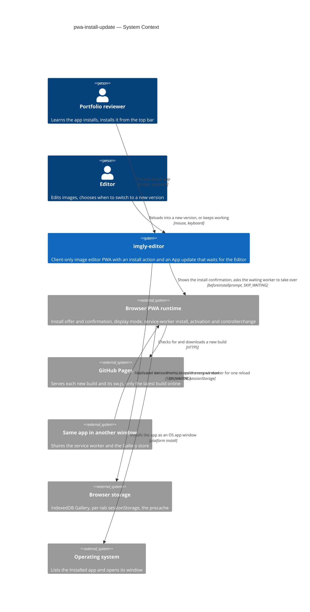
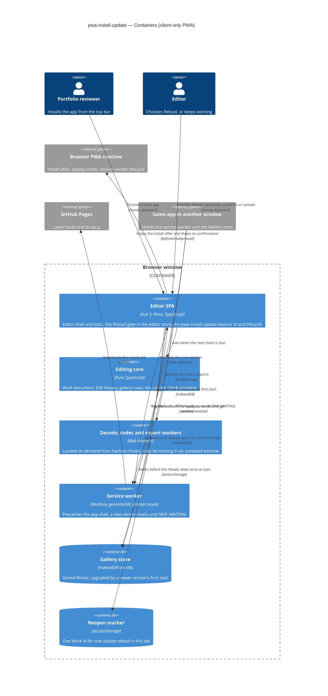

# Software Architecture Document — pwa-install-update

<!-- 12 Arc42 sections. Empty section → <!-- N/A: <one-line reason> -->. -->
<!-- C4 Context (L1) lives inline in §3. C4 Container (L2) lives inline in §5. -->
<!-- Numbers in §10 come VERBATIM from spec.md §6 NFR — no inventing, no rounding. -->

## 1. Introduction and goals

**Intent.** This feature makes the app's two PWA capabilities visible, and it makes App updates wait for the Editor (spec §1, §2). In a browser tab that offers installation, the top bar shows "Install app", which opens the browser's own install confirmation. The Installed app, and every browser that does not offer installation, shows no install action (AC-01 to AC-04). The first time the browser stores the app for offline use, a notice says so once (AC-05). When a new version has downloaded, it waits instead of taking over at once. A lasting update notice offers "Reload". The Reload checks wait for a running save, refuse while a tool is open or an Export runs, and ask for confirmation only when edits are not stored in the Gallery. After the reload, the Work that was open comes back from its Stored state (AC-06 to AC-13). When the Editor ignores the notice, the new version takes over the next time the app starts after every window has closed (AC-09). Every other window is told when one window switches versions, and a window that is still on the older version stops saving once the Gallery's storage shape has changed (AC-14). The feature turns roadmap step 9 into code, and it replaces today's silent `autoUpdate` reload (`vite.config.ts`, `src/app/pwa.ts`).

**Top-3 quality goals (1-liners; full scenarios in §10):**

1. **An update never interrupts work.** The app reloads only after the Editor chooses to, which gives 0 reloads the Editor did not choose. It loses 0 Drafts and 0 applied changes without the Editor's confirmation, across the update e2e flows on Chromium, Firefox and WebKit (spec §6, §7, AC-07 to AC-13).
2. **No window stays outdated without a notice.** An open, online window shows the update notice within ≤ 60 minutes plus the download time. Every other window learns of a switch, and an older window never writes the Gallery in an older shape (spec §6, AC-06, AC-14).
3. **The way back is fast and exact, and works offline.** From "Reload" to the reopened reference Work's first Preview takes p95 ≤ 3 s. The reopened Work's Export matches the one made before the update. 100% of starts of the Installed app succeed offline after its first load on Chromium, and editing stays within the 200 ms freeze budget while an update downloads (spec §6, AC-08).

**Stakeholders.**

| Role | Interest | Sign-off owner? |
|---|---|---|
| Portfolio reviewer | Learns from the app itself that it installs, and installs it with "Install app" plus the browser's confirmation (US-01, KPI "2 actions") | No |
| Editor | Is never reloaded mid-edit, chooses when to switch versions, gets the open Work back afterwards, and is told when another window switched (US-02 to US-06) | No |
| Tech Lead | SAD approval. The feature changes the service worker's update lifecycle that every user already runs, adds a reload gate to the `editor` store next to the Replace gate, and widens the shared notice primitive that every feature uses | Yes |
| Security Lead | Spec §6.1 light review: the marker of which Work to reopen holds only its id, lives only in this window, is gone once it is used or the window closes, and no other start reopens a Work | Yes |

<!-- Decision overrides (¶4) — populated by the critic resolution loop, empty otherwise. -->

## 2. Constraints

**Technical.**
- TypeScript 5.9 (`strict`), the Node 24 toolchain and pnpm (repo ADR [0001](../../adr/0001-build-a-client-only-vue-pwa.md))
- Vue 3.5 with `<script setup>`, Pinia 4 setup stores, Vite 8, vite-plugin-pwa 2 (`generateSW`, Workbox 7) and workbox-window 7.4. The app is a client-only PWA served from `/imgly/`, and the base path, the manifest's `scope` and `start_url`, and the service worker's scope must all stay `/imgly/` (CLAUDE.md)
- Today's update behaviour, which this feature replaces:
  - `vite.config.ts` sets `registerType: 'autoUpdate'`, `injectRegister: false`, and Workbox `skipWaiting: true` and `clientsClaim: true`.
  - `src/app/pwa.ts` calls `registerSW({ immediate: true })` with no callbacks, and `src/main.ts` registers it only in production builds.
  - The precache covers `**/*.{js,css,html,png,svg,webmanifest}`, and `navigateFallback` is `/imgly/index.html`.
- Every hashed chunk is precached, including the decode, work-codec and export workers (`new Worker(new URL(…, import.meta.url))` in `src/infra/image-decode`, `src/infra/work-codec` and `src/render/export`). The app has no lazy `import()` of its own code apart from the e2e test hooks
- The `editor` store already holds every condition the Reload checks need:
  - `activeTool` tells whether a tool is open.
  - `phase === 'exporting'` lasts from `beginExport()` to the end of the save dialog.
  - Autosave's `saving` flag, `settled()` and `isStored(work)` cover the save.
  - The Replace gate in `openImage` and `reopenWork(id)` waits on `settled()` and asks only when edits are not stored (gallery ADR-0001).
- Gallery ADR-0006 already handles an IndexedDB upgrade from a newer version: Autosave lets the running save finish, closes the connection, marks the Gallery unavailable and stops saving. It then shows the info notice `infoNewerVersion()` (`src/features/editor/autosave.ts`)
- The notice boundary is `useNotices` (`src/shared/notices/store.ts`). It knows the kinds `info`, which closes itself after 6 s, and `failure`, which stays. An action always closes its notice (`src/shared/ui/Toast.vue`)
- Browser behaviour the design relies on:
  - A waiting service worker takes over only after `skipWaiting()`, or once no window uses the active one.
  - Activation fires `controllerchange` in every window it controls.
  - `beforeinstallprompt` and `appinstalled` exist only in Chromium-based browsers.
  - `(display-mode: standalone)` matches inside the Installed app.
  - `sessionStorage` belongs to one tab, survives a reload of that tab and is cleared when the tab closes.
  - GitHub Pages serves only the latest build, so an older window's hashed files are no longer on the network after a deploy.
- Architecture convention: a functional core with feature folders (repo ADR [0002](../../adr/0002-organize-code-as-functional-core-with-feature-folders.md)). Features never import each other, they coordinate through the `editor` store, and there is no event bus. `infra` calls only pure `core` functions

**Organisational.**
- Owner: Blazheiko, working alone with the SDD pipeline
- Size S (`.size`) and route `quick` (`.route`). The spec's §1 ¶4 override keeps S, because AC-14 reuses the Gallery's existing handling of a storage version change and the existing notice boundary
- No deadline. This is roadmap step 9, after the Gallery and before OS integration (`docs/roadmap.md`)
- A light security review is required before ship (spec §6.1)

**Conventions.**
- `CLAUDE.md` (module boundaries, conventions, decisions) and `docs/architecture-map.md` §Conventions. The map reflects `3f248c2`, so it predates the Gallery. This SAD reads the code at `9bcf5e0`
- Errors: `core` and `infra` return `Result<T, AppError>`. New codes go in the `AppErrorCode` union in `src/core/result.ts`, and their text goes in the owning feature's `messages.ts`. The UI shows errors only through `useNotices`
- UI: plain CSS with `<style scoped>`, only `var(--…)` tokens, `src/shared/ui/` primitives first, and every new or widened primitive recorded in `docs/design-system.md`
- Tests: Vitest next to the source, with component tests on happy-dom. e2e tests only for what happy-dom can't do, which here means the real service-worker lifecycle across two builds, offline starts of the Installed app and two-window behaviour

**Regulatory / external.**
- Spec §6.1: the data is confidential, because the reopened Work can be a personal photo. The feature adds no personal data. The only new stored value is the reopen marker, which holds one Work id for one window (ADR-0003)
- No compliance regime applies: there is no server, no account and no third party. Installation always passes the browser's own confirmation, and the browser accepts a new service worker only from the app's own origin and `/imgly/` scope

## 3. Context and scope

The app already installs and works offline, but says neither, and it takes every new version with a silent reload. This feature puts both facts in front of the person, and it moves the moment a version switches from the browser's choice to the Editor's. Everything still happens in the browser. The new outside parties are the browser's install offer and its service-worker update lifecycle. GitHub Pages, which publishes each new build, and the app's other windows already existed but now matter at runtime.

<!-- brownfield: Vue 3 + Pinia client-only PWA (functional core, infra adapters, feature folders coordinated through the editor store). vite-plugin-pwa generateSW in autoUpdate mode with skipWaiting and clientsClaim, and a silent reload. The Gallery (IndexedDB v2) shipped with a versionchange handler (gallery ADR-0006). Scanned at 9bcf5e0, since docs/architecture-map.md reflects 3f248c2. -->

**External systems (in / out):**

| Actor or system | Type | Interaction |
|---|---|---|
| Portfolio reviewer | Person | Sees "Install app" in a tab whose browser offers installation, and installs through the browser's confirmation (US-01) |
| Editor | Person | Edits, gets the update notice, chooses "Reload" or ignores it, and works in one or more windows (US-02 to US-06) |
| Browser PWA runtime | System (external, owned by the browser) | Offers installation (`beforeinstallprompt`, `appinstalled`, the install confirmation) and reports the display mode. It installs and activates service workers, and fires `controllerchange` in every window when a new one takes over. **Trust boundary:** the app never installs itself or forces a version; it only reacts to these signals and asks the browser |
| GitHub Pages | System (external) | Serves each new build, and with it a new `sw.js` that the browser downloads in the background. Only the latest build is on the network |
| Same app in another window | System (another instance of this app) | Shares the service worker and the Gallery store. Its "Reload" can activate the new version under this window, and the new version's first start can upgrade the Gallery store (AC-14) |
| Browser storage | System (external, owned by the browser) | IndexedDB holds the Gallery (unchanged). Per-tab `sessionStorage` holds the reopen marker across the update reload only (ADR-0003). The service worker's precache holds the app's files |
| Operating system | System (external) | Lists the Installed app and opens it in its own window. Unchanged otherwise |

Out of scope on purpose: no release notes, no forced updates, no install instructions for browsers without an install offer, no mobile install banners (spec §3).

**C4 Context (L1):**



## 4. Solution strategy

**Target surface.** `[web-frontend]` (frontmatter `target_surfaces`). The app is a client-only SPA (ADR 0001). The spec's actors are people at a desktop browser (spec §4), and ux-flows inventories seven screens (SCR-01 to SCR-07), five of them notices or dialogs over the editor. The service worker is generated by the build and ships in the same deployable, like the decode and export workers, so it is not a `worker` surface: it has no contract of its own. There is one surface, so the decision stays inline.

**UI architecture (web-frontend).** The existing single-view SPA with no router stays. "Install app" is one more component in `App.vue`'s `#top-bar-actions` slot, next to the tool actions. Every other part of the feature is a notice in the single `useNotices` boundary, plus one modal confirmation (SCR-06), so no new screen or route appears (ux-flows §Platform decisions). State lives in one new Pinia setup store, and the Reload checks live in the `editor` store (choice 4).

**Top strategic choices (the seeds for ADRs):**

1. **A new version waits as a waiting service worker until "Reload"** ([ADR-0001](adr/0001-hold-each-new-version-in-a-waiting-service-worker-until-the-editor-chooses-reload.md)). vite-plugin-pwa switches to `registerType: 'prompt'`, and Workbox's `skipWaiting` is dropped, so a downloaded version stays waiting while any window uses the current one. `onNeedRefresh` raises the update notice. After the Reload checks pass, "Reload" asks the waiting worker to take over (`SKIP_WAITING`), and the window reloads on `controllerchange`. An ignored notice leaves the browser's own rule in charge: the waiting worker takes over once every window has closed, which is exactly AC-09. `onOfflineReady` fires only on the first install, which gives AC-05 without a stored flag. `registration.update()` runs on the schedule of spec §6. This serves quality goals 1 and 2.
2. **Other windows learn of a switch from `controllerchange`, and of a storage change from IndexedDB's `versionchange`** ([ADR-0002](adr/0002-tell-other-windows-of-a-switch-through-controllerchange-and-of-a-storage-change-through-versionchange.md)). The browser fires `controllerchange` in every window when the new worker activates. A window that did not ask for the switch shows the "updated in another window" notice. The storage case reuses gallery ADR-0006 unchanged in mechanism. Autosave stops saving on `versionchange`, but it now raises a `storageSuperseded` flag instead of its own notice, and this feature rewords the one update notice to "must reload to keep saving". No new cross-window channel appears. This serves quality goal 2.
3. **The Work to reopen is a take-once marker in this tab's `sessionStorage`** ([ADR-0003](adr/0003-keep-the-work-to-reopen-as-a-take-once-id-in-this-tabs-sessionstorage.md)). Just before an update reload, the app writes only the open Work's id, and only when that Work has a Stored state. The new version reads and deletes the marker before it calls `reopenWork(id)`. No other start writes or reads the marker, so a fresh start opens no Work, as before (gallery AC-05). This is the §6.1 security rule made structural, and it serves quality goal 3.
4. **The `editor` store owns the Reload gate, and the new feature owns the UI and the lifecycle** ([ADR-0004](adr/0004-own-the-reload-gate-in-the-editor-store-and-the-install-and-update-ui-in-a-new-feature.md)). `requestReload()` sits beside the Replace gate and follows the same rules. It waits on `settled()`, then checks the open tool, the Export and whether the edits are stored, and it returns an outcome together with the id to mark. The new `src/features/pwa-install-update/` feature holds the install action, the update and offline notices, the reload confirmation and the check schedule. It reaches the editor only through its public store API, as gallery ADR-0001 split Autosave from the gallery UI. This serves quality goal 1.

Each tactical decision in later sections should trace to one of these seeds. Tactical decisions that *contradict* a strategic choice are red flags — surface them in §11.

## 5. Building block view

The feature follows the repo's functional core with feature folders (repo ADR 0002), with no divergence. Browser APIs are wrapped in `src/infra/platform/`: the service-worker registration, the install offer and display mode, and the reload marker. Each wrapper returns `Result` where it can fail and takes its browser objects by injection, so Vitest can drive it. The check schedule is a pure function in `src/core/app-update/`. The Reload gate is composed into the `editor` store (ADR-0004). The new feature holds one Pinia setup store and two components. `src/app/pwa.ts` stays the single registration point, and it hands the service-worker client to the feature store, the way `App.vue` hands the Gallery connection to the editor.

**Internal decomposition:**

```
src/
├── core/
│   ├── app-update/          NEW  nextCheckDue(lastCheck, now, visible): on start, ≤ 1 per 60 min while visible, on becoming visible after 60 min
│   └── result.ts            + INSTALL_FAILED, APP_PART_UNAVAILABLE
├── infra/
│   ├── platform/
│   │   ├── service-worker.ts   NEW  wraps registerSW (prompt mode): needRefresh, offlineReady, controllerchange, update(), skipWaiting-and-reload
│   │   ├── install-prompt.ts   NEW  beforeinstallprompt / appinstalled / display-mode standalone; prompt() → accepted | dismissed | INSTALL_FAILED
│   │   └── reload-marker.ts    NEW  markReopen(id), takeReopen(): string | null over sessionStorage (ADR-0003)
│   ├── image-decode/, work-codec/   a worker script that fails to load → APP_PART_UNAVAILABLE
├── render/export/              same mapping for the export worker
├── shared/
│   ├── notices/store.ts        + kind 'lasting' (no timeout), action.run may keep the notice open, slot: a newer notice in the same slot replaces the older
│   └── ui/Toast.vue            honours keep-open; registered in docs/design-system.md
├── features/
│   ├── editor/
│   │   ├── store.ts            + requestReload(): waits on settled(), then tool-open | exporting | confirm | ready { reopenId }; + storageSuperseded
│   │   ├── autosave.ts         versionchange raises storageSuperseded instead of pushing infoNewerVersion()
│   │   └── messages.ts         infoNewerVersion() moves to the new feature's wording (SCR-05, third wording)
│   └── pwa-install-update/  NEW  store.ts (install offer, update state, dismissed worker, outdated flag, check timer, resumeAfterUpdate),
│                                 InstallAction.vue (top bar), ReloadDialog.vue (SCR-06), messages.ts, index.ts
└── app/
    ├── pwa.ts                  registers the service worker in prompt mode and connects the feature store
    ├── App.vue                 mounts InstallAction and ReloadDialog; after connectGallery, calls resumeAfterUpdate()
    └── test-hooks.ts           + PWA hooks for e2e (synthetic install offer, update state, marker)
vite.config.ts                  registerType 'prompt'; workbox: skipWaiting removed, clientsClaim kept
```

**C4 Container (L2):**



**Tactical decisions in this section (inline):**

- **The notice primitive gains a lasting, slotted notice.** `NoticeInput` gains the kind `'lasting'`, which never times out. It also gains an optional `slot`: a new notice in an occupied slot replaces the one there, which gives "at most one update notice, the newest replaces the one before" (AC-14). `action.run` may return `'keep-open'`, so a refused "Reload" leaves the notice in place (AC-10, AC-12, AC-13). Existing callers are unchanged, because `info` and `failure` keep their behaviour. The change is additive and reversible in a day, but `screens` sets its look and `docs/design-system.md` records it (spec §1 cross-feature change).
- **One update notice, three wordings.** The feature store keeps one `updateNotice` state, either `none`, `available`, `updated-elsewhere` or `reload-to-save`, and renders it into the `app-update` slot. `reload-to-save` wins over `updated-elsewhere`, which wins over `available`, because a later signal never has less to say. A dismissal hides the notice until the page loads again. For `available`, the dismissal is remembered for that waiting worker only, so a still newer version shows the notice again (AC-09). `updated-elsewhere` and `reload-to-save` are shown even after the notice was dismissed (AC-14).
- **"Reload" acts according to the wording.** When a worker is waiting, "Reload" sends it `SKIP_WAITING` and reloads on `controllerchange`. When the version has already switched under this window (`updated-elsewhere`, `reload-to-save`), it reloads the page. Both go through the same `requestReload()` and write the marker first.
- **The install offer follows the browser.** The store keeps the deferred `beforeinstallprompt` event, and "Install app" shows only while one is held and the display mode is not `standalone` (AC-02, AC-04). `appinstalled` and a `dismissed` choice drop the event (AC-01, AC-03). A `prompt()` that rejects, or an `accepted` choice with no `appinstalled` within a bounded wait (default 10 s, which `tasks` may tune), raises the could-not-install notice (AC-03).
- **An outdated window reports a missing part instead of failing halfway.** The three worker clients map a worker script that fails to load to `APP_PART_UNAVAILABLE`. The decode, reopen and export paths already change nothing until their worker succeeds (open-and-view, gallery ADR-0003, export ADR-0001), so the action changes nothing. Each owner's `messages.ts` words the code as "imgly was updated in another window and must be reloaded to continue", because a hashed script of this build goes missing only after a newer build has replaced it (AC-14).

## 6. Runtime view

<!-- 🎯 Why: the RUNTIME FLOW of 1–2 critical scenarios — who talks to whom, when, in what order.
     Without §6, §5 is just boxes with no life.
     📋 Write: a Mermaid sequenceDiagram. Participants are names from §5 (don't invent new ones).
     Messages are semantic («saves a draft»), NO HTTP verbs / paths / status codes — endpoint-level
     sequences arrive at the `api` stage.
     📌 e.g. «author → web: composes draft → web → content API: save». Seed the primary flow(s) here;
     the `sequences` stage then covers every §5 AC (no cap). Never N/A for M+; XS/S keeps ≥1 happy-path flow. -->

**Critical flow 1: <flow name>**

```mermaid
sequenceDiagram
    actor Actor
    participant Web
    participant Service
    participant Store
    Actor->>Web: <action>
    Web->>Service: <call>
    Service->>Store: <write>
    Store-->>Service: ok
    Service-->>Web: result
    Web-->>Actor: confirmation
```

**Critical flow 2: <e.g. async event propagation>** — <if applicable, otherwise N/A>.

## 7. Deployment view

<!-- 🎯 Why: the TOPOLOGY DevOps must know without reading the deploy charts — how many replicas,
     where the background worker lives, AT WHAT NUMBERS we scale.
     📋 Write: 2–3 sentences on topology + monitoring + concrete threshold numbers.
     📌 e.g. «500 authors → partition by quarter» (not «we'll think about scale later»).
     🎯 N/A allowed for XS/S that reuses an existing deployment unit with no change.
     Deployment-diagram scaffold → templates/deployment.md. -->

<Topology in 2–3 sentences. Where it runs, replicas, scaling thresholds.>

**Monitoring:**
- <Metrics — e.g. `<metric_name>`>
- <Alerts — e.g. «worker lag > 10 min → page on-call»>
- <Tracing — e.g. spans on the request boundary>

**Scaling thresholds:**
- <e.g. comfortable in one table up to N rows/year>
- <e.g. partition by quarter above N rows/year>

<!-- For XS/S with no deployment change: <!-- N/A: reuses existing deployment unit, no infra change --> -->

## 8. Crosscutting concepts

<!-- 🎯 Why: CROSS-CUTTING PATTERNS spanning several modules: logging, errors, authorization, ID
     strategy, events, caching. ⭐ The second-densest section. A pattern inside one module is NOT
     here; a project-wide convention belongs in the convention file.
     📋 Write: a table — concept / convention / where defined. One row per concept.
     📌 e.g. «sortable time-based IDs generated in the app layer» as a default from the convention file. -->

| Concept | Convention | Where defined |
|---|---|---|
| Logging | <e.g. structured, fields `module=<name>`> | <convention file §X or here> |
| Authentication | <e.g. token-based via middleware> | <convention file §X> |
| Error handling | <e.g. domain sentinel → ports error mapping → JSON> | <convention file §X> |
| ID strategy | <e.g. sortable time-based ID in the app layer> | <convention file §X> |
| Internationalisation | <e.g. N/A, single language> | — |
| Observability | <e.g. tracing on the request boundary> | — |
| Events | <module-specific patterns, if any> | <here> |

## 9. Architecture decisions

<!-- 🎯 Why: the REVERSE INDEX onto the adr/ folder. `ls adr/` gives the files; §9 gives the
     semantics — why they exist, which SAD section they attach to, what status.
     📋 Write: a 4-column table, one row per ADR. Mixed status is fine.
     📌 e.g. «0001 | Store content as a table of typed blocks | Accepted | §4». -->

| # | Title | Status | Section |
|---|---|---|---|
| <NNNN> | <imperative — e.g. "Use a sliding-window counter for rate limiting"> | Accepted | §<N> |
| <NNNN> | <imperative — e.g. "Co-locate the worker in the API process"> | Accepted | §<N> |

ADR files live under `docs/features/<slug>/adr/NNNN-<title>.md`.

## 10. Quality requirements

<!-- 🎯 Why: the QUALITY TREE — take a goal from §1 and break it into concrete leaves: tests,
     metrics, configs, drills. ⭐ Without §10, §1 is a manifesto. With §10 each declaration maps
     to something PROVABLE.
     📋 Write: per §1 goal — When / Then / How-verify. Numbers from spec §6 NFR VERBATIM (don't
     round ≤250ms to ≤300ms — that's a critic F6 hit).
     📌 e.g. «p95 ≤ 500 ms on a block update, verified by a 100 req/s load test». -->

Each top-3 goal from §1 expanded into a full scenario:

**QG-1. <quality attribute>**
- **When:** <trigger condition>
- **Then:** <expected behaviour with numbers from spec §6 NFR>
- **How verify:** <test / chaos drill / load test / metric>

**QG-2. <quality attribute>**
- **When:** <trigger>
- **Then:** <expected>
- **How verify:** <how>

**QG-3. <quality attribute>**
- **When:** <trigger>
- **Then:** <expected>
- **How verify:** <how>

## 11. Risks and technical debt

<!-- 🎯 Why: ⭐ collects EVERYTHING that can break — not only the technical. Without §11 risks get
     discussed at standups and lost; debt lives only in the head of whoever accepted it.
     📋 Write: a risk/debt table — severity — mitigation — owner. Accepted debt in its own block.
     📌 The first risk is often a product risk, not a technical one. That's normal. -->

<!-- Severity literals: Low / Medium / High for regular risks; "Open question" for rows created by
     a Save-as-OQ resolution during the Socratic walk (see references/socratic.md). -->

| Risk / debt | Severity | Mitigation | Owner |
|---|---|---|---|
| <e.g. Worker lag may reach hours during a downstream outage> | Medium | <alert >10 min, on-call playbook, retry backoff> | <DevOps> |
| <e.g. No event-schema versioning in v1> | Medium | <ADR-NNNN planned for v2, tolerate unknown fields> | <Backend> |
| Open architectural decision: <decision-headline> | Open question | Resolve before <stage trigger or YYYY-MM-DD>; <inline rationale from the Save-as-OQ> | <owner> |

**Accepted debt (acceptable in v1, plan to fix later):**
- <e.g. the entity is immutable / unversioned — OK for v1, may need audit versioning in v2>

## 12. Glossary

<!-- 🎯 Why: ⭐ the DOMAIN GLOSSARY that ends arguments a year later («checkpoint — weekly or
     biweekly? quarter — calendar or fiscal?»).
     📋 Write: a term / meaning table. Business + technical terms mixed.
     📌 e.g. «Lesson | a unit inside a course made of blocks (text, video)». -->

| Term | Meaning |
|---|---|
| <e.g. domain object A> | <its meaning in this domain> |
| <e.g. domain object B> | <its meaning> |
| <e.g. domain invariant name> | <the rule, in plain language> |
