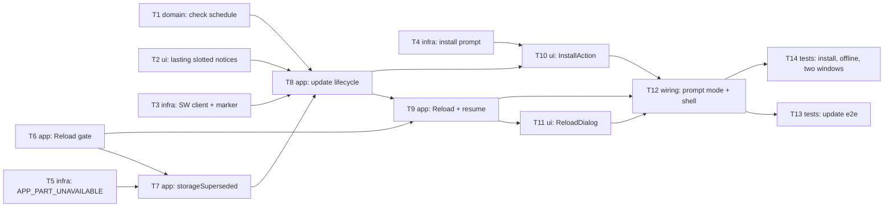

# Epic — pwa-install-update

> **Spec:** [spec.md](../spec.md) · **Design:** [sad.md](../sad.md) · **Screens:** [screens.md](../screens.md) · **Data model:** none (no schema change, `sad.md §6`) · **API:** none (`target_surfaces: [web-frontend]`, no external interface) · **ADRs:** [adr/](../adr/)

## Goal

Ship roadmap step 9. A visitor whose browser can install the app learns this from the app and installs it with one action plus the browser's confirmation. A new version never reloads the page under the Editor: it waits behind a lasting update notice, "Reload" passes the same checks as the Replace gate, and the open Work comes back after the reload. Every other window learns of a switch and gets a safe way to catch up (spec §2).

## Scope

- **In:** `src/core/app-update/` (check schedule), `src/core/result.ts` (two codes), `src/infra/platform/` (service-worker client, install prompt, reload marker), the three worker clients (`APP_PART_UNAVAILABLE`), `src/shared/notices/` and `Toast` (lasting, slotted, keep-open, busy notices), the `editor` store (Reload gate, `storageSuperseded`, Autosave), a new `src/features/pwa-install-update/` feature, `src/app/` wiring, `vite.config.ts` (prompt mode), the e2e harness for two builds, and `CONTEXT.md` terms.
- **Out:** install instructions for Firefox and Safari, release notes, forced updates, keeping the Edit history or View across the reload, mobile install banners, and uninstalling from the app (spec §3).

## Task map

**Waves:** 1 — T1, T2, T3, T4, T5, T6 (six parallel starts; T3/T4 share `infra/platform/index.ts` and T4/T5 share `core/result.ts`, so those run serialized) · 2 — T7 · 3 — T8 · 4 — T9, T10 (same feature store, serialized) · 5 — T11 · 6 — T12 · 7 — T13, T14 (shared e2e harness, serialized).

## Tasks

See [tracker.md](./tracker.md) for status. Machine contract: [tasks.json](../tasks.json).

| # | Task | Layer | Blocked by | DoD (short) |
|---|---|---|---|---|
| T1 | [Pure update-check schedule `nextCheckDue`](./t01-core-update-check-schedule.md) | domain | — | fake-clock tests for start, 60 min, hidden, visible |
| T2 | [Lasting, slotted, keep-open, busy notices](./t02-shared-lasting-slotted-notices.md) | ui | — | primitive tests + design-system rows |
| T3 | [Service-worker client and reload marker](./t03-infra-service-worker-and-reload-marker.md) | infra | — | fakes prove callbacks, silent check, take-once marker |
| T4 | [Install-prompt client + `INSTALL_FAILED`](./t04-infra-install-prompt.md) | infra | — | offer, dismissed, accepted, failed, standalone |
| T5 | [`APP_PART_UNAVAILABLE` in worker clients](./t05-infra-app-part-unavailable.md) | infra | — | load failure ≠ runtime error, copy worded |
| T6 | [Reload gate `editor.requestReload()`](./t06-editor-reload-gate.md) | app | — | four outcomes + reopenId after `settled()` |
| T7 | [Autosave raises `storageSuperseded`](./t07-autosave-storage-superseded.md) | app | T5, T6 | stop on versionchange / missing codec, no notice |
| T8 | [Feature store update lifecycle](./t08-feature-store-update-lifecycle.md) | app | T1, T2, T3, T7 | three wordings, dismissal, schedule, offline-ready |
| T9 | [Reload action and resume after update](./t09-feature-store-reload-and-resume.md) | app | T6, T8 | outcomes → effects, marker, reopen notices |
| T10 | [InstallAction and install-offer state](./t10-install-action.md) | ui | T4, T8 | AC-01–AC-04 component + store tests |
| T11 | [ReloadDialog (SCR-06)](./t11-reload-dialog.md) | ui | T9 | two bodies, focus, cancel / confirm |
| T12 | [Prompt mode + app shell wiring + hooks](./t12-wiring-prompt-mode-and-app-shell.md) | wiring | T9, T10, T11 | App tests, sw.js waits, CONTEXT terms |
| T13 | [Two-build e2e: single-window update flows](./t13-e2e-update-reload-flows.md) | tests | T12 | 0 unchosen reloads, same Export after reopen |
| T14 | [e2e: install, offline, two windows](./t14-e2e-install-two-window-offline.md) | tests | T12 | 0 windows left without a notice |

## Risks / Hard rules

- **Module boundaries (CLAUDE.md, repo ADR 0002):** `core` imports nothing outside `core`. `infra` never imports Vue, Pinia or a feature. The new feature never imports another feature (in particular not `gallery`), and it reaches the editor only through `@/features/editor`'s `index.ts`.
- **Security (spec §6.1, ADR-0003):** the reopen marker holds only the Work id, lives in this tab's `sessionStorage`, is taken before use, and is written only by the update reload path. `prompt()` runs only from the Editor's click. A light security review is due before ship.
- **0 reloads the Editor did not choose, 0 Drafts lost (spec §6):** no task may call `activateWaiting()` or reload the page outside T9's `leave()` path.
- **Size override check (sad.md §1):** the SAD keeps size S "unless `tasks` produces more than 5 PRs". This breakdown has 14 tasks, delivered as per-task commits on one feature branch. Re-run `/sdd:classify-size pwa-install-update` if they ship as separate PRs.
- **Open design gaps flagged in tasks (don't guess):** T5 must find a reliable "worker script failed to load" signal per engine. T9 must check how the gallery's damaged-Work notice ("Delete…") can be raised without importing `gallery`.
- **Transition release (sad.md §7, §11):** windows on the old `autoUpdate` build get no notice for the first release. The changelog says so at ship.
