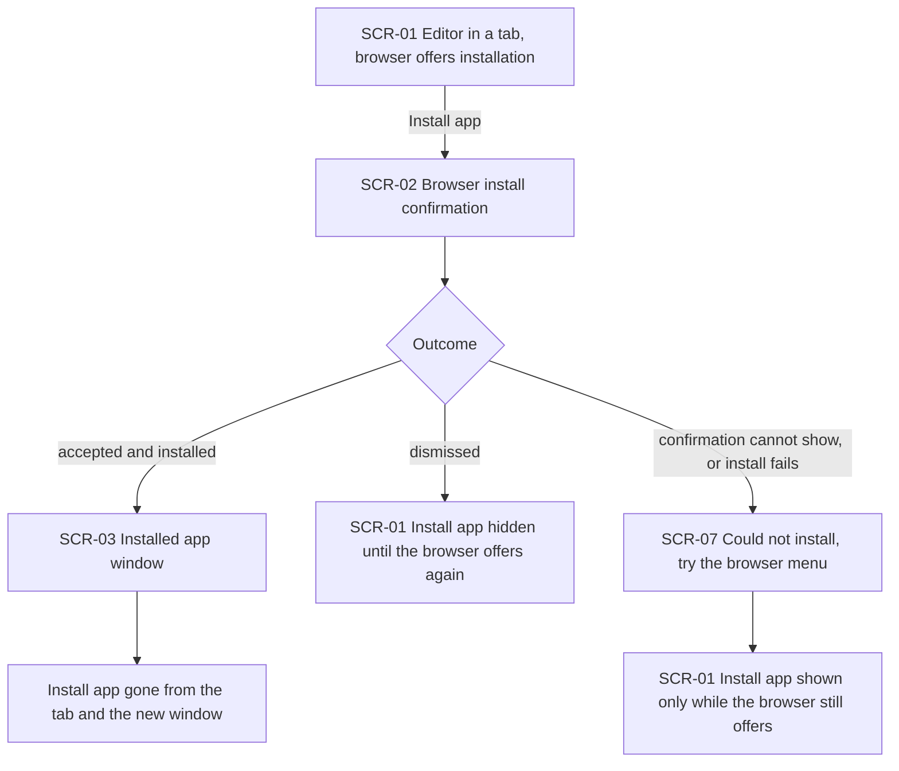
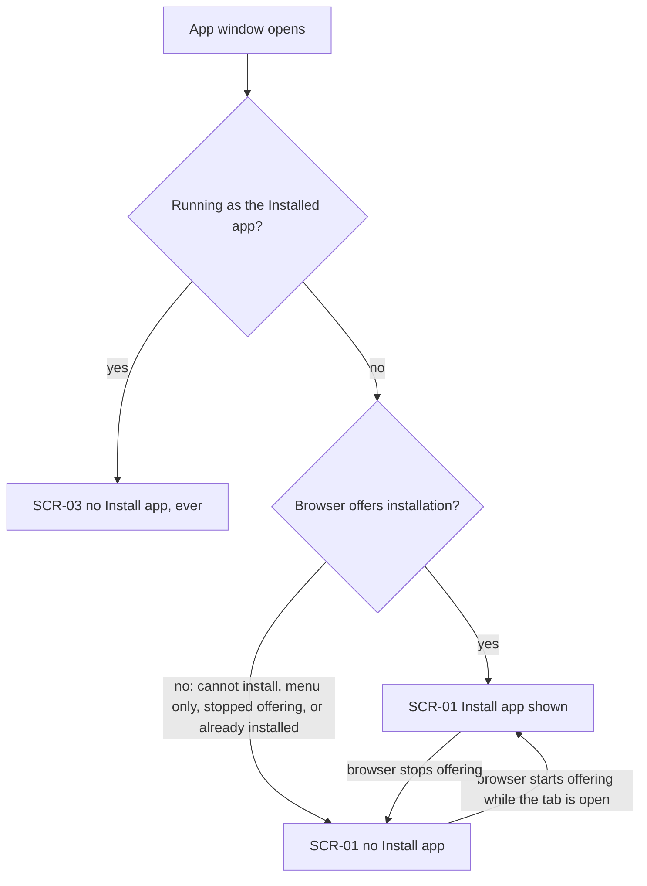
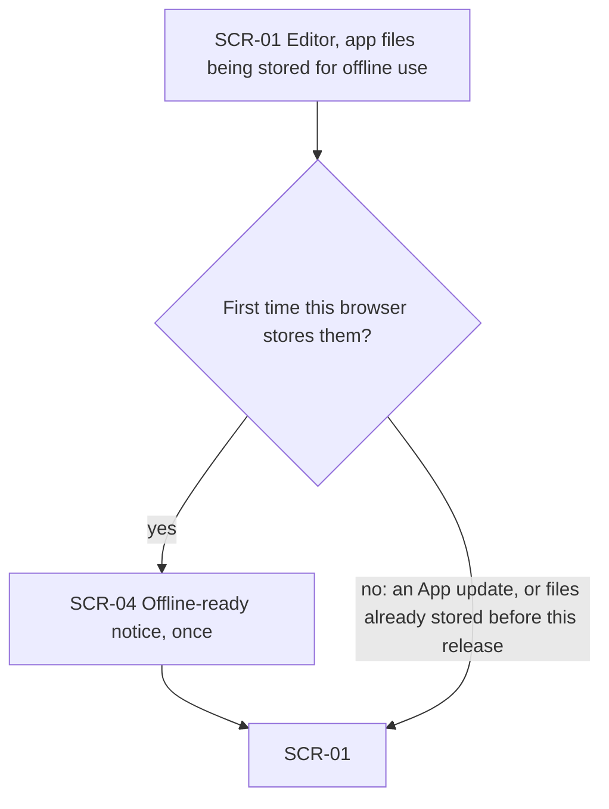
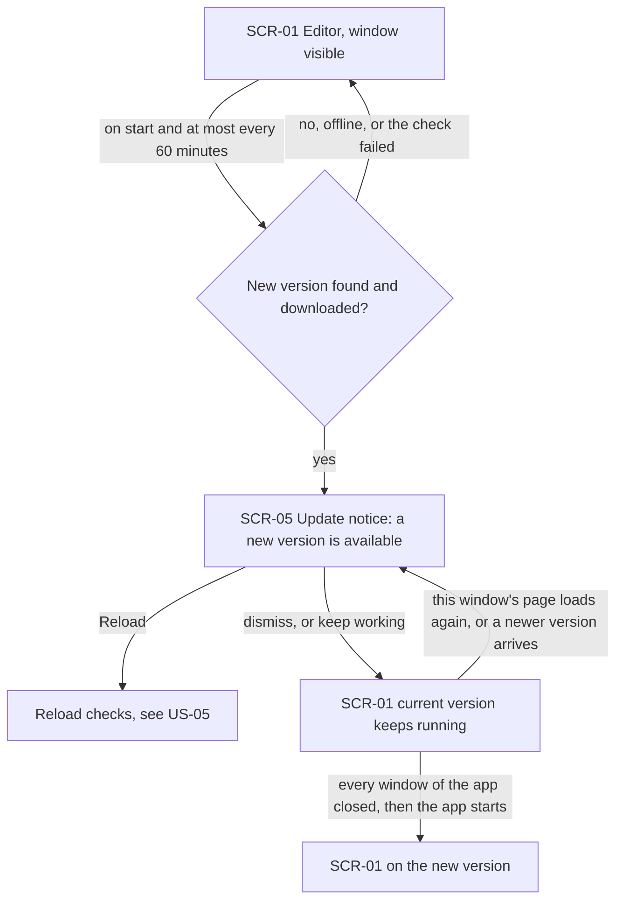
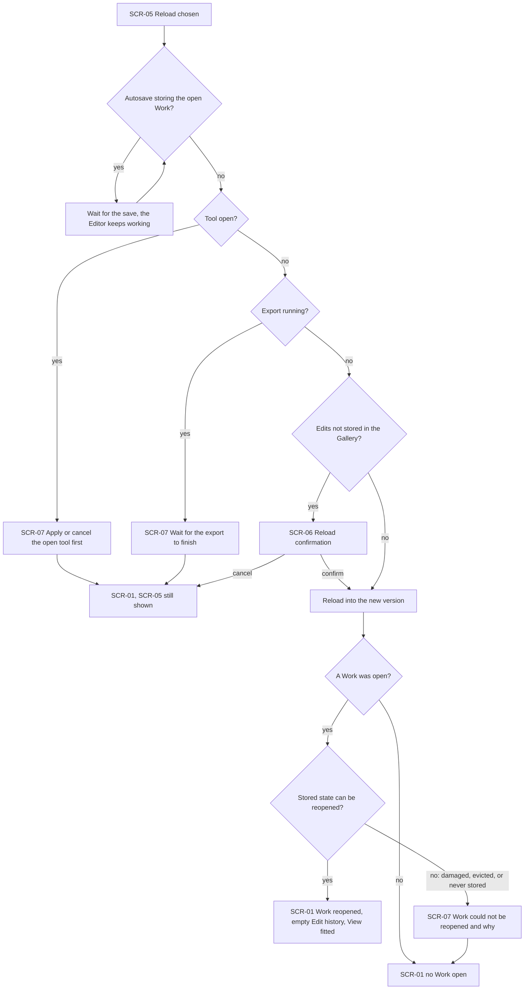
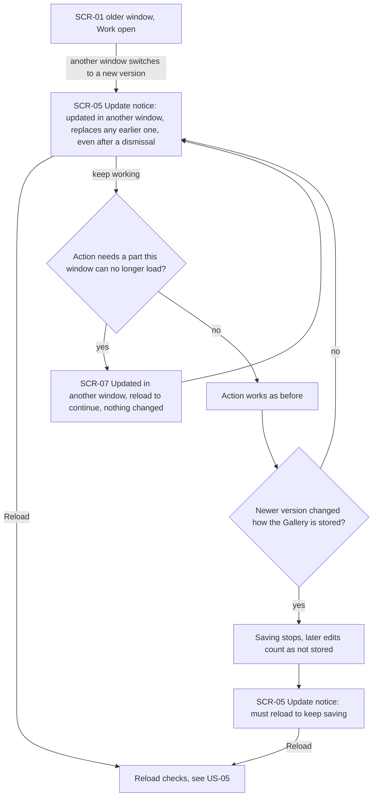

# UX flows — pwa-install-update

> User flows for every UI-touching §4 user story, produced by `ux-flows` (after `clarify`, before
> `design`) and read by `design` (evidence for the target-surface + UI-architecture decisions),
> `sequences` (UI-driven flows align on SCR ids), `screens` (details every inventory row) and
> `plan-tests` (the e2e-through-UI paths). **Always markdown + mermaid `flowchart`**, whatever the
> design tool — this artifact is flow-altitude, not visual design.

## Platform decisions

- **Posture:** desktop-first, as in `docs/design-system.md` §Platform posture, confirmed by the owner on 2026-10-15. The flows cover desktop browser tabs and the Installed app's own window. Mobile install banners are out of scope (spec §3).
- **Navigation shape:** one editor view with no page navigation, as in every earlier feature. Nothing in this feature adds a screen of its own. "Install app" is one more entry in the always-visible top bar, and every other part of the feature is a notice or a confirmation over the editor.
- **Modality:** the reload confirmation (SCR-06) is the only blocking dialog the feature designs. The install confirmation (SCR-02) belongs to the browser and is not designed by us. Every notice uses the canon's single notice boundary (`docs/design-system.md`, ToastStack). The update notice (SCR-05) is the one notice that stays until the Editor acts on it, and it stays after a refused or cancelled "Reload" (spec §1, cross-feature change).
- **One update notice per window:** the three update messages (a new version is available, imgly was updated in another window, imgly must be reloaded to keep saving) are wordings of the same SCR-05. The newest replaces the one shown before (spec AC-14).
- **Shared step — Reload checks:** every "Reload", whichever SCR-05 wording offered it, passes the same checks in this order. It waits for a running save, then refuses while a tool is open or an Export runs, then asks (SCR-06) when edits are not stored in the Gallery, and otherwise reloads (spec AC-07, AC-10 to AC-13). It is drawn in full in US-05, and other flows reference it as a node.
- **Design input (Tech Lead flag, not decided here):**
  1. Today the app switches to every new version at once and reloads the page. The flows need the new version to wait until "Reload" or the next start after every window closed (AC-06, AC-09). `design` decides how the app holds the new version back and how it tells a window that one is waiting.
  2. Remembering which Work to reopen across the update reload, only in that window (AC-08, spec §6.1 security review).
  3. Telling every other window that one window switched versions, and when a newer version changed how the Gallery is stored (AC-14).
  4. An older window that can no longer load a part of the app must refuse the action that needed it, rather than fail halfway (AC-14).
  5. The notice primitive gains a lasting notice whose action can leave it open (spec §1). `screens` decides its look, and `design-system` records it.
  6. The check schedule runs per window and only while the window is visible (spec §6).

## Screen inventory

| ID | Screen | Purpose | Entry | Exit |
|---|---|---|---|---|
| SCR-01 | Editor | the existing editor, in a browser tab or in the Installed app, with or without a Work open. In a tab, its top bar shows "Install app" only while the browser offers installation | App start; the end of every notice and dialog below | SCR-02 ("Install app"), SCR-05 (an App update is waiting, or another window switched), SCR-04 (first offline-ready) |
| SCR-02 | Browser install confirmation | The browser's own install question (not designed by us) | "Install app" on SCR-01 | SCR-03 (accepted and installed), SCR-01 (dismissed), SCR-07 (install failed) |
| SCR-03 | Installed app window | SCR-01 opened in its own window as the Installed app; it never shows "Install app" | Accepting SCR-02; starting the Installed app from the system's list of apps | Same exits as SCR-01, apart from installation |
| SCR-04 | Offline-ready notice | Says once that imgly is ready to work offline | The browser stores the app's files for offline use for the first time | SCR-01 (closes by itself) |
| SCR-05 | Update notice | The lasting notice with "Reload" and a dismiss, in one of three wordings: a new version is available; imgly was updated in another window; imgly must be reloaded to keep saving | An App update finished downloading; another window switched versions; another window's version changed how the Gallery is stored | Reload checks ("Reload"), SCR-01 (dismissed) |
| SCR-06 | Reload confirmation | Says the edits not stored in the Gallery will be lost and that exporting first keeps them | Reload checks when the open Work has edits not stored in the Gallery | Reload (confirm), SCR-01 with SCR-05 still shown (cancel) |
| SCR-07 | Refusal and failure notices | One notice per case: "Apply or cancel the open tool first."; wait for the export to finish; the app could not be installed, try the browser's menu; the Work could not be reopened and why; imgly was updated in another window and must be reloaded to continue | A refused "Reload", a failed install, a Work that cannot be reopened after the reload, an action an older window can no longer load | SCR-01 (SCR-05 stays where it was shown) |

## Flows

### Flow: US-01 — Discover and install the app

The Portfolio reviewer sees "Install app" in the top bar of a tab whose browser offers installation, and choosing it opens the browser's own confirmation. Accepting it opens the Installed app in its own window, and "Install app" disappears from both the tab and that window (AC-01). Dismissing it shows nothing, and the action hides until the browser offers installation again (AC-03). When the browser cannot show its confirmation, or does not install the app after it was accepted, a notice says the app could not be installed and suggests the browser's menu. The action then stays only while the browser still offers installation (AC-03).

### Flow: US-02 — Not be offered what I already have

When a window opens, the Installed app never shows "Install app", whatever the browser does (AC-04). In a tab, the action follows the browser's offer. It shows while the browser offers installation, and it is absent in Firefox, in Safari, when the browser has stopped offering for now, or when the app is already installed (AC-02). The action appears later if the browser starts offering while the tab is open, and it disappears when the browser stops (AC-02).

### Flow: US-03 — Know the app works offline

The first time the browser stores the app's files for offline use, a short notice says imgly is ready to work offline, and then it closes by itself. An App update, or a browser that already had the files before this release, shows nothing. The notice returns only after the browser has cleared the files and stores them again (AC-05).

### Flow: US-04 — Update when I choose

A visible window checks for a new version on start and at most once every 60 minutes. Offline, or when the check fails, nothing is shown and the app keeps working (AC-15, spec §6). Once a newer version has downloaded, the lasting update notice offers "Reload" while editing, Autosave and Export carry on (AC-06). "Reload" goes through the Reload checks (AC-07). Dismissing the notice, or ignoring it, keeps the current version. The notice comes back when this window's page loads again or when a still newer version arrives, and the new version takes over by itself the next time the app starts after every window has closed (AC-09).

### Flow: US-05 — Never lose work to an update

Choosing "Reload" first waits for a running save while the Editor keeps working, then checks again from the top (AC-11). With a tool open, the app refuses with "Apply or cancel the open tool first." (AC-10). During an Export, from choosing to export until the file is saved or cancelled, it refuses and asks to wait for the export (AC-13). In both cases the update notice stays. When the open Work has edits not stored in the Gallery, a confirmation says they will be lost and that exporting first keeps them. Cancelling changes nothing, and confirming reloads (AC-12). Otherwise the app reloads at once (AC-07). After the reload, the Work that was open comes back from its Stored state, with the same Original, Geometry, Adjustments and Drawing layer, an empty Edit history and the View fitted (AC-08). A Work that cannot be reopened, because it is damaged, was evicted or was never stored, leaves no Work open, and a notice says why (AC-08, AC-12). Only this path reopens a Work. Any other start opens none (gallery AC-05).

### Flow: US-06 — Keep every window in step

When another window switches versions, this window shows the update notice worded "imgly was updated in another window", even if the Editor had dismissed the update notice for that version. It replaces any update notice already shown (AC-14). The window keeps its Work and everything it has already loaded. An action that needs a part of the app this window can no longer load changes nothing, and a notice asks for a reload to continue (AC-14). If the newer version changed how the Gallery is stored, this window stops saving from that moment, and the notice is reworded to say it must reload to keep saving. Edits made after that count as not stored, so its "Reload" asks for confirmation (SCR-06) through the Reload checks (AC-14, AC-12).

## AC coverage

| AC | Shown by | Notes |
|---|---|---|
| AC-01 | Flow US-01 → accepted and installed → SCR-03 | |
| AC-02 | Flow US-02 → "Browser offers installation?" both branches, plus the later-offer edge | |
| AC-03 | Flow US-01 → dismissed, and install fails → SCR-07 | |
| AC-04 | Flow US-02 → Running as the Installed app → SCR-03 | |
| AC-05 | Flow US-03 → both branches | |
| AC-06 | Flow US-04 → New version downloaded → SCR-05 | |
| AC-07 | Flow US-05 → no save, tool, Export or unstored edits → Reload | Entry from Flow US-04 → Reload |
| AC-08 | Flow US-05 → A Work was open → reopened, or SCR-07 | |
| AC-09 | Flow US-04 → dismiss → current version; page loads again; every window closed | |
| AC-10 | Flow US-05 → Tool open → SCR-07 | |
| AC-11 | Flow US-05 → Autosave storing → wait → check again | |
| AC-12 | Flow US-05 → Edits not stored → SCR-06 cancel or confirm; Flow US-06 → saving stops | |
| AC-13 | Flow US-05 → Export running → SCR-07 | |
| AC-14 | Flow US-06 → every branch | |
| AC-15 | Flow US-04 → no, offline, or the check failed | |
