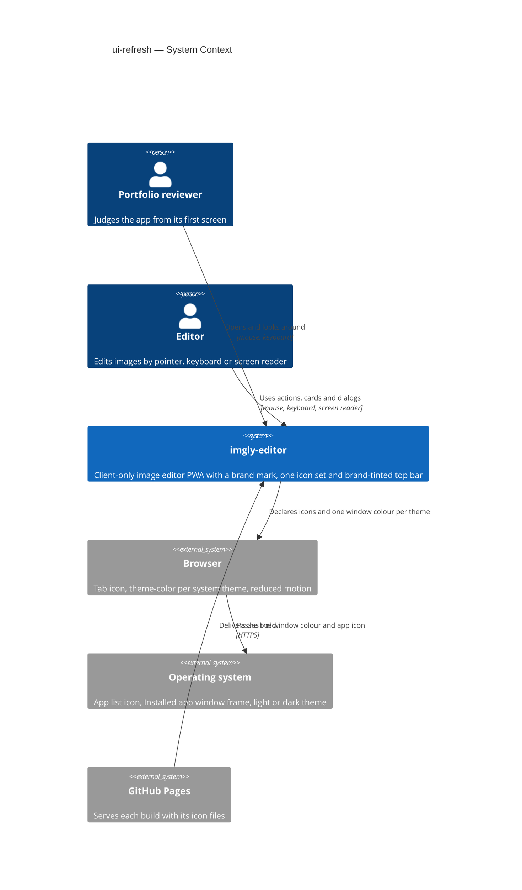
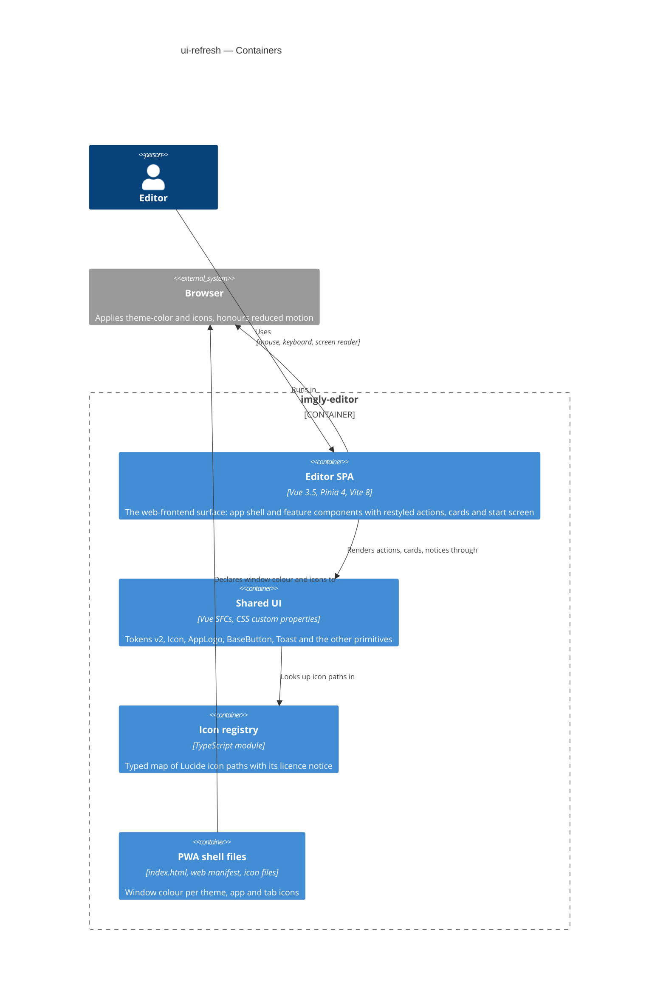
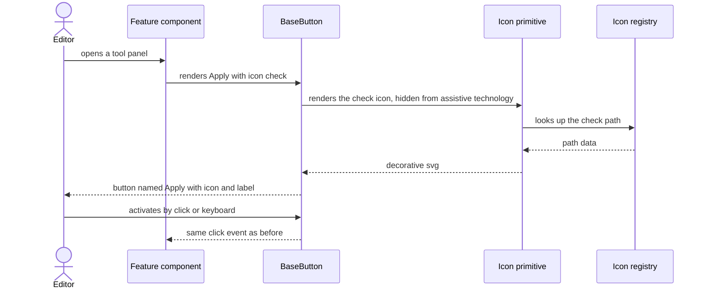
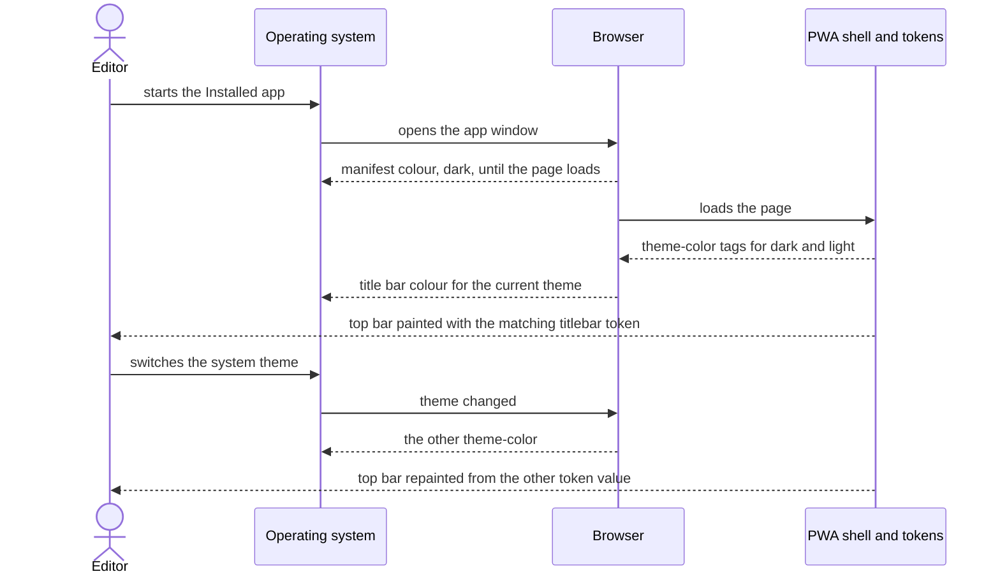

# Software Architecture Document — ui-refresh

<!-- 12 Arc42 sections. Empty section → <!-- N/A: <one-line reason> -->. -->
<!-- C4 Context (L1) lives inline in §3. C4 Container (L2) lives inline in §5. -->
<!-- Numbers in §10 come VERBATIM from spec.md §6 NFR — no inventing, no rounding. -->

## 1. Introduction and goals

**Intent.** This feature gives imgly a brand and a consistent, premium look without changing what the app does (spec §1, §2). The imgly mark appears in the top bar, the browser tab, the Installed app's icon and the home-screen icon (AC-01). Every action button across the app shows an icon from one shared set, and the top bar shows four groups with Export last (AC-02, AC-03, AC-15). The start screen gets a drop area, and the Gallery shows each Work as a same-shape card with a lift on hover and a Delete that appears on hover or focus (AC-04 to AC-10). Deleting looks destructive (AC-12). In the Installed app, the window's title bar and the top bar share one brand-tinted colour per system theme (AC-11). All of it is built on extended design tokens, with visible focus, AA contrast and reduced motion respected (AC-13, AC-14). Names, shortcuts, enabled rules and keyboard order stay as they are, except that Install app moves before Export (spec §1).

**Top-3 quality goals (1-liners; full scenarios in §10):**

1. **Accessible in both themes.** Text ≥ 4.5:1 except the labels of disabled controls, icons, control borders and the focus mark ≥ 3:1, focus always visible, 0 ms of movement when reduced motion is requested (spec §6, AC-13, AC-14).
2. **No behaviour regression.** Accessible names and keyboard order 100% unchanged, except that Install app now comes before Export; every existing unit and end-to-end test passes without any edit, except the one app-shell test that pins Install app after Export (spec §6, AC-03).
3. **Light on weight and motion.** ≤ 15 KB compressed growth of downloaded code and styles, 0 new runtime packages, ≤ 200 ms per transition, and the longest interface freeze ≤ 200 ms with 20 Works in the Gallery (spec §6).

**Stakeholders.**

| Role | Interest | Sign-off owner? |
|---|---|---|
| Portfolio reviewer | Recognises imgly as one branded, carefully designed product from the first screen (US-01) | No |
| Editor | Finds actions by icon, opens or drops an image from a clear place, browses Works as cards, sees destructive actions clearly, keeps keyboard and screen-reader access (US-02 to US-08) | No |
| Tech Lead | SAD approval. The feature touches every feature's buttons, widens two shared primitives used everywhere (`BaseButton`, `Toast`) and adds one shared module (the icon set) | Yes |
| Security Lead | Spec §6.1 verdict N/A: no new data, permission, storage or network access. No sign-off needed beyond confirming that verdict | No |

<!-- Decision overrides (¶4) — populated by the critic resolution loop, empty otherwise. -->

## 2. Constraints

**Technical.**
- TypeScript 5.9 (`strict`), Vue 3.5 with `<script setup>`, Pinia 4 setup stores, Vite 8, vite-plugin-pwa 2 (`generateSW`), Vitest 5 on happy-dom, Playwright 1.63 (repo ADR [0001](../../adr/0001-build-a-client-only-vue-pwa.md)). The app is a client-only SPA served from `/imgly/`
- Styling: plain CSS in `<style scoped>`, every colour, spacing value and font from `var(--…)` in `src/shared/styles/tokens.css`, dark by default with a light override under `@media (prefers-color-scheme: light)`. No UI kit or CSS framework (CLAUDE.md)
- Today's icons are inline `<svg>` in five files: `UndoRedoActions.vue`, `CropRotateAction.vue`, `CropRotateControls.vue`, `AdjustAction.vue`, `DrawAction.vue`, each 16×16 with a hand-drawn path and sized through `--space-4`. No shared icon module exists
- `BaseButton` (`src/shared/ui/BaseButton.vue`) has variants `primary` / `secondary` / `ghost` and an optional `pressed`; about 40 uses across 9 features. `Toast.vue:26` renders the action as a ghost `BaseButton` with a busy `Spinner`; `Toast.vue:42` is a native Dismiss button with the text "×" and `aria-label="Dismiss"`
- Gallery thumbnails are PNG Blobs rendered at `THUMBNAIL_LONG_SIDE = 320` px with the Work's aspect ratio (`src/render/preview-renderer.ts:51`) and shown through an object URL (`src/features/gallery/store.ts:121`). The card is one native `<button>` whose accessible name is "name, status" (`GalleryEntry.vue:30-41`); Delete is a separate ghost `BaseButton` with `data-delete-id`
- The start screen is `EmptyCanvas` (editor) above `GalleryStart` (gallery), composed through `EditorView`'s `#start-screen` slot; the window-wide drag state is `dragging` in `EditorView.vue:15`
- PWA surface: one `<meta name="theme-color" content="#16181d">` (`index.html:6`), manifest `theme_color` and `background_color` `#16181d` (`vite.config.ts:32-33`), four PNG icons in `public/icons/`, no icon-generation script
- e2e tests find buttons by accessible name (`getByRole('button', { name: 'Apply' | 'Auto' | /^Export/ … })`), and `src/app/App.test.ts:473` pins Install app right after Export
- Architecture convention: functional core with feature folders (repo ADR [0002](../../adr/0002-organize-code-as-functional-core-with-feature-folders.md)). `src/shared/` may import `core` types only, never `features`, `infra` or `render`; features never import each other

**Organisational.**
- Owner: Blazheiko, working alone with the SDD pipeline
- Size S (`.size`), route `quick` (`.route`); four PRs in the plan (`design-proposal.md` §8). Spec §1 keeps S by override
- No deadline. Roadmap step 11; the branch `feat/ui-refresh` is stacked on `feat/pwa-install-update` (PR #11, not yet merged)
- Open question: the final logo artwork needs the owner's approval before `sdd:tasks` (spec §8)

**Conventions.**
- `CLAUDE.md` (module boundaries, conventions) and `docs/design-system.md` (token source, component inventory, every new or widened primitive registered there). `docs/architecture-map.md` reflects `3f248c2` and predates the Gallery and pwa-install-update; this SAD reads the code at `9626711`
- IDs, errors and persistence are untouched: no new `AppError` code, no new stored field, no migration
- Tests: Vitest next to the source for primitives and components; e2e only for what happy-dom can't show (real rendering, the window colour in the Installed app, reduced motion emulation, contrast checks)

**Regulatory / external.**
- Spec §6.1: data classification internal, no personal data touched, security review N/A
- Third-party code: the icon paths are copied from Lucide under the ISC licence, which requires keeping its copyright notice (ADR-0001)

## 3. Context and scope

imgly is a client-only image editor. This feature changes how it looks, not who it talks to: the same people use it, and no new external system appears. What changes at the boundary is what the app hands to the browser and the operating system to draw on its behalf: the tab icon, the Installed app's icons and the colour of the Installed app's title bar.

<!-- brownfield: Vue 3 + Pinia client-only PWA with feature folders coordinated through the editor store, shared UI primitives in src/shared/ui, tokens in src/shared/styles/tokens.css, five hand-drawn inline SVG icons, one static theme-color. Scanned at 9626711, since docs/architecture-map.md reflects 3f248c2. -->

**External systems (in / out):**

| Actor or system | Type | Interaction |
|---|---|---|
| Portfolio reviewer | Person | Opens the app, sees the brand mark, the start screen and the Gallery (US-01) |
| Editor | Person | Uses every restyled action, card and dialog by pointer, keyboard or screen reader (US-02 to US-08) |
| Browser | System (external) | Draws the tab icon from the app's icon files, chooses the `theme-color` that matches the system theme and repaints it when the theme changes, honours reduced motion. **Trust boundary:** the app only declares colours and icons; the browser decides how far it applies them |
| Operating system | System (external) | Lists the Installed app with its icon, draws the Installed app's window frame in the colour the browser passes on, reports the light or dark theme |
| GitHub Pages | System (external) | Serves the new icon files, styles and code with each build (unchanged role) |

Out of scope on purpose: drawing into the title bar area beside the window buttons, custom fonts, in-app theme switch, new card data (spec §3).

**C4 Context (L1):**



## 4. Solution strategy

**Top strategic choices (the seeds for ADRs):**

1. **Target surface: `web-frontend`, the existing client-side SPA.** Every user story is about the browser UI that already exists; no backend, worker or other surface is involved (spec §4, ux-flows platform decisions). The UI architecture stays as it is: one Vue SPA, one editor view, no routing, Pinia stores, no SSR. Nothing to decide, so it stays inline — no ADR.
2. **One shared icon set, owned by `src/shared/`.** A typed registry of icon paths copied from Lucide (`src/shared/icons/`) and one `Icon` primitive replace the hand-drawn inline SVGs in five files and give the ~30 icons every feature needs one style and one size scale, with no runtime package and nothing to download → [ADR-0001](adr/0001-copy-lucide-paths-into-a-typed-shared-icon-registry-rendered-by-an-icon-primitive.md).
3. **Extend the existing primitives additively.** `BaseButton` gains optional `icon`, `size` and a `danger` variant; an icon-only button is the same `BaseButton` with an `aria-label` and a `title`. `Toast`'s action gains an optional icon that the busy `Spinner` replaces, and its Dismiss shows the `x` icon. Every existing call keeps working and every accessible name stays the same, which is what goal 2 needs → [ADR-0003](adr/0003-extend-basebutton-and-toast-with-optional-icon-size-and-danger-instead-of-new-button-primitives.md).
4. **The theme decides the window colour declaratively.** Two `theme-color` meta tags with `media` queries let the browser pick and repaint the title bar colour per system theme, and the new `--color-titlebar` token gives the top bar the same value in each theme; the manifest's `theme_color` and `background_color` become the dark titlebar value `#15122A` for the start-up moment → [ADR-0002](adr/0002-declare-the-window-colour-with-two-media-scoped-theme-color-tags-matching-a-titlebar-token.md).

Each tactical decision in later sections traces to one of these seeds. Tactical decisions that contradict a strategic choice are red flags — surface them in §11.

## 5. Building block view

The feature keeps the functional-core-with-feature-folders style (repo ADR 0002) and touches only the presentation layer: `src/shared/` (tokens, primitives, the new icon set), the feature components that render buttons, cards and the start screen, `src/app/` (the order of the top-bar slot), and the static PWA files. `core`, `infra`, `render` and every store keep their logic; no store gains state.

**Internal decomposition:**

```
src/shared/
├── styles/tokens.css        tokens v2: brand + titlebar colours (dark and light), surfaces, semantic
│                            colours, shadows, radii, type scale, motion (0 ms under reduced motion),
│                            icon and control sizes
├── icons/                   NEW: index.ts (typed name → Lucide path map), LICENSE-lucide
└── ui/
    ├── Icon.vue             NEW: <svg aria-hidden> from the registry, size via --icon-size-*
    ├── AppLogo.vue          NEW: the imgly mark (+ optional wordmark), inline SVG
    ├── BaseButton.vue       + icon, size sm|md|lg, variant danger, neutral disabled look
    └── Toast.vue            + action.icon (Spinner takes its place while busy), Dismiss as the x icon
src/shared/notices/          notice action type gains an optional icon name
src/features/editor/components/
├── EditorTopBar.vue         AppLogo at the left, --color-titlebar background, group dividers
└── EmptyCanvas.vue          the drop area; highlighted from EditorView's existing `dragging`
src/features/gallery/components/
├── GalleryEntry.vue         the Work card: same shape, whole thumbnail over its blurred copy,
│                            lift ≤ 4 px, Delete revealed on hover / focus-within / touch
├── GalleryList.vue          header count + thin bar, Storage line as an info note
└── DeleteWorkDialog.vue     confirm button → variant danger with the trash-2 icon
src/features/*/              every other action button passes its `icon`; the five inline SVGs go
src/app/App.vue              top-bar slot order: … InstallAction before ExportAction
index.html, vite.config.ts   two theme-color tags; manifest theme_color and background_color #15122A; favicon.svg
public/icons/                favicon.svg + PNGs rendered from the AppLogo artwork
scripts/render-icons.ts      NEW (dev only): renders the PNG icons from the SVG with Playwright's Chromium
```

**C4 Container (L2):**



## 6. Runtime view

**Critical flow 1: an action button renders with its icon and keeps its name**



**Critical flow 2: the window colour follows the system theme**



The `sequences` stage then covers every §5 AC.

## 7. Deployment view

<!-- N/A: reuses existing deployment unit, no infra change -->

The same static build is deployed to GitHub Pages under `/imgly/` and precached by the existing service worker. The only new deployed files are `favicon.svg` and the re-rendered PNG icons in `public/icons/`, which the existing precache pattern (`**/*.{js,css,html,png,svg,webmanifest}`) already covers; the icon registry ships inside the existing JavaScript chunks.

## 8. Crosscutting concepts

| Concept | Convention | Where defined |
|---|---|---|
| Design tokens | Every colour, spacing, radius, shadow, size, duration and font is a `--…` custom property in `tokens.css`, set for dark in `:root` and overridden for light; components never hard-code one. The only duplicated values are the window colours: the two `theme-color` hex codes in `index.html` and the manifest's `theme_color` and `background_color` in `vite.config.ts`, all pinned to `--color-titlebar` by one unit test that reads the three files (ADR-0002) | `src/shared/styles/tokens.css`, `docs/design-system.md` §Token source |
| Icons | One typed registry and the `Icon` primitive; icons are decoration (`aria-hidden`, `focusable="false"`), so a button's accessible name comes only from its label or `aria-label` (ADR-0001, ADR-0003) | `src/shared/icons/`, `src/shared/ui/Icon.vue` |
| Accessible names and keyboard order | Unchanged by restyling; the only reorder is Install app before Export in the top bar (spec §1) | spec §1, AC-03 |
| Focus | Always visible through `--color-focus-ring`; a control revealed on hover is also revealed on `:focus-within` and always on `(hover: none)`, and is never removed from the keyboard order | `docs/design-system.md` §Interaction, AC-07, AC-13 |
| Motion | Durations come from motion tokens (≤ 200 ms) and are 0 under `prefers-reduced-motion: reduce`; only colour changes remain | `tokens.css`, AC-14 |
| Error handling | Unchanged: refusals and failures keep their notices and wording; the feature adds no `AppError` code | `src/core/result.ts`, `useNotices` |
| Persistence and IDs | Unchanged: no new stored field, no migration; the card's blurred backdrop reuses the thumbnail object URL already in memory | gallery store |
| Internationalisation | N/A, single language; labels stay in each feature's `messages.ts` | — |
| Third-party code | Lucide paths copied with their ISC notice kept beside them; no runtime package | `src/shared/icons/LICENSE-lucide` |

## 9. Architecture decisions

| # | Title | Status | Section |
|---|---|---|---|
| 0001 | Copy Lucide paths into a typed shared icon registry rendered by an Icon primitive | Accepted | §4 |
| 0002 | Declare the window colour with two media-scoped theme-color tags matching a titlebar token | Accepted | §4 |
| 0003 | Extend BaseButton and Toast with optional icon, size and danger instead of new button primitives | Accepted | §4 |

ADR files live under `docs/features/ui-refresh/adr/NNNN-<title>.md`.

## 10. Quality requirements

**QG-1. Accessible in both themes**
- **When:** the start screen, the Gallery, each tool panel and the export panel are shown, in the light and the dark theme, including the brand-tinted top bar
- **Then:** text contrast ≥ 4.5:1 for all text except the labels of disabled controls; icons, control borders and the focus mark ≥ 3:1; keyboard focus always visibly marked; with reduced motion requested, 0 ms of movement (spec §6, AC-13, AC-14)
- **How verify:** an automated accessibility check run by Playwright over those screens in both themes; a manual check of the focus mark; a unit test that the motion tokens resolve to 0 under reduced motion, plus an e2e run with reduced motion emulated

**QG-2. No behaviour regression**
- **When:** the restyled build runs the existing suites
- **Then:** accessible names and keyboard order 100% unchanged, except that Install app now comes before Export in the top bar; every existing unit and end-to-end test passes without any edit, except the one app-shell test that pins Install app after Export (spec §6)
- **How verify:** `pnpm test` and `pnpm test:e2e` on Chromium, Firefox and WebKit; a review of the diff over `src/**/*.test.ts` and `e2e/` shows no existing test case edited or deleted except `src/app/App.test.ts`'s Install-app order test; added test files and added cases are allowed

**QG-3. Light on weight and motion**
- **When:** the feature's build is compared with the main branch, and the Gallery holds 20 Works
- **Then:** ≤ 15 KB compressed growth of the app's downloaded code and styles; 0 new third-party packages downloaded at runtime; ≤ 200 ms per transition; longest interface freeze ≤ 200 ms while pointing across the cards; 0 hard-coded colours, spacing or fonts in components outside the design-token file and the two window-colour values the page header must state (spec §6)
- **How verify:** build size report comparing compressed `dist/` assets with the main branch; dependency list diff; unit test of the motion values; long-task trace on the reference machine; a lint or search check in the review for hex colours, `rgb(`, and `px` or font values in `src/**/*.vue` styles outside `tokens.css`

## 11. Risks and technical debt

| Risk / debt | Severity | Mitigation | Owner |
|---|---|---|---|
| The thumbnail is 320 px on its long side; on a 2× display a card wider than 160 CSS px shows it slightly soft | Low | Accept for now; raising `THUMBNAIL_LONG_SIDE` later affects only newly saved thumbnails, needs no migration, and is a one-line change | Blazheiko |
| The pale lavender top bar in the light theme carries the brand-coloured Export button and the logo gradient; contrast may fall short there | Medium | QG-1's automated check covers the top bar in both themes; `screens` picks the light-theme on-titlebar colours with contrast measured before implementation | Blazheiko |
| Safari's installed app may not apply `theme-color` per theme the way Chromium does | Low | AC-11 binds Chromium only; Safari is best effort, checked once by hand | Blazheiko |
| The branch is stacked on PR #11; changes there (Install app, update notice) may conflict | Medium | Rebase onto main as soon as PR #11 merges, before phase 2 touches the top bar | Blazheiko |
| No size check exists in CI, so the ≤ 15 KB budget is measured by hand | Low | The review compares compressed `dist/` sizes with main; adding a CI size step is out of scope | Blazheiko |
| `docs/architecture-map.md` is stale (reflects `3f248c2`) | Low | Run `sdd:survey` after this feature ships | Blazheiko |
| Open architectural decision: the final logo artwork (two crop corners and an accent dot, with the wordmark) | Open question | Resolve before `sdd:tasks`; the icon files, `AppLogo` and the tab icon all render from it | Blazheiko |

**Accepted debt (acceptable in v1, plan to fix later):**
- The window colours live in `index.html` (two `theme-color` tags) and `vite.config.ts` (manifest `theme_color`, `background_color`) as well as in `tokens.css`; one unit test reads the three files and keeps them equal (ADR-0002).
- The PNG icons are rendered once by a dev script and committed, not generated on every build.

## 12. Glossary

| Term | Meaning |
|---|---|
| Editor | The person editing an image in the app (CONTEXT) |
| Portfolio reviewer | A recruiter or engineer who opens the deployed app to evaluate it (CONTEXT) |
| Work | One image being edited, shown in the Gallery as a card (CONTEXT) |
| Gallery | The recent Works kept in this browser, at most 20 (CONTEXT) |
| Damaged Work | A Gallery entry that can't be read; its card shows the damaged state and still counts (CONTEXT) |
| Storage line | The Gallery's line about where Works are kept, shown as an info note (CONTEXT) |
| Installed app | imgly added through the browser's install offer, running in its own window (CONTEXT) |
| Brand mark | The imgly logo (two crop corners and an accent dot) used in the top bar, tab, app icon and home-screen icon. UI term, not a domain term |
| Titlebar colour | The brand-tinted colour shared by the Installed app's title bar and the top bar: `#15122A` dark, `#F4F2FF` light. UI term |
| Icon registry | The typed map of icon names to Lucide path data in `src/shared/icons/`. UI term |
