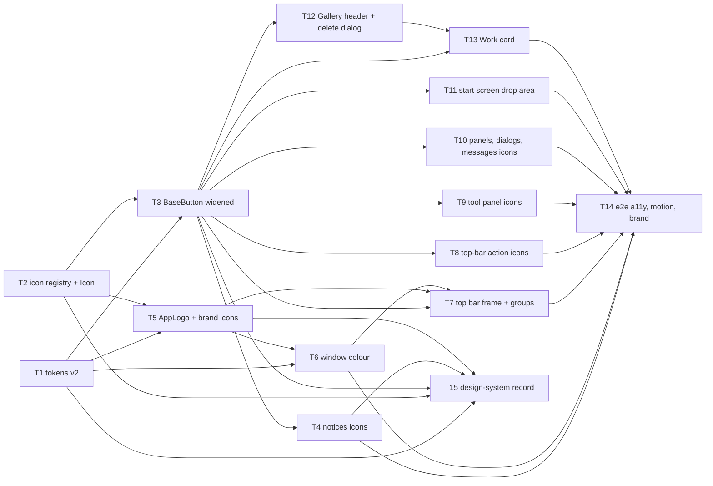

# Epic — ui-refresh

> **Spec:** [spec.md](../spec.md) · **Design:** [sad.md](../sad.md) · **Screens:** [screens.md](../screens.md) · **Data model:** none (no stored-data change, `sad.md §8`) · **API:** none (`target_surfaces: [web-frontend]`, no external interface) · **ADRs:** [adr/](../adr/)

## Goal

Ship roadmap step 11. A Portfolio reviewer recognises imgly as one branded product: the same mark in the top bar, the tab and the Installed app's icon. Every action carries an icon from one set without losing its name, shortcut or keyboard access. The start screen and the Gallery look finished. The Installed app's title bar and the top bar read as one strip in both themes (spec §2).

## Scope

- **In:** `src/shared/styles/tokens.css` (tokens v2), `src/shared/icons/` + `Icon` (new), `AppLogo` (new), `BaseButton` and `Toast` widened additively, every feature component that renders an action button, the top bar's frame and group order (`EditorTopBar`, `EditorView`, `App.vue`), the start screen drop area, the Gallery header and Work card, `index.html` + `vite.config.ts` (theme-color, icons), `public/icons/` + `scripts/render-icons.ts`, `e2e/ui-refresh/`, `docs/design-system.md`.
- **Out:** drawing into the title bar area (Window Controls Overlay), new behaviour or actions, a custom web font, mobile layouts beyond "does not break", an in-app theme switch, new information on the Work card (spec §3).

## Task map

**Waves.** 1: T1, T2 · 2: T3, T5 · 3: T4, T6, T8, T9, T10, T11, T12 · 4: T7, T13, T15 · 5: T14.
**Lanes (overlapping `files_hint`, serialized):** `EditorView.vue` — T7, T10, T11 · `GalleryList.vue` — T12 → T13 · `index.html` / `vite.config.ts` — T5 → T6 · `src/shared/ui/index.ts` — T2 → T5. No compile-coupled pair: every shared-type change (`BaseButton` props, `NoticeAction.icon`) is additive.

## Tasks

See [tracker.md](./tracker.md) for status. Machine contract: [tasks.json](../tasks.json).

| # | Task | Layer | Blocked by | DoD (short) |
|---|---|---|---|---|
| T1 | Tokens v2 with motion 0 under reduced motion | ui | — | tokens.test: durations ≤ 200 ms, 0 reduced, both themes |
| T2 | Typed Lucide registry + `Icon` | ui | — | 29 names render `aria-hidden` svgs |
| T3 | Widen `BaseButton` (icon, size, danger, busy, neutral disabled) | ui | T1, T2 | BaseButton.test covers every new prop; names unchanged |
| T4 | Notices: action icon, busy Spinner, icon-only Dismiss | ui | T3 | Toast/notices cases; Delete… and Reload have icons |
| T5 | `AppLogo` + favicon.svg + rendered PNG icons | ui | T1, T2 | AppLogo.test; five icon files linked |
| T6 | Two theme-color tags + manifest `#15122A` + guard test | wiring | T1, T5 | window-colour.test pins three files to the token |
| T7 | Top bar frame: logo, titlebar colour, four groups, Install before Export | ui | T3, T5, T6 | EditorTopBar.test + one updated App.test case |
| T8 | Icons on the seven top-bar actions | ui | T3 | one icon each, names unchanged, inline svgs gone |
| T9 | Icons on crop-rotate, adjust, draw panels | ui | T3 | icons on actions, none on choice controls |
| T10 | Icons on export panel, dialogs, zoom bar, Reload page | ui | T3 | icons, names and focus unchanged |
| T11 | Start screen drop area + scrim overlay + shared column | ui | T3 | EmptyCanvas.test; drop tests unedited |
| T12 | Gallery count + meter, Storage note, Close, danger confirmation | ui | T3 | meter counts damaged; danger Delete; Cancel focused |
| T13 | Work card: blurred backdrop, lift, Delete reveal, damaged, Open | ui | T3, T12 | GalleryEntry.test covers states and DOM order |
| T14 | e2e: contrast both themes, reduced motion, brand, top bar | tests | T4, T6–T11, T13 | three browsers green; size delta ≤ 15 KB recorded |
| T15 | Record tokens and primitives in `design-system.md` | docs | T1–T5 | canon matches code |

## Risks / Hard rules

- **Names and keyboard order unchanged** (spec §6, QG-2): every existing unit and e2e test passes without edit, except `src/app/App.test.ts`'s Install-app order case (T7).
- **0 hard-coded colours, spacing or fonts** in components outside `tokens.css` and the window colours in `index.html` / `vite.config.ts` (spec §6, ADR-0002).
- **0 runtime packages**, ≤ 15 KB compressed growth (spec §6). `@axe-core/playwright` (T14) is a devDependency only.
- **Motion** ≤ 200 ms per transition, 0 under reduced motion (spec §6, AC-14).
- **Module boundaries:** `src/shared/` imports `core` types only; features never import each other (CLAUDE.md).
- The branch is stacked on PR #11; rebase onto main once it merges, before T7 touches the top bar (`sad.md §11`).
