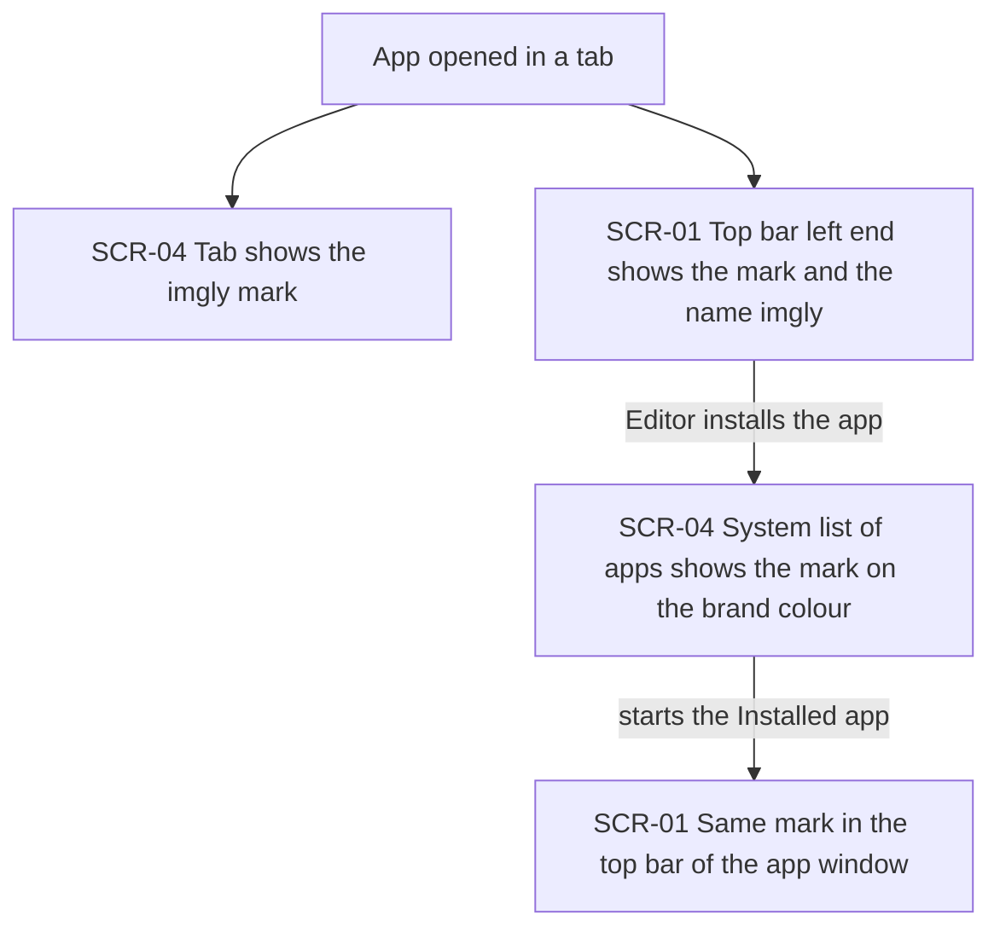
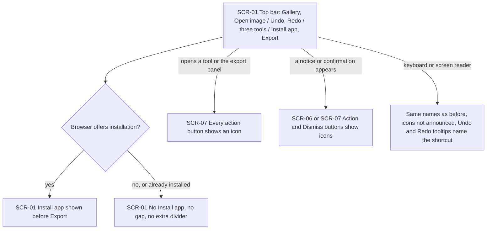
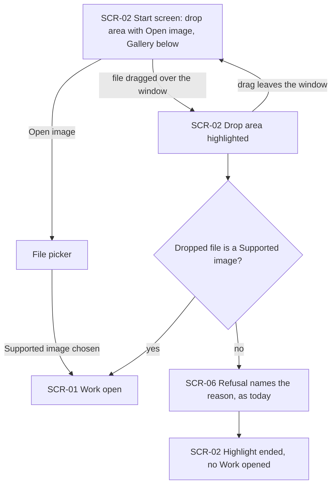
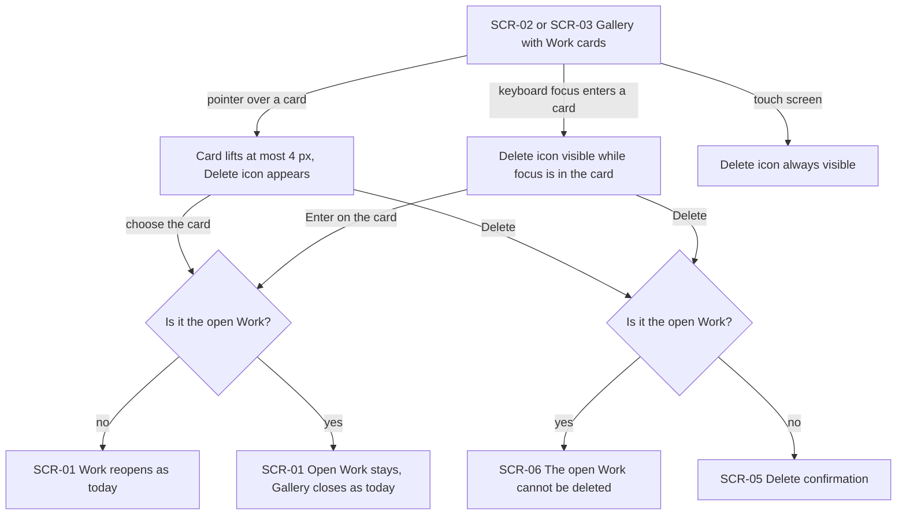
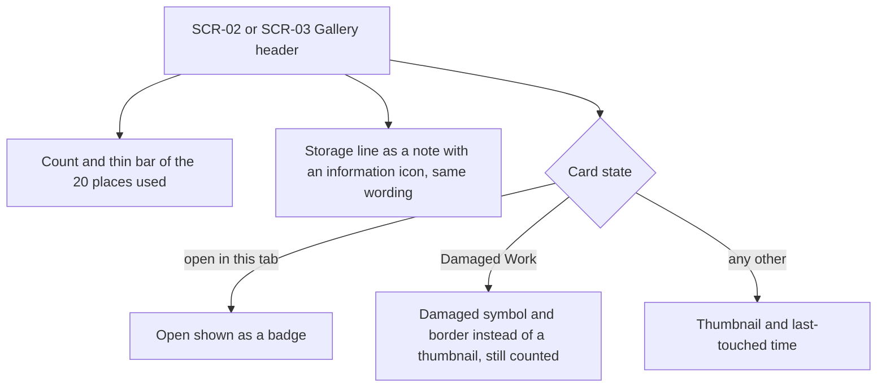
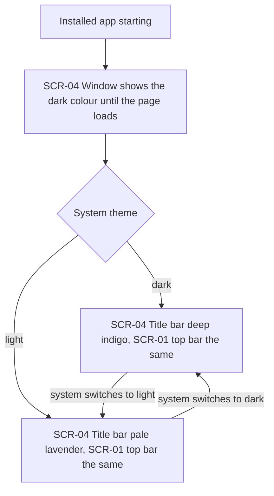
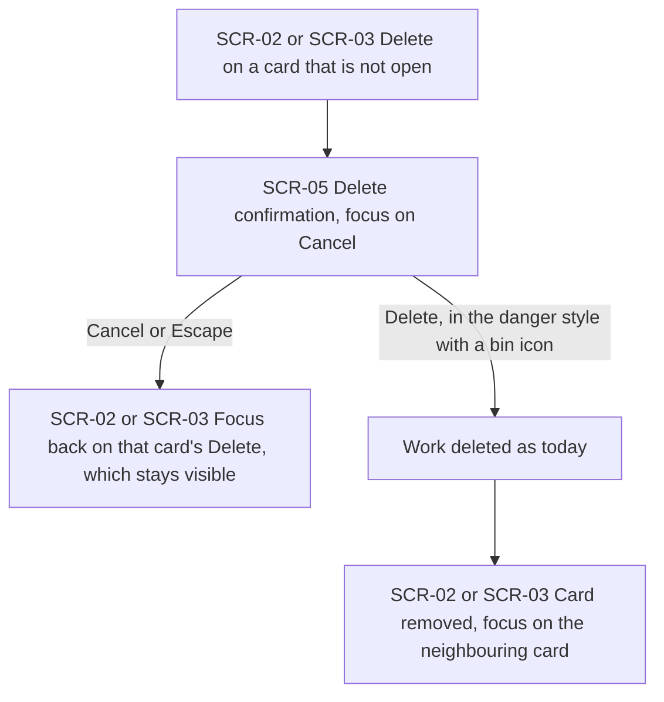
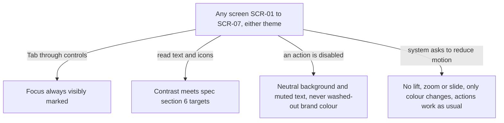

# UX flows — ui-refresh

> User flows for every UI-touching §4 user story, produced by `ux-flows` (after `clarify`, before
> `design`) and read by `design` (evidence for the target-surface + UI-architecture decisions),
> `sequences` (UI-driven flows align on SCR ids), `screens` (details every inventory row) and
> `plan-tests` (the e2e-through-UI paths). **Always markdown + mermaid `flowchart`**, whatever the
> design tool — this artifact is flow-altitude, not visual design.

## Platform decisions

- **Posture:** desktop-first, as in `docs/design-system.md` §Platform posture, confirmed by the owner on 2026-10-16. The flows cover a desktop browser tab and the Installed app's own window. The one touch-screen rule the spec adds is that a card's Delete is always visible where nothing can point (spec AC-06); there are no separate mobile flows (spec §3).
- **Navigation shape:** unchanged. One editor view with no page navigation; the start screen is what the editor shows with no Work open, and the Gallery opens over the editor when a Work is open. This feature adds no screen, no route and no new transition. It restyles the screens that already exist and the places outside the page that carry the brand mark.
- **Modality:** unchanged. The delete confirmation (SCR-05) stays the only dialog this feature restyles on purpose; every other dialog only gains icons on its buttons (spec AC-02). Notices keep the single notice boundary.
- **Keyboard order:** unchanged except one deliberate move: in the top bar, Install app now comes before Export, so Export ends the bar (spec AC-02, AC-03, §1 cross-feature change with pwa-install-update SCR-01).
- **Design input (Tech Lead flag, not decided here):**
  1. The window colour must follow the system theme while the app runs, and the top bar must use the same colour (AC-11). `design` decides how the page tells the browser the colour per theme, and what the window shows before the page loads.
  2. One icon set shared by every feature, without a runtime download (spec §6). `design` decides where it lives under the module boundaries.
  3. The shared button and the shared notice gain icons, sizes and a destructive style (spec §1). `design` decides the primitives' new options; `screens` decides their look; `design-system` records them.
  4. The card thumbnail shows the whole image over a blurred copy of itself (AC-06). `design` decides whether that copy comes from the existing thumbnail or needs anything new; the spec forbids new stored data (§3).
  5. The brand mark appears in places the browser and the operating system draw (tab, app icon, home-screen icon), so it is a set of image files as well as an in-page mark (AC-01).

## Screen inventory

| ID | Screen | Purpose | Entry | Exit |
|---|---|---|---|---|
| SCR-01 | Editor with its top bar | The existing editor, in a tab or in the Installed app, with the brand mark at the left end of the top bar and the actions in four groups | App start; closing any panel, dialog or the Gallery overlay | SCR-02 (no Work open), SCR-03 ("Gallery"), SCR-07 (a tool or the export panel opens), SCR-06 (a notice) |
| SCR-02 | Start screen | What the editor shows with no Work open: the drop area with "Open image", and the Gallery list below it with its header, Storage line and Work cards | App start with no Work open; the open Work is closed or deleted elsewhere | SCR-01 with a Work open (open, drop or reopen), SCR-05 (a card's Delete), SCR-06 (a refusal) |
| SCR-03 | Gallery overlay | The same Gallery list shown over the editor while a Work is open | "Gallery" on SCR-01 | SCR-01 ("Close", or a card chosen), SCR-05 (a card's Delete), SCR-06 (a refusal) |
| SCR-04 | Brand surfaces outside the page | The browser tab, the system's list of apps and the Installed app's window title bar, which carry the mark or the brand-tinted colour | Opening the app in a tab; installing it; starting the Installed app | — (not navigated; shown alongside SCR-01) |
| SCR-05 | Delete confirmation | Asks whether to delete a Work, with a destructive confirm and a cancel that holds the initial focus | A card's Delete on SCR-02 or SCR-03 | SCR-02 or SCR-03 (cancel returns focus to that card's Delete; confirm removes the card) |
| SCR-06 | Notices | The existing notices, restyled with icons on their action and Dismiss buttons: refusals (the open Work cannot be deleted, an image that is not a Supported image), information and the update notice | Any refusal or information from the flows above | The screen it was shown over |
| SCR-07 | Tool panels, export panel, other dialogs and full-screen messages | The existing surfaces whose buttons all gain icons: Crop and rotate, Adjust and Draw panels, the export panel, the replace and reload confirmations, and the full-screen messages such as "Reload page" | Opening a tool or the export panel; a confirmation or blocking condition | SCR-01 |

## Flows

### Flow: US-01 — Recognise the product

Opening the app in a tab shows the imgly mark on the tab and the mark with the name "imgly" at the left end of the top bar. Once installed, the system's list of apps shows the same mark on the brand colour, and starting the Installed app shows the same top bar. No generic picture symbol remains in any of those four places (AC-01).

### Flow: US-02 — Understand actions at a glance

The top bar shows four groups left to right, in the same keyboard order: Gallery and Open image; Undo and Redo; the three tools; Install app and Export, with Export last (AC-02). Where the browser offers installation, Install app sits before Export; where it does not, or the app already runs installed, no Install app is shown and no gap or divider is left (AC-15). Every tool panel, the export panel, every confirmation, notice and full-screen message shows an icon on each action button (AC-02). A keyboard or screen-reader user reaches every button by the same name as before; only Undo, Redo and a card's Delete are icon-only, each with a tooltip (AC-03).

### Flow: US-03 — Start from a clear place to open an image

With no Work open, the start screen shows a drop area with an image icon, a heading, the "Open image" button and the drop hint, lined up with the Gallery below (AC-04). Only the button opens the file picker; the area adds no keyboard stop. Dragging a file anywhere over the window highlights the drop area; dropping a Supported image opens it. Dropping anything else ends the highlight, opens nothing and shows the existing refusal with its reason (AC-05).

### Flow: US-04 — Browse my Works as cards

Each Work appears as a card of the same shape, with the whole image over a blurred copy of itself, its name and the same second line as today (AC-06). Pointing lifts the card by at most 4 px and shows its Delete icon; keyboard focus anywhere in the card shows it too, and on a touch screen it is always shown (AC-06, AC-07). Choosing a card, or pressing Enter on it, reopens the Work exactly as today (AC-07). Delete on the open Work's card looks unavailable, deletes nothing and shows the existing reason (AC-08); Delete on any other card opens the confirmation, drawn in US-07.

### Flow: US-05 — See the Gallery's state honestly

The Gallery header shows how many of the 20 places are used as a count and a thin bar, and a Damaged Work still counts (AC-09). The Storage line keeps its wording and appears as a note with an information icon (AC-10). Each card's second line is as today: the open Work's "Open" becomes a badge (AC-08), a Damaged Work shows the damaged symbol and border instead of a thumbnail (AC-09), and every other card shows when it was last touched (AC-06).

### Flow: US-06 — One surface in the Installed app

While the Installed app starts, the window may show the dark colour. Once the page has loaded, the title bar and the top bar share one colour: deep indigo in the dark theme, pale lavender in the light theme, and they follow a theme change while the app is open, with no contrasting band between them (AC-11). This holds in Chromium-based desktop browsers, and in Safari's installed app as far as Safari allows.

### Flow: US-07 — Recognise destructive actions

Delete on a card that is not open opens the confirmation. Its confirming button is in the danger style with a bin icon, and Cancel holds the initial focus (AC-12). Cancelling returns focus to that card's Delete, which stays visible while it has focus (AC-07). Confirming deletes the Work as today and moves focus to the neighbouring card (AC-12).

### Flow: US-08 — Use the new look with the keyboard and assistive technology

On every screen and in both themes, keyboard focus is always visibly marked and text and icons meet the contrast targets of spec §6 (AC-13). A disabled action such as Export with no image looks unavailable through a neutral background and muted text (AC-13). When the system asks to reduce motion, nothing lifts, zooms or slides; only colours change, and every action works as usual (AC-14). Names and keyboard order are covered in US-02 (AC-03).

## AC coverage

| AC | Shown by | Notes |
|---|---|---|
| AC-01 | Flow US-01 → every node | Four brand places: top bar, tab, app icon, home-screen icon |
| AC-02 | Flow US-02 → A, E, F | Top-bar groups and order; icons on every action button |
| AC-03 | Flow US-02 → G | Names, tooltips, keyboard order with the one Install app move |
| AC-04 | Flow US-03 → A | Drop area, button-only picker, no keyboard stop |
| AC-05 | Flow US-03 → E "no" → F → G | Existing refusal, highlight ends |
| AC-06 | Flow US-04 → A, B, D; Flow US-05 → G | Same-shape cards, whole image, lift ≤ 4 px, touch rule |
| AC-07 | Flow US-04 → C → E "no" → F; Flow US-07 → C | Focus-within visibility, reopen as today |
| AC-08 | Flow US-04 → H "yes" → I; Flow US-05 → E | Open badge; refusal as today |
| AC-09 | Flow US-05 → B, F | Count and bar; Damaged Work counted |
| AC-10 | Flow US-05 → C | Storage line note, wording unchanged |
| AC-11 | Flow US-06 → every node | Chromium required, Safari best effort, dark at start-up |
| AC-12 | Flow US-07 → B, D, E | Danger style, Cancel focused |
| AC-13 | Flow US-08 → B, C, D | Focus, contrast, disabled look |
| AC-14 | Flow US-08 → E | Reduced motion |
| AC-15 | Flow US-02 → B "no" → D | No Install app, no gap, no extra divider |
