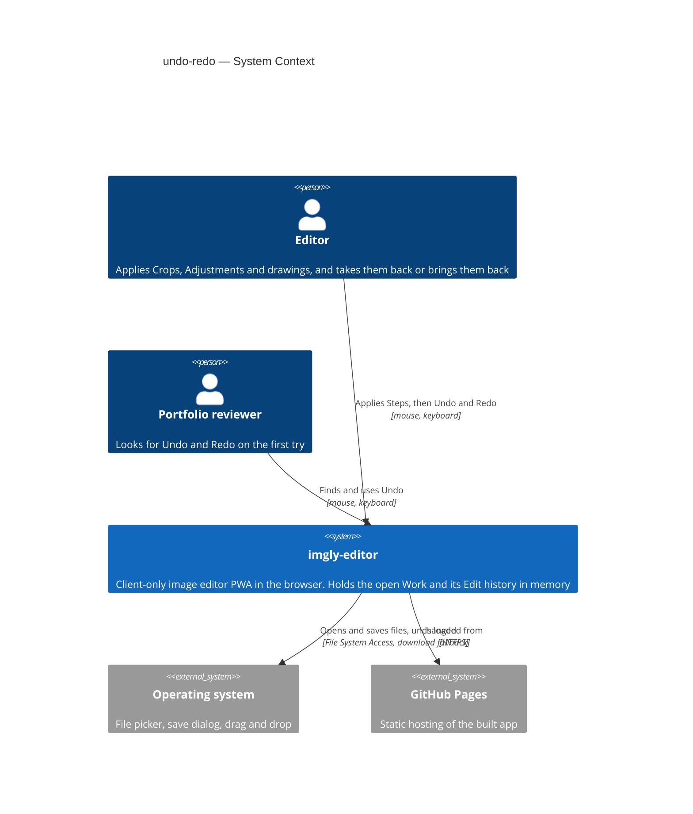
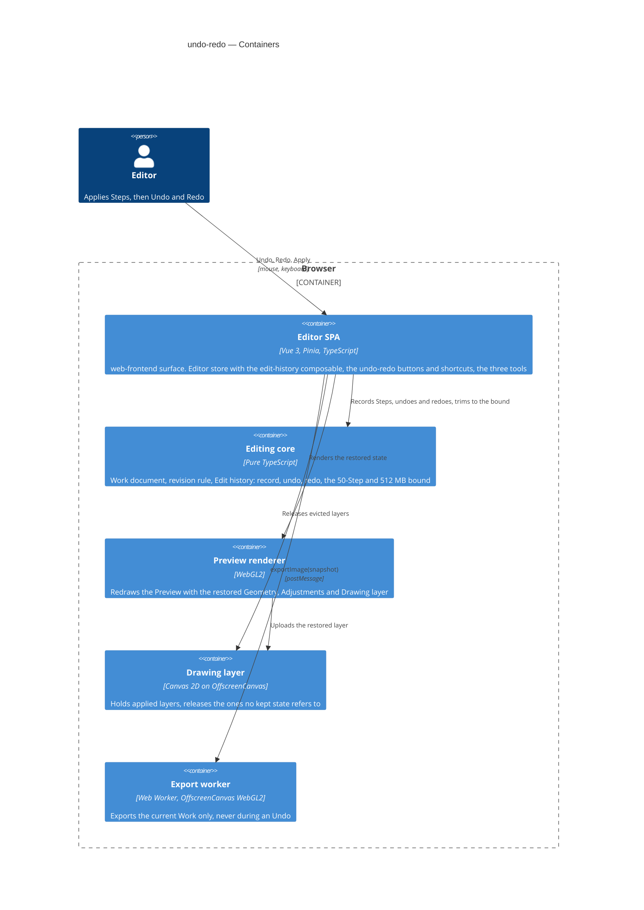

# Software Architecture Document — undo-redo

<!-- 12 Arc42 sections. Empty section → <!-- N/A: <one-line reason> -->. -->
<!-- C4 Context (L1) lives inline in §3. C4 Container (L2) lives inline in §5. -->
<!-- Numbers in §10 come VERBATIM from spec.md §6 NFR — no inventing, no rounding. -->

## 1. Introduction and goals

**Intent.** undo-redo gives the Editor a linear Edit history of applied Steps for the open Work (spec §1). Every Apply of "Crop and rotate", "Adjust" or "Draw" that counts as an edit is one Step (draw ADR-0005). Undo takes back the last Step and Redo restores it. Both are reached from two buttons in the top bar, or with Ctrl/Cmd+Z and Shift+Ctrl/Cmd+Z (also Ctrl+Y on Windows and Linux). Undo and Redo are exact: the Work returns to precisely the state it had, so the Preview and every Export match it pixel for pixel. A new Step after an Undo discards the Steps that could have been redone. The Edit history lasts only while the Work is open: replacing the Work clears it, and it is never saved. It keeps up to 50 Steps within a 512 MB budget of image data, and drops the oldest first. A successful Export marks the save point, and undoing or redoing back to it clears Unsaved edits (CONTEXT: Edit history, Step, Unsaved edits). This closes the open questions in export §8, crop-rotate §8 and draw §8. It also gives the Gallery (roadmap step 8) a clear line: the Gallery keeps Works, and this history keeps the Steps of the open Work only.

**Top-3 quality goals (1-liners; full scenarios in §10):**

1. **Exact undo and redo**: an Undo or Redo restores the Work exactly. A full-size PNG Export afterwards differs by 0 per channel from the Export of the same state made before, on Chromium, Firefox and WebKit, for Steps of each tool.
2. **Bounded, leak-free memory**: the Edit history holds ≤ 512 MB of image data, keeps at least the last 10 Steps that draw over the whole image (and up to 50 Steps), and releases every layer that no kept Step, the Work or an open Draft refers to.
3. **Responsive Undo and Redo**: from choosing Undo or Redo to the updated Preview, p95 ≤ 150 ms for a Step of each tool, with a drawing over the whole image.

A fourth goal is a correctness rule rather than a quality trade-off, and §10 covers it as QG-4: what the app says about saving stays honest. The Work has no Unsaved edits only at its save point (spec §2).

**Stakeholders.**

| Role | Interest | Sign-off owner? |
|---|---|---|
| Editor | Tries a Crop, an Adjustment or a drawing without fear: one keystroke takes back a wrong Apply, exactly, and the app's Unsaved-edits warning stays honest after undoing | No |
| Portfolio reviewer | Finds Undo and Redo on the first try, in the top bar or with the usual shortcuts, and takes a change back in at most one action (AC-14) | No |
| Tech Lead | SAD approval. The Step model, the memory bound and the revision rule change the editor store's apply paths and the layer lifetime of draw ADR-0004, and the Gallery (step 8) inherits them | Yes |
| Security Lead | Spec §6.1: the Edit history keeps earlier states of confidential photos, including removed marks, in session memory only. It is never saved, never leaves the device, and is bounded against resource exhaustion. No full security review is needed | Yes |

<!-- Decision overrides (¶4) — populated by the critic resolution loop, empty otherwise. -->

## 2. Constraints

**Technical.**
- TypeScript 5.9 (`strict`), Node 24 toolchain, pnpm — repo ADR [0001](../../adr/0001-build-a-client-only-vue-pwa.md)
- Vue 3.5 (Composition API, `<script setup>`), Pinia 4 setup stores, Vite 8. Client-only PWA with no backend (ADR 0001)
- The Preview and the Export share one WebGL2 program (geometry, Adjustments, Drawing layer), so the same Work values give the same pixels (repo ADR [0004](../../adr/0004-render-adjustments-on-webgl2-and-drawing-on-canvas2d.md), crop-rotate ADR-0002, draw ADR-0003)
- A Drawing layer is one `OffscreenCanvas` bitmap of the Original's size (draw ADR-0001): up to 4096 × 4096 × 4 B = 64 MB, and 4096 × 3072 × 4 B = 50 331 648 B on the reference Work. Once applied it is never painted again (draw ADR-0004)
- The Work is an immutable value that the `editor` store swaps on every edit. Unsaved edits are `revision !== cleanRevision` (open-and-view ADR-0005, `src/core/document.ts`)
- No persistence: the Edit history lives in memory only, and IndexedDB is not touched (spec §3, §6.1)
- Architecture convention: functional core with feature folders (repo ADR [0002](../../adr/0002-organize-code-as-functional-core-with-feature-folders.md)). `src/core/` is pure TypeScript with no Vue, Pinia or DOM. Features never import each other and coordinate through the `editor` store, and there is no event bus

**Organisational.**
- Owner: Blazheiko, working alone with the SDD pipeline
- Size S (`.size`), route `quick` (`.route`): about one week and 2–5 PRs, per the size matrix
- No deadline: the roadmap orders steps by dependency and gives no dates (`docs/roadmap.md`, step 7)

**Conventions.**
- `CLAUDE.md` (module boundaries, `Result`/`AppError`, `newId()`, styling with tokens and `src/shared/ui/` primitives, co-located Vitest tests, e2e only for what happy-dom can't do) and `docs/architecture-map.md` §Conventions
- Resource lifetime: call `releaseLayer()` (`src/render/drawing/layer.ts:69`) before dropping a Drawing layer. In DEV and e2e builds the bitmap ledger counts layers created and released (`src/shared/bitmap-ledger.ts`)
- Shortcuts follow the existing per-feature `shortcuts.ts` pattern: skip text fields, ignore held-key repeats, and show refusals as info notices through `useNotices` (draw AC-15, AC-16)

**Regulatory / external.**
- Spec §6.1: the data is confidential and no new personal data is touched. The Edit history holds earlier Geometries, Adjustments and Drawing layers of the open Work in session memory only. It is discarded when the Work is replaced or the page is closed
- Abuse-case controls: Undo and Redo are refused during an export (AC-07), and the history is bounded to 50 Steps and 512 MB (AC-11). Security review: N/A (spec §6.1)

## 3. Context and scope

The Editor crops, adjusts and draws on a photo with three tools, and each Apply changes the Work at once. undo-redo lets the Editor take any applied change back and bring it back again, exactly, inside the one open Work. The Portfolio reviewer expects Ctrl/Cmd+Z to work as in any desktop editor. Nothing about this feature crosses the browser tab: the Edit history is in-memory state of the existing client-only app.

<!-- brownfield: scan = docs/architecture-map.md at 3f248c2 (no src/ change since; HEAD 186422d adds docs only). The editor store already swaps an immutable Work on every Apply (src/features/editor/store.ts:209, :242, :257) and applied layers are immutable (draw ADR-0004), so earlier states can be kept by reference. -->

**External systems (in / out):**

| Actor or system | Type | Interaction |
|---|---|---|
| Editor | Person | Applies Steps with the three tools, then undoes and redoes them with the top-bar buttons or the shortcuts |
| Portfolio reviewer | Person | Looks for Undo and Redo in the top bar and with Ctrl/Cmd+Z, and takes one change back |
| Operating system | System (external) | Unchanged: file picker, save dialog and drag and drop for opening and exporting. Undo and Redo use no OS API |
| GitHub Pages | System (external) | Unchanged: serves the static app over HTTPS |

External: no new external system. The Edit history never leaves the tab, and it is never written to IndexedDB or any other store (deliberate, spec §3).

**C4 Context (L1):**



## 4. Solution strategy

**Target surface and UI architecture.** `target_surfaces: [web-frontend]`. This is the existing Editor SPA: the spec's only actors are the Editor and the Portfolio reviewer in a desktop browser, and `ux-flows.md` changes only the editor screens SCR-01 to SCR-05. It is one surface and adds no new container, so it has no ADR. The UI architecture is inherited, not decided here: a client-only Vue 3 SPA with Pinia setup stores (repo ADR 0001), whose top-bar actions mount into `EditorView`'s `top-bar-actions` slot from `App.vue`. The two buttons reuse `BaseButton` and the tokens, following `docs/design-system.md`.

**Top strategic choices (the seeds for ADRs):**

1. **Record the Edit history as snapshots of the Work's edited state** ([ADR-0001](adr/0001-record-the-edit-history-as-snapshots-of-the-works-edited-state.md)). Each kept state is `{ geometry, adjustments, drawing, revision }`, and each Step carries the tool that made it. Undo puts the previous state back into the Work, and Redo puts the next one back. Exactness (quality goal 1) holds by construction, because the restored values and layer objects are the very ones the Preview and the Export used before, and nothing is recomputed. A state costs a few hundred bytes plus a reference to an immutable layer (draw ADR-0004).
2. **Keep whole applied layers by reference, and bound the history by 50 Steps and 512 MB** ([ADR-0002](adr/0002-keep-whole-layers-by-reference-and-bound-the-history-by-50-steps-and-512-mb.md)). The budget counts w × h × 4 bytes for each distinct layer the kept states hold, except the layer the Work currently shows. With this rule, k Steps never hold more than k counted layers, so 10 drawing Steps on the reference Work take 503 316 480 B ≤ 512 000 000 B (AC-11, quality goal 2). An Undo is a reference swap plus one texture upload (quality goal 3).
3. **Make the revision a never-reused state id that Undo and Redo restore** ([ADR-0003](adr/0003-make-the-revision-a-never-reused-state-id-that-undo-and-redo-restore.md)). Each new Step takes the next number from a high-water mark (the highest revision ever issued), so a number never returns. Undo and Redo bring back the state's own revision, and Export keeps setting `cleanRevision`. `hasUnsavedEdits` is unchanged, and AC-09 follows from it (QG-4). This replaces the clause of open-and-view ADR-0005 that undo and redo raise the revision.
4. **Run the history rules in `core`, own the history in the `editor` store, and add an `undo-redo` feature for the controls** ([ADR-0004](adr/0004-run-the-history-in-core-own-it-in-the-editor-store-and-add-an-undo-redo-feature.md)). `src/core/history/` holds the pure rules. An `edit-history.ts` composable in the editor feature records a Step inside `applyGeometry`, `applyAdjustments` and `applyDrawing` and releases evicted layers. `src/features/undo-redo/` holds the buttons, the shortcuts and the copy. The three tools do not change, because they already apply through the editor store.

**Tactical rules that follow from these (inline, no ADR; assumptions ledger L5, L7, L10):**

- **When Undo and Redo are available:** a Work is open, no tool is open (AC-08), no export is running (AC-07) and the replace dialog is closed. They stay available while an image is being read and under the open export panel. The panel's size field already follows the Work through a `computed` (AC-14 "from anywhere in the editor").
- **View:** an Undo or Redo that changes the image's size fits the View, as a "Crop and rotate" Apply does. Any other Undo or Redo keeps the View (AC-06, AC-12).
- **One release path:** a layer leaves memory only when no kept state refers to it, and the `edit-history` composable is where that is decided. `applyDrawing` stops releasing the previous layer itself. An Apply of "Draw" with no change keeps the Work's current layer and releases the Draft, which has the same content, so no kept state ever refers to a released layer.

Each tactical decision in later sections should trace to one of these seeds. Tactical decisions that *contradict* a strategic choice are red flags — surface them in §11.

## 5. Building block view

The style is the repo's functional core with feature folders (repo ADR 0002), with no divergence. The rules of the Edit history are pure functions in `core`, tested without Vue. The `editor` store, already the coordination hub, owns the one history instance, because every Step starts in one of its `apply*` actions and features may not import each other. As `tool-slot.ts` did for the tool slot, the history is a composable that the store composes, so the store file itself grows only by the wiring. The controls are a thin new feature that reads and calls the store, like the existing top-bar actions.

**Internal decomposition:**

```
src/core/
├── document.ts             WorkState = { geometry, adjustments, drawing, revision }; editStateOf(work),
│                           withState(work, state); withEdit(work, revision, now) takes the new revision
└── history/                pure, generic over the Step label (the editor passes ToolId)
    ├── history.ts          EditHistory<L>: entries [{ state, label }], cursor; createHistory(base),
    │                       record() → { history, evicted }, undo(), redo(), canUndo/canRedo,
    │                       undoLabel/redoLabel
    ├── budget.ts           HISTORY_MAX_STEPS = 50, HISTORY_BUDGET_BYTES = 512_000_000,
    │                       heldLayerBytes(history), trim() → evicted (oldest first)
    └── index.ts
src/features/editor/
├── edit-history.ts         composable: the history shallowRef, the revision high-water mark, record on
│                           apply*, undo()/redo() into the Work, fit on a size change, clear on
│                           replace, releaseLayer() for evicted layers that no kept state refers to
└── store.ts                apply* record a Step when they count as an edit; replace() clears the history;
                            exposes canUndo, canRedo, undoTool, redoTool, undo, redo
src/features/undo-redo/     new feature: the controls only
├── UndoRedoActions.vue     two BaseButtons in the top bar; hints name the tool and the shortcut
├── shortcuts.ts            Ctrl/Cmd+Z, Shift+Ctrl/Cmd+Z, Ctrl+Y off Mac; skips text fields and repeats;
│                           refusal hints as info notices
├── messages.ts             labels, hints and the tool names ("Crop and rotate", "Adjust", "Draw")
└── index.ts
src/shared/keyboard.ts      isTextTarget, moved to shared so undo-redo can use it (ledger L8)
src/app/App.vue             mounts <UndoRedoActions /> in the top-bar-actions slot
src/app/test-hooks.ts       exposes the history's held bytes and Step count for e2e (ledger L11)
```

**C4 Container (L2):** the `web-frontend` surface is the Editor SPA container. Every other container already exists (architecture map). This feature adds the Edit history to the Editing core and changes how the SPA and the Drawing layer lifecycle release layers.



The diagram shows the Editor using the Editor SPA. The SPA records Steps and undoes or redoes them through the Editing core, which also trims the history to its bound. The SPA has the Preview renderer redraw the restored state, and the renderer uploads the restored layer from the Drawing layer container. The SPA releases evicted layers there, and it hands only the current Work to the Export worker.

## 6. Runtime view

<!-- 🎯 Why: the RUNTIME FLOW of 1–2 critical scenarios — who talks to whom, when, in what order.
     Without §6, §5 is just boxes with no life.
     📋 Write: a Mermaid sequenceDiagram. Participants are names from §5 (don't invent new ones).
     Messages are semantic («saves a draft»), NO HTTP verbs / paths / status codes — endpoint-level
     sequences arrive at the `api` stage.
     📌 e.g. «author → web: composes draft → web → content API: save». Seed the primary flow(s) here;
     the `sequences` stage then covers every §5 AC (no cap). Never N/A for M+; XS/S keeps ≥1 happy-path flow. -->

**Critical flow 1: <flow name>**

```mermaid
sequenceDiagram
    actor Actor
    participant Web
    participant Service
    participant Store
    Actor->>Web: <action>
    Web->>Service: <call>
    Service->>Store: <write>
    Store-->>Service: ok
    Service-->>Web: result
    Web-->>Actor: confirmation
```

**Critical flow 2: <e.g. async event propagation>** — <if applicable, otherwise N/A>.

## 7. Deployment view

<!-- 🎯 Why: the TOPOLOGY DevOps must know without reading the deploy charts — how many replicas,
     where the background worker lives, AT WHAT NUMBERS we scale.
     📋 Write: 2–3 sentences on topology + monitoring + concrete threshold numbers.
     📌 e.g. «500 authors → partition by quarter» (not «we'll think about scale later»).
     🎯 N/A allowed for XS/S that reuses an existing deployment unit with no change.
     Deployment-diagram scaffold → templates/deployment.md. -->

<Topology in 2–3 sentences. Where it runs, replicas, scaling thresholds.>

**Monitoring:**
- <Metrics — e.g. `<metric_name>`>
- <Alerts — e.g. «worker lag > 10 min → page on-call»>
- <Tracing — e.g. spans on the request boundary>

**Scaling thresholds:**
- <e.g. comfortable in one table up to N rows/year>
- <e.g. partition by quarter above N rows/year>

<!-- For XS/S with no deployment change: <!-- N/A: reuses existing deployment unit, no infra change --> -->

## 8. Crosscutting concepts

<!-- 🎯 Why: CROSS-CUTTING PATTERNS spanning several modules: logging, errors, authorization, ID
     strategy, events, caching. ⭐ The second-densest section. A pattern inside one module is NOT
     here; a project-wide convention belongs in the convention file.
     📋 Write: a table — concept / convention / where defined. One row per concept.
     📌 e.g. «sortable time-based IDs generated in the app layer» as a default from the convention file. -->

| Concept | Convention | Where defined |
|---|---|---|
| Logging | <e.g. structured, fields `module=<name>`> | <convention file §X or here> |
| Authentication | <e.g. token-based via middleware> | <convention file §X> |
| Error handling | <e.g. domain sentinel → ports error mapping → JSON> | <convention file §X> |
| ID strategy | <e.g. sortable time-based ID in the app layer> | <convention file §X> |
| Internationalisation | <e.g. N/A, single language> | — |
| Observability | <e.g. tracing on the request boundary> | — |
| Events | <module-specific patterns, if any> | <here> |

## 9. Architecture decisions

<!-- 🎯 Why: the REVERSE INDEX onto the adr/ folder. `ls adr/` gives the files; §9 gives the
     semantics — why they exist, which SAD section they attach to, what status.
     📋 Write: a 4-column table, one row per ADR. Mixed status is fine.
     📌 e.g. «0001 | Store content as a table of typed blocks | Accepted | §4». -->

| # | Title | Status | Section |
|---|---|---|---|
| <NNNN> | <imperative — e.g. "Use a sliding-window counter for rate limiting"> | Accepted | §<N> |
| <NNNN> | <imperative — e.g. "Co-locate the worker in the API process"> | Accepted | §<N> |

ADR files live under `docs/features/<slug>/adr/NNNN-<title>.md`.

## 10. Quality requirements

<!-- 🎯 Why: the QUALITY TREE — take a goal from §1 and break it into concrete leaves: tests,
     metrics, configs, drills. ⭐ Without §10, §1 is a manifesto. With §10 each declaration maps
     to something PROVABLE.
     📋 Write: per §1 goal — When / Then / How-verify. Numbers from spec §6 NFR VERBATIM (don't
     round ≤250ms to ≤300ms — that's a critic F6 hit).
     📌 e.g. «p95 ≤ 500 ms on a block update, verified by a 100 req/s load test». -->

Each top-3 goal from §1 expanded into a full scenario:

**QG-1. <quality attribute>**
- **When:** <trigger condition>
- **Then:** <expected behaviour with numbers from spec §6 NFR>
- **How verify:** <test / chaos drill / load test / metric>

**QG-2. <quality attribute>**
- **When:** <trigger>
- **Then:** <expected>
- **How verify:** <how>

**QG-3. <quality attribute>**
- **When:** <trigger>
- **Then:** <expected>
- **How verify:** <how>

## 11. Risks and technical debt

<!-- 🎯 Why: ⭐ collects EVERYTHING that can break — not only the technical. Without §11 risks get
     discussed at standups and lost; debt lives only in the head of whoever accepted it.
     📋 Write: a risk/debt table — severity — mitigation — owner. Accepted debt in its own block.
     📌 The first risk is often a product risk, not a technical one. That's normal. -->

<!-- Severity literals: Low / Medium / High for regular risks; "Open question" for rows created by
     a Save-as-OQ resolution during the Socratic walk (see references/socratic.md). -->

| Risk / debt | Severity | Mitigation | Owner |
|---|---|---|---|
| <e.g. Worker lag may reach hours during a downstream outage> | Medium | <alert >10 min, on-call playbook, retry backoff> | <DevOps> |
| <e.g. No event-schema versioning in v1> | Medium | <ADR-NNNN planned for v2, tolerate unknown fields> | <Backend> |
| Open architectural decision: <decision-headline> | Open question | Resolve before <stage trigger or YYYY-MM-DD>; <inline rationale from the Save-as-OQ> | <owner> |

**Accepted debt (acceptable in v1, plan to fix later):**
- <e.g. the entity is immutable / unversioned — OK for v1, may need audit versioning in v2>

## 12. Glossary

<!-- 🎯 Why: ⭐ the DOMAIN GLOSSARY that ends arguments a year later («checkpoint — weekly or
     biweekly? quarter — calendar or fiscal?»).
     📋 Write: a term / meaning table. Business + technical terms mixed.
     📌 e.g. «Lesson | a unit inside a course made of blocks (text, video)». -->

| Term | Meaning |
|---|---|
| <e.g. domain object A> | <its meaning in this domain> |
| <e.g. domain object B> | <its meaning> |
| <e.g. domain invariant name> | <the rule, in plain language> |
