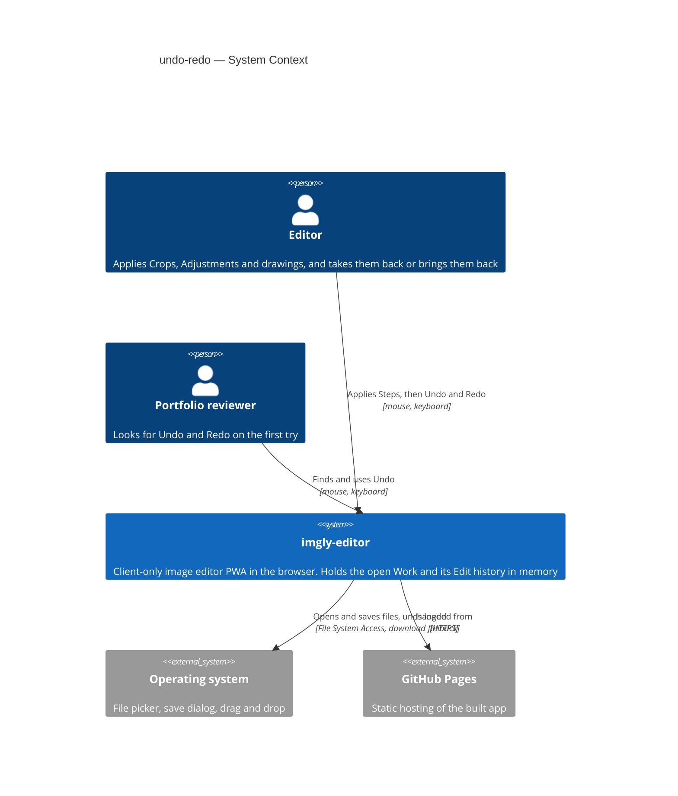
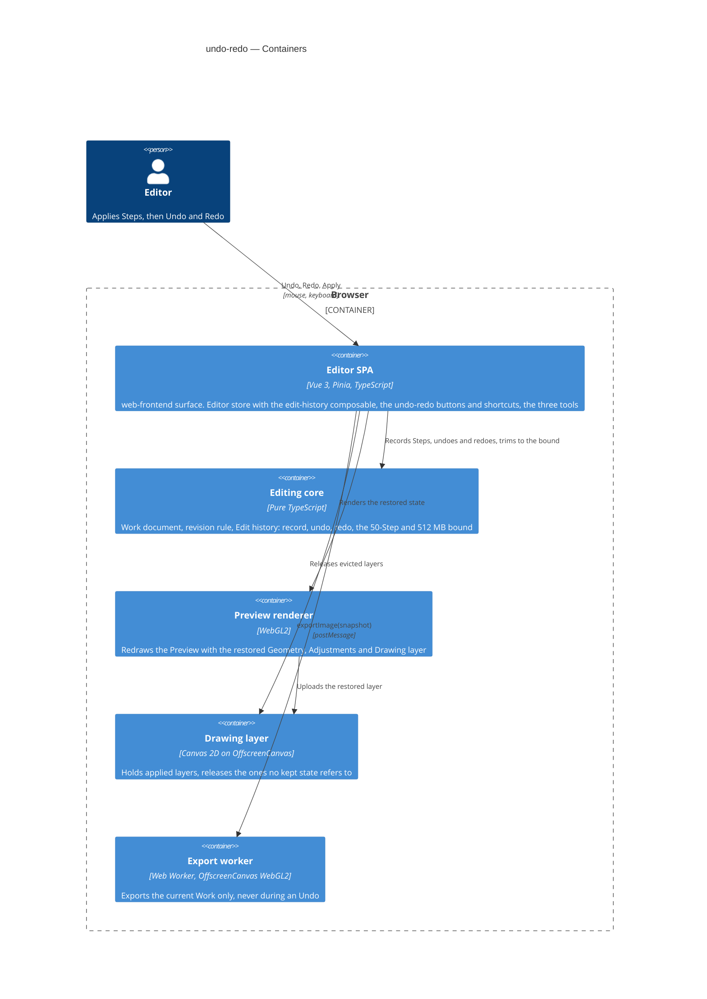
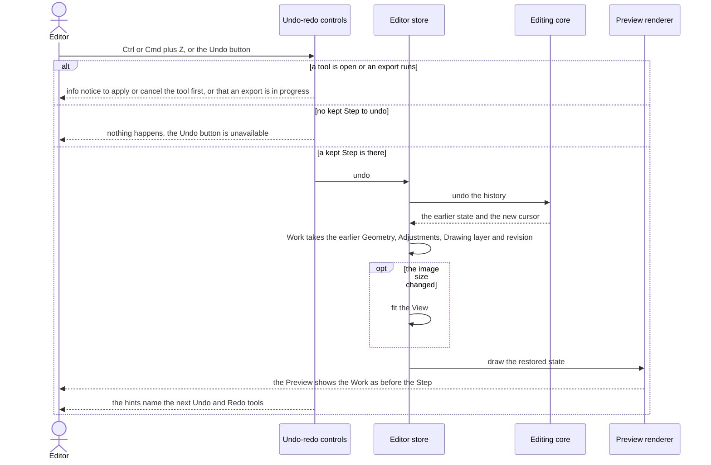
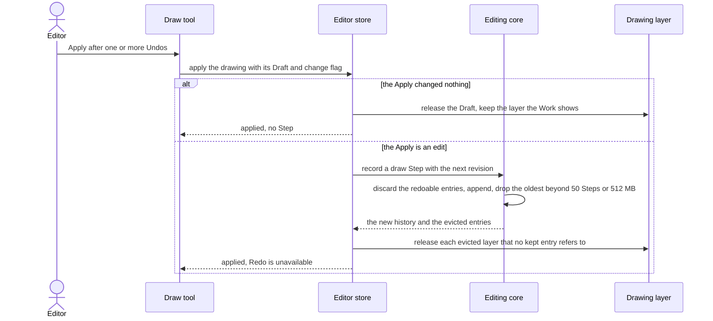

# Software Architecture Document — undo-redo

<!-- 12 Arc42 sections. Empty section → <!-- N/A: <one-line reason> -->. -->
<!-- C4 Context (L1) lives inline in §3. C4 Container (L2) lives inline in §5. -->
<!-- Numbers in §10 come VERBATIM from spec.md §6 NFR — no inventing, no rounding. -->

## 1. Introduction and goals

**Intent.** undo-redo gives the Editor a linear Edit history of applied Steps for the open Work (spec §1). Every Apply of "Crop and rotate", "Adjust" or "Draw" that counts as an edit is one Step (draw ADR-0005). Undo takes back the last Step and Redo restores it. Both are reached from two buttons in the top bar, or with Ctrl/Cmd+Z and Shift+Ctrl/Cmd+Z (also Ctrl+Y on Windows and Linux). Undo and Redo are exact: the Work returns to precisely the state it had, so the Preview and every Export match it pixel for pixel. A new Step after an Undo discards the Steps that could have been redone. The Edit history lasts only while the Work is open: replacing the Work clears it, and it is never saved. It keeps up to 50 Steps within a 512 MB budget of image data, and drops the oldest first. A successful Export marks the save point, and undoing or redoing back to it clears Unsaved edits (CONTEXT: Edit history, Step, Unsaved edits). This closes the open questions in export §8, crop-rotate §8 and draw §8. It also gives the Gallery (roadmap step 8) a clear line: the Gallery keeps Works, and this history keeps the Steps of the open Work only.

**Top-3 quality goals (1-liners; full scenarios in §10):**

1. **Exact undo and redo**: an Undo or Redo restores the Work exactly. A full-size PNG Export afterwards differs by 0 per channel from the Export of the same state made before, on Chromium, Firefox and WebKit, for Steps of each tool.
2. **Bounded, leak-free memory**: the Edit history holds ≤ 512 MB of image data, keeps at least the last 10 Steps that draw over the whole image (and up to 50 Steps), and releases every layer that no kept Step, the Work or an open Draft refers to.
3. **Responsive Undo and Redo**: from choosing Undo or Redo to the updated Preview, p95 ≤ 150 ms for a Step of each tool, with a drawing over the whole image.

A fourth goal is a correctness rule rather than a quality trade-off, and §10 covers it as QG-4: what the app says about saving stays honest. The Work has no Unsaved edits only at its save point (spec §2).

**Stakeholders.**

| Role | Interest | Sign-off owner? |
|---|---|---|
| Editor | Tries a Crop, an Adjustment or a drawing without fear: one keystroke takes back a wrong Apply, exactly, and the app's Unsaved-edits warning stays honest after undoing | No |
| Portfolio reviewer | Finds Undo and Redo on the first try, in the top bar or with the usual shortcuts, and takes a change back in at most one action (AC-14) | No |
| Tech Lead | SAD approval. The Step model, the memory bound and the revision rule change the editor store's apply paths and the layer lifetime of draw ADR-0004, and the Gallery (step 8) inherits them | Yes |
| Security Lead | Spec §6.1: the Edit history keeps earlier states of confidential photos, including removed marks, in session memory only. It is never saved, never leaves the device, and is bounded against resource exhaustion. No full security review is needed | Yes |

<!-- Decision overrides (¶4) — populated by the critic resolution loop, empty otherwise. -->

## 2. Constraints

**Technical.**
- TypeScript 5.9 (`strict`), Node 24 toolchain, pnpm — repo ADR [0001](../../adr/0001-build-a-client-only-vue-pwa.md)
- Vue 3.5 (Composition API, `<script setup>`), Pinia 4 setup stores, Vite 8. Client-only PWA with no backend (ADR 0001)
- The Preview and the Export share one WebGL2 program (geometry, Adjustments, Drawing layer), so the same Work values give the same pixels (repo ADR [0004](../../adr/0004-render-adjustments-on-webgl2-and-drawing-on-canvas2d.md), crop-rotate ADR-0002, draw ADR-0003)
- A Drawing layer is one `OffscreenCanvas` bitmap of the Original's size (draw ADR-0001): up to 4096 × 4096 × 4 B = 64 MB, and 4096 × 3072 × 4 B = 50 331 648 B on the reference Work. Once applied it is never painted again (draw ADR-0004)
- The Work is an immutable value that the `editor` store swaps on every edit. Unsaved edits are `revision !== cleanRevision` (open-and-view ADR-0005, `src/core/document.ts`)
- No persistence: the Edit history lives in memory only, and IndexedDB is not touched (spec §3, §6.1)
- Architecture convention: functional core with feature folders (repo ADR [0002](../../adr/0002-organize-code-as-functional-core-with-feature-folders.md)). `src/core/` is pure TypeScript with no Vue, Pinia or DOM. Features never import each other and coordinate through the `editor` store, and there is no event bus

**Organisational.**
- Owner: Blazheiko, working alone with the SDD pipeline
- Size S (`.size`), route `quick` (`.route`): about one week and 2–5 PRs, per the size matrix
- No deadline: the roadmap orders steps by dependency and gives no dates (`docs/roadmap.md`, step 7)

**Conventions.**
- `CLAUDE.md` (module boundaries, `Result`/`AppError`, `newId()`, styling with tokens and `src/shared/ui/` primitives, co-located Vitest tests, e2e only for what happy-dom can't do) and `docs/architecture-map.md` §Conventions
- Resource lifetime: call `releaseLayer()` (`src/render/drawing/layer.ts:69`) before dropping a Drawing layer. In DEV and e2e builds the bitmap ledger counts layers created and released (`src/shared/bitmap-ledger.ts`)
- Shortcuts follow the existing per-feature `shortcuts.ts` pattern: skip text fields, ignore held-key repeats, and show refusals as info notices through `useNotices` (draw AC-15, AC-16)

**Regulatory / external.**
- Spec §6.1: the data is confidential and no new personal data is touched. The Edit history holds earlier Geometries, Adjustments and Drawing layers of the open Work in session memory only. It is discarded when the Work is replaced or the page is closed
- Abuse-case controls: Undo and Redo are refused during an export (AC-07), and the history is bounded to 50 Steps and 512 MB (AC-11). Security review: N/A (spec §6.1)

## 3. Context and scope

The Editor crops, adjusts and draws on a photo with three tools, and each Apply changes the Work at once. undo-redo lets the Editor take any applied change back and bring it back again, exactly, inside the one open Work. The Portfolio reviewer expects Ctrl/Cmd+Z to work as in any desktop editor. Nothing about this feature crosses the browser tab: the Edit history is in-memory state of the existing client-only app.

<!-- brownfield: scan = docs/architecture-map.md at 3f248c2 (no src/ change since; HEAD 186422d adds docs only). The editor store already swaps an immutable Work on every Apply (src/features/editor/store.ts:209, :242, :257) and applied layers are immutable (draw ADR-0004), so earlier states can be kept by reference. -->

**External systems (in / out):**

| Actor or system | Type | Interaction |
|---|---|---|
| Editor | Person | Applies Steps with the three tools, then undoes and redoes them with the top-bar buttons or the shortcuts |
| Portfolio reviewer | Person | Looks for Undo and Redo in the top bar and with Ctrl/Cmd+Z, and takes one change back |
| Operating system | System (external) | Unchanged: file picker, save dialog and drag and drop for opening and exporting. Undo and Redo use no OS API |
| GitHub Pages | System (external) | Unchanged: serves the static app over HTTPS |

External: no new external system. The Edit history never leaves the tab, and it is never written to IndexedDB or any other store (deliberate, spec §3).

**C4 Context (L1):**



## 4. Solution strategy

**Target surface and UI architecture.** `target_surfaces: [web-frontend]`. This is the existing Editor SPA: the spec's only actors are the Editor and the Portfolio reviewer in a desktop browser, and `ux-flows.md` changes only the editor screens SCR-01 to SCR-05. It is one surface and adds no new container, so it has no ADR. The UI architecture is inherited, not decided here: a client-only Vue 3 SPA with Pinia setup stores (repo ADR 0001), whose top-bar actions mount into `EditorView`'s `top-bar-actions` slot from `App.vue`. The two buttons reuse `BaseButton` and the tokens, following `docs/design-system.md`.

**Top strategic choices (the seeds for ADRs):**

1. **Record the Edit history as snapshots of the Work's edited state** ([ADR-0001](adr/0001-record-the-edit-history-as-snapshots-of-the-works-edited-state.md)). Each kept state is `{ geometry, adjustments, drawing, revision }`, and each Step carries the tool that made it. Undo puts the previous state back into the Work, and Redo puts the next one back. Exactness (quality goal 1) holds by construction, because the restored values and layer objects are the very ones the Preview and the Export used before, and nothing is recomputed. A state costs a few hundred bytes plus a reference to an immutable layer (draw ADR-0004).
2. **Keep whole applied layers by reference, and bound the history by 50 Steps and 512 MB** ([ADR-0002](adr/0002-keep-whole-layers-by-reference-and-bound-the-history-by-50-steps-and-512-mb.md)). The budget counts w × h × 4 bytes for each distinct layer the kept states hold, except the layer the Work currently shows. With this rule, k Steps never hold more than k counted layers, so 10 drawing Steps on the reference Work take 503 316 480 B ≤ 512 000 000 B (AC-11, quality goal 2). An Undo is a reference swap plus one texture upload (quality goal 3).
3. **Make the revision a never-reused state id that Undo and Redo restore** ([ADR-0003](adr/0003-make-the-revision-a-never-reused-state-id-that-undo-and-redo-restore.md)). Each new Step takes the next number from a high-water mark (the highest revision ever issued), so a number never returns. Undo and Redo bring back the state's own revision, and Export keeps setting `cleanRevision`. `hasUnsavedEdits` is unchanged, and AC-09 follows from it (QG-4). This replaces the clause of open-and-view ADR-0005 that undo and redo raise the revision.
4. **Run the history rules in `core`, own the history in the `editor` store, and add an `undo-redo` feature for the controls** ([ADR-0004](adr/0004-run-the-history-in-core-own-it-in-the-editor-store-and-add-an-undo-redo-feature.md)). `src/core/history/` holds the pure rules. An `edit-history.ts` composable in the editor feature records a Step inside `applyGeometry`, `applyAdjustments` and `applyDrawing` and releases evicted layers. `src/features/undo-redo/` holds the buttons, the shortcuts and the copy. The three tools do not change, because they already apply through the editor store.

**Tactical rules that follow from these (inline, no ADR; assumptions ledger L5, L7, L10):**

- **When Undo and Redo are available:** a Work is open, no tool is open (AC-08), no export is running (AC-07) and the replace dialog is closed. They stay available while an image is being read and under the open export panel. The panel's size field already follows the Work through a `computed` (AC-14 "from anywhere in the editor").
- **View:** an Undo or Redo that changes the image's size fits the View, as a "Crop and rotate" Apply does. Any other Undo or Redo keeps the View (AC-06, AC-12).
- **One release path:** a layer leaves memory only when no kept state refers to it, and the `edit-history` composable is where that is decided. `applyDrawing` stops releasing the previous layer itself. An Apply of "Draw" with no change keeps the Work's current layer and releases the Draft, which has the same content, so no kept state ever refers to a released layer.

Each tactical decision in later sections should trace to one of these seeds. Tactical decisions that *contradict* a strategic choice are red flags — surface them in §11.

## 5. Building block view

The style is the repo's functional core with feature folders (repo ADR 0002), with no divergence. The rules of the Edit history are pure functions in `core`, tested without Vue. The `editor` store, already the coordination hub, owns the one history instance, because every Step starts in one of its `apply*` actions and features may not import each other. As `tool-slot.ts` did for the tool slot, the history is a composable that the store composes, so the store file itself grows only by the wiring. The controls are a thin new feature that reads and calls the store, like the existing top-bar actions.

**Internal decomposition:**

```
src/core/
├── document.ts             WorkState = { geometry, adjustments, drawing, revision }; editStateOf(work),
│                           withState(work, state); withEdit(work, revision, now) takes the new revision
└── history/                pure, generic over the Step label (the editor passes ToolId)
    ├── history.ts          EditHistory<L>: entries [{ state, label }], cursor; createHistory(base),
    │                       record() → { history, evicted }, undo(), redo(), canUndo/canRedo,
    │                       undoLabel/redoLabel
    ├── budget.ts           HISTORY_MAX_STEPS = 50, HISTORY_BUDGET_BYTES = 512_000_000,
    │                       heldLayerBytes(history), trim() → evicted (oldest first)
    └── index.ts
src/features/editor/
├── edit-history.ts         composable: the history shallowRef, the revision high-water mark, record on
│                           apply*, undo()/redo() into the Work, fit on a size change, clear on
│                           replace, releaseLayer() for evicted layers that no kept state refers to
└── store.ts                apply* record a Step when they count as an edit; replace() clears the history;
                            exposes canUndo, canRedo, undoTool, redoTool, undo, redo
src/features/undo-redo/     new feature: the controls only
├── UndoRedoActions.vue     two BaseButtons in the top bar; hints name the tool and the shortcut
├── shortcuts.ts            Ctrl/Cmd+Z, Shift+Ctrl/Cmd+Z, Ctrl+Y off Mac; skips text fields and repeats;
│                           refusal hints as info notices
├── messages.ts             labels, hints and the tool names ("Crop and rotate", "Adjust", "Draw")
└── index.ts
src/shared/keyboard.ts      isTextTarget, moved to shared so undo-redo can use it (ledger L8)
src/app/App.vue             mounts <UndoRedoActions /> in the top-bar-actions slot
src/app/test-hooks.ts       exposes the history's held bytes and Step count for e2e (ledger L11)
```

**C4 Container (L2):** the `web-frontend` surface is the Editor SPA container. Every other container already exists (architecture map). This feature adds the Edit history to the Editing core and changes how the SPA and the Drawing layer lifecycle release layers.



The diagram shows the Editor using the Editor SPA. The SPA records Steps and undoes or redoes them through the Editing core, which also trims the history to its bound. The SPA has the Preview renderer redraw the restored state, and the renderer uploads the restored layer from the Drawing layer container. The SPA releases evicted layers there, and it hands only the current Work to the Export worker.

## 6. Runtime view

design seeds the two flows that carry the new mechanics. The `sequences` stage then covers every §5 AC, including the export save point (AC-09), the refusal during an export (AC-07) and replacing the Work (AC-10). Participants are the §5 containers and the modules inside the Editor SPA.

**Critical flow 1: Undo a Step** (AC-01, AC-05, AC-07, AC-08, AC-12, AC-13). Redo is the same flow with `redo` and the next state.



The Editor presses Ctrl/Cmd+Z or chooses the Undo button. If a tool is open or an export runs, the shortcut shows an info notice and nothing changes. If no kept Step is left, nothing happens, because the button is already unavailable. Otherwise the editor store asks the Editing core to undo, puts the returned earlier state into the Work, revision included, fits the View only when the image size changed, and the renderer redraws the restored state, uploading the earlier layer once. The hints then name the tools of the next Undo and Redo.

**Critical flow 2: Apply after an Undo — discard, trim, release** (AC-04, AC-11, §6 release). Shown for "Draw", the only tool whose Steps hold layers; "Crop and rotate" and "Adjust" take the same path with nothing to release.



After one or more Undos the Editor applies "Draw". If the Draft changed nothing, the store releases the Draft, keeps the Work's current layer and records no Step. Otherwise the store records a draw Step with a fresh revision. The core discards the redoable entries, appends the new state, and drops the oldest entries while there are more than 50 Steps or more than 512 MB of held layers. The store then releases every evicted layer that no kept entry still refers to, and Redo becomes unavailable.

## 7. Deployment view

<!-- N/A: reuses existing deployment unit, no infra change -->

undo-redo ships inside the same static bundle on GitHub Pages under `/imgly/`. It adds no worker, no service-worker route, no storage and no build step. The memory budget is a per-tab bound on the client (§10 QG-2), not a deployment threshold.

## 8. Crosscutting concepts

| Concept | Convention | Where defined |
|---|---|---|
| Error handling | No new `AppErrorCode`: Undo and Redo cannot fail. Refusals are app rules (a tool is open, an export runs), not errors. They show as unavailable buttons and, for the shortcuts, as info notices | `CLAUDE.md` Errors; `src/core/result.ts` |
| Notices | Shortcut refusals raise an `info` notice through `useNotices`, as draw AC-15 and AC-16 do. A successful Undo or Redo and the silent drop of old Steps raise none (AC-11, ux-flows §Platform decisions) | `src/shared/notices/store.ts` |
| Revision strategy | `Work.revision` is a never-reused state id taken from the history's high-water mark. `withEdit(work, revision, now)` requires it, and Undo and Redo restore a state's own revision. `cleanRevision` is set only by a finished Export | ADR-0003 |
| ID strategy | Unchanged. Layer ids come from `newId()` (UUIDv7) at Apply. History entries need no id of their own, because their position is their identity | `src/shared/ids.ts` |
| Resource lifetime | Layers referred to by the history are released only by the `edit-history` composable, for evicted entries that no kept entry refers to, and for the whole history on replace. `applyDrawing` no longer releases the previous layer. The bitmap ledger counts every create and release | ADR-0002; `src/render/drawing/layer.ts:69`; `src/shared/bitmap-ledger.ts` |
| Memory accounting | `heldLayerBytes` = Σ w × h × 4 over the distinct layers (by id) of the kept entries, leaving out the layer the Work shows. Bound: ≤ 50 Steps and ≤ 512 000 000 B, oldest dropped first | ADR-0002; `src/core/history/budget.ts` |
| Keyboard | A `keydown` handler in `undo-redo/shortcuts.ts`. Undo is Ctrl/Cmd+Z (`ctrlKey` or `metaKey`, no Shift or Alt). Redo is Shift+Ctrl/Cmd+Z, or Ctrl+Y (`ctrlKey` only, so Cmd+Y stays the browser's). It skips `isTextTarget` fields (now in `src/shared/keyboard.ts`) and held-key repeats, and calls `preventDefault` on keys it handles. No platform sniffing, as the export's Ctrl/Cmd+S | `src/features/export/shortcuts.ts` precedent; ADR-0004 |
| Accessibility | The two buttons are `BaseButton`s reachable with Tab and used with Enter or Space. Their hints name the action, the Step's tool and the shortcut (AC-14), and they are unavailable in the same way as the tools' top-bar actions | `docs/design-system.md`; `src/shared/ui/` |
| Persistence | None. The Edit history is never written to IndexedDB or any storage, and is discarded on replace or page close | spec §3, §6.1 |
| Internationalisation | N/A. English only, with copy in `src/features/undo-redo/messages.ts` | — |
| Observability | No logging, as in the rest of the app. In e2e builds `window.__imglyTest` exposes the history's held bytes and Step count next to the bitmap ledger | `src/app/test-hooks.ts` |

## 9. Architecture decisions

| # | Title | Status | Section |
|---|---|---|---|
| 0001 | Record the Edit history as snapshots of the Work's edited state | Accepted | §4 |
| 0002 | Keep whole applied layers by reference, and bound the history by 50 Steps and 512 MB | Accepted | §4 |
| 0003 | Make the revision a never-reused state id that Undo and Redo restore | Accepted | §4 |
| 0004 | Run the history rules in core, own the history in the editor store, and add an undo-redo feature for the controls | Accepted | §4 |

ADR files live under `docs/features/undo-redo/adr/NNNN-<title>.md`.

## 10. Quality requirements

Reference machine and protocol from spec §6: Apple M1 MacBook Air with the latest stable Chrome; the reference Work is 4096 × 3072 px; each p95 is taken over 20 runs after 2 warm-up runs; "a drawing over the whole image" is a Drawing layer covered by marks over the whole image, as draw §6 defines it.

**QG-1. Exact undo and redo** (AC-03, AC-13)
- **When:** a Step of each tool ("Crop and rotate" with a Straighten angle, "Adjust" with all seven Adjustments away from neutral, "Draw") is undone, and undone then redone.
- **Then:** difference 0 per channel between a full-size PNG Export after Undo (or Redo) and the Export of the same state made before it.
- **How verify:** e2e pixel comparison on Chromium, Firefox and WebKit, for Steps of each tool. Below it, a `core` unit test asserts that `withState` restores the very Geometry, Adjustments and layer object of the kept state (ADR-0001), and the AC-03 sequence (Crop, Adjust, Draw, three Undos, three Redos) runs as an editor store test.

**QG-2. Bounded, leak-free memory** (AC-04, AC-10, AC-11)
- **When:** 100 Applies of a new drawing over the whole image on the reference Work, and separately 50 Crops or Adjustments, and the three release cases with 10 drawing Steps (replacing the Work, a new Step discarding redoable Steps, the oldest Steps being dropped).
- **Then:**
  - ≤ 512 MB of image data held by the Edit history (kept layers or their differences, counted as width × height × 4 bytes), whatever the number and kind of Steps.
  - Steps kept: at most 50; at least the last 10 when each is a drawing over the whole image on the reference Work; all 50 when they are Crops or Adjustments.
  - Whole-page memory after 100 Applies of a new drawing over the whole image ≤ whole-page memory after the 10th such Apply + 10%.
  - 0 retained layers that no kept Step, the Work or an open Draft refers to, after each of the three release cases.
- **How verify:** the DEV resource ledger (`heldLayerBytes` and the bitmap ledger through `window.__imglyTest`), asserted in a unit test and in e2e after 100 Applies of a new drawing over the whole image. A unit test of the history bound covers 50 Crops or Adjustments and the 10-drawing minimum, and the memory e2e counts the Undos available. Whole-page memory is measured as export §6 measures it, in Chromium e2e. The release rows are asserted in e2e for each of the three cases with 10 drawing Steps.

**QG-3. Responsive Undo and Redo**
- **When:** the Editor chooses Undo or Redo for a Step of each tool, with a drawing over the whole image on the reference Work.
- **Then:** from choosing Undo or Redo to the updated Preview, p95 ≤ 150 ms (the same target as an Apply in draw §6).
- **How verify:** e2e performance test on the reference machine (`@perf`, run with `PERF=1`), 20 runs after 2 warm-ups, timed from the shortcut's `keydown` to the next presented frame of the Preview.

**QG-4. Honest Unsaved edits** (AC-09, AC-10, spec §2)
- **When:** the AC-09 sequence: two Steps, a successful Export, a third Step, then Undo, Undo, Redo. Also: undoing every Step of a never-exported Work; a cancelled or failed export; and an Export at revision 1, an Undo, then a new Step.
- **Then:** no Unsaved edits exactly at the save point (after the first Undo and after the Redo, and at the opened state of a never-exported Work), so opening another image replaces the Work without confirmation. There are Unsaved edits everywhere else, including after the new Step that follows Undo past the exported state. A cancelled or failed export never moves the save point.
- **How verify:** `core` unit tests of the revision rule (ADR-0003), including the reused-revision sequence. Editor store tests drive the sequences through `applyGeometry`, `applyAdjustments`, `applyDrawing`, `beginExport` and `finishExport`, and check `hasUnsavedEdits` and whether `openImage` returns `replaced` or `confirming`.

## 11. Risks and technical debt

| Risk / debt | Severity | Mitigation | Owner |
|---|---|---|---|
| Brownfield: `applyDrawing` releases the previous layer as soon as a new one is applied (`src/features/editor/store.ts:249`), and `replace()` releases the Work's layer (`:395`). Once the history keeps earlier layers, a release on either path would leave a kept entry pointing at a 0×0 canvas, and an Undo would silently show no marks | High | One release path (ADR-0002): the first editor task changes `applyDrawing` and `replace()` together with the composable, in the same PR. In DEV the composable asserts that no kept entry's layer has been released. The QG-2 release rows and the QG-1 exactness e2e for a "Draw" Step catch a miss | Blazheiko |
| A path that still computes `revision + 1` reissues a revision and reports a changed Work as saved, so replacing it would skip the confirmation and lose edits (ADR-0003) | Medium | `withEdit` takes the revision as a required argument, so an old call fails `vue-tsc`. The reused-revision sequence is a `core` unit test (QG-4) | Blazheiko |
| The whole-page memory row (≤ +10% between the 10th and the 100th drawing Apply) is tight. In the steady state the page holds one more layer than after the 10th Apply (+50 331 648 B, the Work's own layer), on top of about 10 layers, the Original and the GPU textures, which is roughly +7–8%. Allocator and GC timing can add more | Medium | The memory e2e is the first e2e task, measured as export §6 does (`settledKiB` in `e2e/perf-memory.ts`: renderer and GPU processes after a forced garbage collection). If it misses, release evicted layers before the new layer's texture upload. If it still misses, raise it to the owner as a spec §6 clarification rather than loosen the ≥ 10-Step rule | Blazheiko |
| Undoing a "Draw" Step re-uploads a whole layer: a readback of 50 MB plus a texture upload, and mipmaps below 100% (draw ADR-0003). This may miss p95 ≤ 150 ms (QG-3) | Medium | It is the same re-upload path as the draw tool's Cancel, which draw §10 holds to the same 150 ms. The `@perf` test runs in the first UI task. If it misses, the fallback is to keep the GPU texture of the most recently replaced layer for one Step, keyed by layer id, which costs one more texture | Blazheiko |
| Undo under the open export panel (ledger L7): an Undo that changes the image's size can leave the panel's chosen size above the restored Work's long side | Low | `ExportPanel` already derives `workSize` from `editor.work` through a `computed` and normalizes the long side against it. A component test in `tasks` covers an Undo of a size-changing Crop under the open panel | Blazheiko |
| A 4096 × 4096 Work keeps only 7 drawing Steps, because 8 layers of 67 108 864 B exceed 512 000 000 B (ADR-0002). AC-11's minimum of 10 is stated for the 4096 × 3072 reference Work only | Low | Accepted. The history drops the oldest Steps silently, as AC-11 allows. Raising the Downscale limit or the budget means re-checking this row | Blazheiko |
| Other features' documents now describe the old behaviour. open-and-view ADR-0005 says undo and redo raise the revision and accepts a confirmation after a full undo. draw `spec.md` §6 has the 50-Apply memory row this spec replaces, and draw `sad.md` §11 has the undo-stack row this SAD resolves. export §8 and crop-rotate §8 checkboxes are unticked (spec §1) | Low | The owner adds "partly superseded by undo-redo ADR-0003" to open-and-view ADR-0005, marks the two draw rows as replaced or resolved by undo-redo, and ticks the two checkboxes. Resolve before `/sdd:ship undo-redo` | Blazheiko — before `/sdd:ship undo-redo` |
| Shortcut collisions: Shift+Ctrl/Cmd+Z and Ctrl+Y have no default action in the target browsers outside text fields, but Cmd+Y opens Safari's History | Low | Redo handles Ctrl+Y with `ctrlKey` only and never Cmd+Y. Handled keys call `preventDefault`. A shortcut test per engine in e2e | Blazheiko |
| Brownfield: the editor store is the hub (495 lines) and gains the history wiring | Low | The history is a composable (`edit-history.ts`) composed like `tool-slot.ts`, and the store gains only the three `record` calls and the public getters and actions (ADR-0004) | Blazheiko |

**Accepted debt (acceptable in v1, plan to fix later):**
- A small mark costs a whole layer in the Edit history, so far fewer than 50 drawing Steps fit (ADR-0002). Storing differences stays possible inside `core/history` and `render/drawing`.
- The Edit history is not persisted and is lost on reload or replace (spec §3). The Gallery (step 8) persists the Work's editable state, not its Steps.
- `isTextTarget` now exists in `src/shared/keyboard.ts` and as copies in `adjust`, `crop-rotate` and `draw`. The copies switch to the shared one when those features are next touched.
- Draw spec §6's row "memory after 50 Applies ≤ 110% of memory after the first Apply" no longer holds by design. This spec's §6 rows replace it (spec §1).

## 12. Glossary

| Term | Meaning |
|---|---|
| Edit history | The ordered Steps of the open Work that the Editor can undo and redo. It lasts only while the Work is open, is cleared when the Work is replaced, and is never saved. NOT the Gallery of recent works (CONTEXT) |
| Step | One applied change to the Work: one Apply of "Crop and rotate", "Adjust" or "Draw" that counts as an edit. Undo takes back exactly one Step and Redo restores it. NOT a Stroke or a slider move inside an open tool (CONTEXT, draw ADR-0005) |
| Unsaved edits | Changes to the open Work made since it was opened or last exported successfully. Undoing or redoing back to the save point clears them (CONTEXT) |
| Save point | The state of the last successful Export, or the state at open when nothing was exported. Here, the state whose revision equals `cleanRevision` (ADR-0003). Defined inside "Unsaved edits" in CONTEXT, not as its own term |
| Work, Original, Geometry, Adjustments, Drawing layer, Preview, View, Export | As in CONTEXT |
| Draft | An open tool's unapplied changes. For "Draw", a full copy of the layer owned by the `draw` store (draw ADR-0004). Used by the CONTEXT definition of Step but not defined there. Flagged for `/sdd:glossary` |
| Edited state (`WorkState`) | The part of the Work that a Step changes and Undo restores: Geometry, Adjustments, the Drawing layer reference and the revision (ADR-0001). Technical term |
| Kept entry | One state in the Edit history, with the tool of the Step that produced it. `entries[cursor]` is the Work's current state (ADR-0001). Technical term |
| High-water mark | The highest revision ever issued for the open Work. Each new Step takes the next number, so a revision is never reused (ADR-0003). Technical term |
| Held layer bytes | w × h × 4 summed over the distinct layers of the kept entries, leaving out the layer the Work shows. The quantity bounded by the 512 MB budget (ADR-0002). Technical term |
