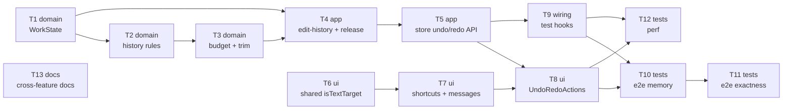

# Epic — undo-redo

> **Spec:** [spec.md](../spec.md) · **Design:** [sad.md](../sad.md) · **Screens:** [screens.md](../screens.md) · **UX flows:** [ux-flows.md](../ux-flows.md) · **ADRs:** [adr/](../adr/) · Data model / API: none (in-memory only, no external surface)

## Goal

Ship a linear Edit history of applied Steps for the open Work: Undo and Redo from two top-bar buttons and the usual shortcuts, exact to the pixel, bounded to 50 Steps and 512 MB, and honest about Unsaved edits at the save point (spec §2). One Apply of "Crop and rotate", "Adjust" or "Draw" that counts as an edit is one Step.

## Scope

- **In:** `src/core/document.ts` (WorkState, `withEdit` revision), new `src/core/history/`, `src/features/editor/` (`edit-history.ts` composable + store API), `src/shared/keyboard.ts`, new `src/features/undo-redo/`, `src/app/App.vue` + `test-hooks.ts`, `e2e/undo-redo/`, cross-feature doc notes.
- **Out:** per-Stroke or per-slider undo inside an open tool; persisting the history across reload or into the Gallery; a history panel or branching; undoing an open or an Export (spec §3). The three tool features are not changed.

## Task map

Parallel starts: **T1** (core), **T6** (shared keyboard) and **T13** (docs) begin together; T7 runs alongside the core/editor chain; T10/T12 run in parallel after T8+T9.

## Tasks

See [tracker.md](./tracker.md) for status. Machine contract: [tasks.json](../tasks.json).

| # | Task | Layer | Blocked by | DoD (short) |
|---|---|---|---|---|
| T1 | [Add WorkState, editStateOf and withState to core/document](./t01-core-work-state.md) | domain | — | Vitest proves withState(work, editStateOf(other)) restores the very Geometry, Adjustments and Drawing layer objects (toBe) and the state's revision, while keeping id, Original, source and cleanRevision |
| T2 | [Add core/history: EditHistory with createHistory, record, undo, redo, canUndo/canRedo and undo/redo labels](./t02-core-history-record-undo-redo.md) | domain | T1 | Vitest proves record appends and discards redoable entries (returning them as evicted), undo/redo move the cursor by one and return the state to restore, canUndo/canRedo are false at the ends, and undoLabel/redoLabel name the Step each would take back or restore |
| T3 | [Bound the history: budget.ts with 50 Steps and 512 000 000 B, heldLayerBytes, and the oldest-first trim inside record](./t03-core-history-budget-and-trim.md) | domain | T2 | Vitest proves 10 drawing Steps of 4096×3072 layers fit (503 316 480 B), an 11th drops the oldest, 50 Crop/Adjust Steps are all kept and a 51st drops the oldest, a shared layer counts once, the Work's own layer is not counted, and a 4096×4096 Work keeps 7 |
| T4 | [Add the edit-history composable, record a Step on every counting Apply, make withEdit take the revision, and move layer release to one path](./t04-editor-edit-history-record-and-release.md) | app | T1, T3 | Vitest proves the AC-09 revision sequence and the reused-revision sequence through the composable, that only counting Applies record a Step (AC-06), that replace() starts an empty history and releases every old layer (AC-10), and that the bitmap ledger shows 0 retained layers after a discard (AC-04) — with withEdit requiring the revision and every existing test green |
| T5 | [Expose undo, redo, canUndo, canRedo, undoTool, redoTool and historyStats on the editor store, with the refusals and the View fit](./t05-editor-store-undo-redo-api.md) | app | T4 | Store tests prove the AC-03 Crop→Adjust→Draw sequence restores each state's very objects after three Undos and three Redos, undo/redo are refused (no change) while a tool is open, an export runs or the replace dialog is open, a size-changing Undo fits the View and a same-size one keeps it, and an ExportPanel test shows the size field following an Undo of a size-changing Crop |
| T6 | [Move isTextTarget to src/shared/keyboard.ts so undo-redo can skip text and number fields](./t06-shared-keyboard-is-text-target.md) | ui | — | src/shared/keyboard.ts exports isTextTarget with the same behaviour as draw's copy, re-exported from @/shared, and keyboard.test.ts covers text, number, textarea, select, contenteditable, checkbox/range and non-element targets |
| T7 | [Add the undo-redo feature's messages and the pure shortcut handler for Ctrl/Cmd+Z, Shift+Ctrl/Cmd+Z and Ctrl+Y](./t07-undo-redo-shortcuts-and-messages.md) | ui | T6 | shortcuts.test.ts proves Undo on Ctrl+Z and Cmd+Z, Redo on Shift+Ctrl/Cmd+Z and Ctrl+Y but never Cmd+Y, no action in text fields or on repeats, the tool-open and export notices, nothing with no Work or with the replace dialog open, and preventDefault on handled keys |
| T8 | [Build UndoRedoActions (two ghost BaseButtons with hints) and mount it first in the top bar with the shortcuts](./t08-undo-redo-actions-top-bar.md) | ui | T5, T7 | Component tests render SCR-01 default/can undo/can undo and redo/oldest reached, SCR-02, SCR-03 (aria-disabled + info toast on activate) and SCR-04 (truly disabled) with the catalog hints as title and aria-describedby, clicking Undo/Redo calls the store, and App.test shows UndoRedoActions right after "Open image" in the top bar |
| T9 | [Expose the editor store's historyStats through window.__imglyTest for the e2e memory checks](./t09-test-hooks-history-stats.md) | wiring | T5 | window.__imglyTest.historyStats() returns { heldBytes, steps } from the editor store in the hooks-enabled build, typed in e2e/test-hooks.d.ts, and pnpm typecheck passes for both |
| T10 | [e2e (Chromium): the 512 MB budget, Steps kept and layer release after replace, discard and drop](./t10-e2e-memory-and-release.md) | tests | T8, T9 | Chromium e2e proves heldBytes ≤ 512 000 000 and ≥ 10 Undos available after 100 full-image drawing Applies on the reference Work, whole-page memory after the 100th ≤ after the 10th + 10%, and 0 retained layers after replacing the Work, after a new Step discards redoable Steps, and after the oldest Steps are dropped (10 drawing Steps each) |
| T11 | [e2e (Chromium, Firefox, WebKit): pixel-exact Undo and Redo for each tool, View fit, marks follow Geometry, shortcuts per engine](./t11-e2e-exactness-view-and-shortcuts.md) | tests | T10 | e2e on all three engines proves a full-size PNG Export after Undo or Redo differs by 0 per channel from the Export of that state made before, for Steps of each tool (Straighten angle, all seven Adjustments off neutral, a drawing), the AC-12 fit/keep rule, the AC-13 marks-with-Geometry sequence, and that Ctrl/Cmd+Z, Shift+Ctrl/Cmd+Z and Ctrl+Y act while Cmd+Y is not handled |
| T12 | [@perf e2e: Undo and Redo p95 ≤ 150 ms for a Step of each tool with a full-image drawing](./t12-perf-undo-redo-latency.md) | tests | T8, T9 | The @perf spec (PERF=1) measures 20 runs after 2 warm-ups from the shortcut keydown to the next presented Preview frame on the reference Work, for an Undo and a Redo of each tool's Step, and asserts p95 ≤ 150 ms |
| T13 | [Record what undo-redo supersedes in open-and-view ADR-0005, draw spec §6 and sad §11, and tick export §8 and crop-rotate §8](./t13-docs-cross-feature-updates.md) | docs | — | open-and-view ADR-0005 carries a "partly superseded by undo-redo ADR-0003" note, draw spec §6's 50-Apply memory row and draw sad §11's undo-stack row are marked replaced/resolved by undo-redo, the export §8 and crop-rotate §8 checkboxes are ticked, and CONTEXT.md defines Draft |

## Risks / Hard rules

- **One release path (High, sad §11):** `applyDrawing` and `replace()` stop releasing layers in the same PR that adds the composable (T4); a DEV assertion catches a kept entry pointing at a released layer.
- **Never-reused revision (ADR-0003):** `withEdit` takes the revision as a required argument (T4), so no path can compute `revision + 1` on its own.
- **Compile-coupled change:** the `withEdit` signature change is folded into T4 with every caller, not emitted standalone.
- **Whole-page memory ≤ +10% (Medium, sad §11):** the memory e2e (T10) is the first e2e task; if it misses, release before upload, then raise a spec §6 clarification — never loosen the 10-Step rule.
- **Undo latency for Draw (Medium, sad §11):** T12 runs as soon as T8 lands; fallback is keeping the last replaced layer's texture for one Step.
- **Module boundaries (CLAUDE.md):** `core/history` is pure; `undo-redo` reads only `@/features/editor`; `shared/keyboard.ts` imports nothing from features.
- **No persistence, no new AppError** (sad §8): the history is session memory only; refusals are unavailable buttons and info notices.
- **Before `/sdd:ship`:** T13 cross-feature doc notes are done.
