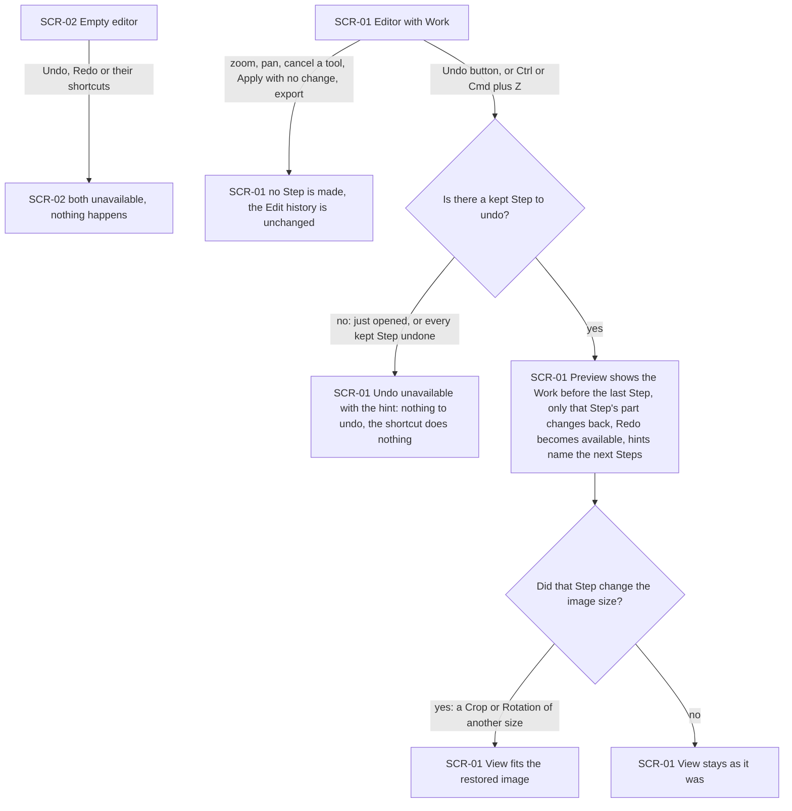
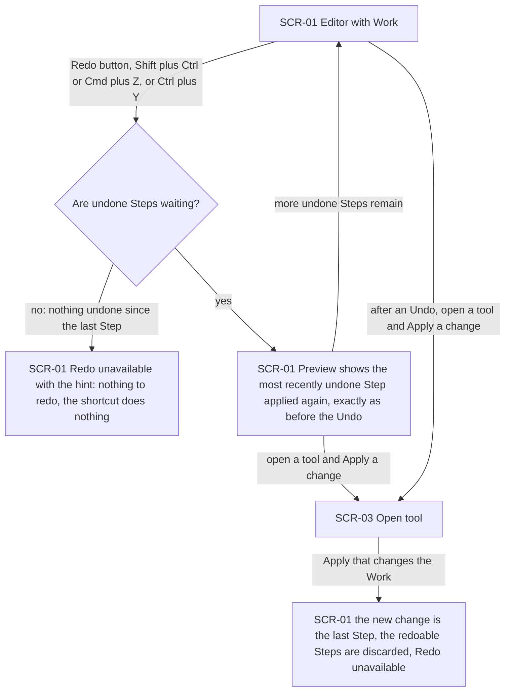
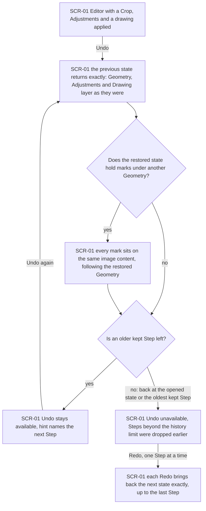
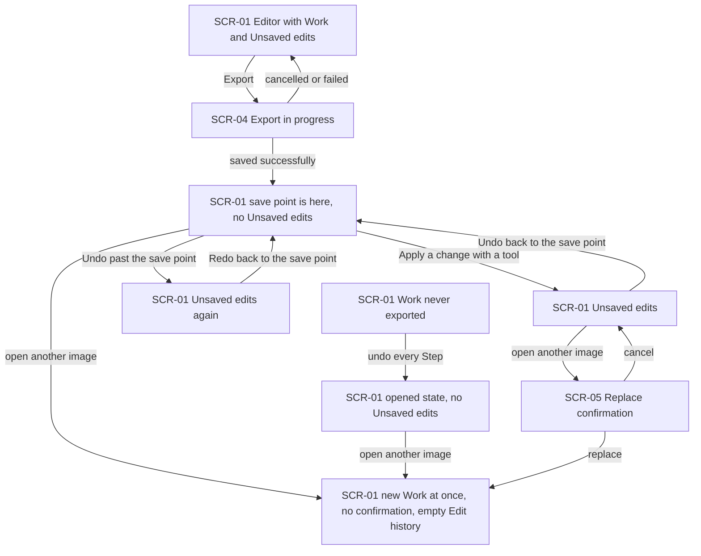
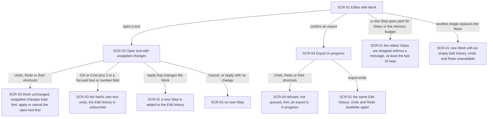
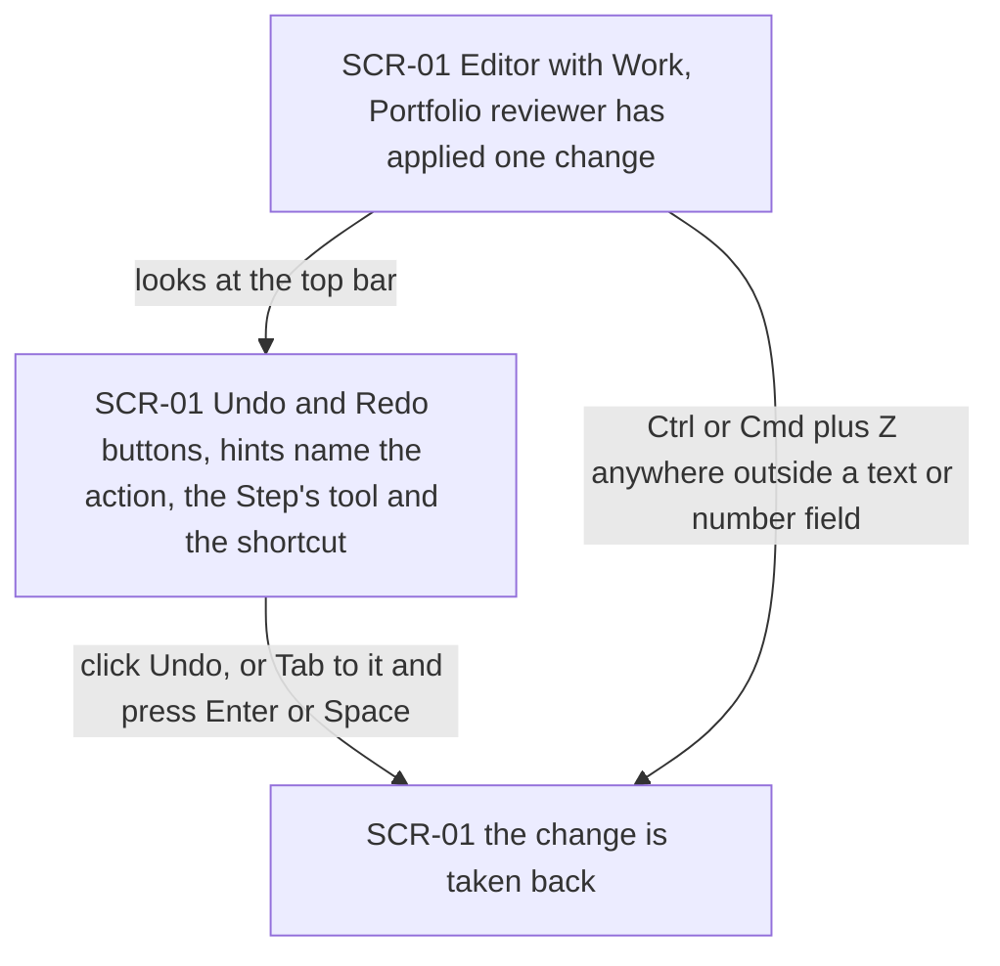

# UX flows — undo-redo

> User flows for every UI-touching §4 user story, produced by `ux-flows` (after `clarify`, before
> `design`) and read by `design` (evidence for the target-surface + UI-architecture decisions),
> `sequences` (UI-driven flows align on SCR ids), `screens` (details every inventory row) and
> `plan-tests` (the e2e-through-UI paths). **Always markdown + mermaid `flowchart`**, whatever the
> design tool — this artifact is flow-altitude, not visual design.

## Platform decisions

- **Posture:** desktop-first, as in `docs/design-system.md` §Platform posture. The keyboard (Ctrl/Cmd+Z, Shift+Ctrl/Cmd+Z, and Ctrl+Y on Windows and Linux) is the primary path. The Undo and Redo buttons in the top bar are the second path, for the mouse and for Tab plus Enter or Space (AC-14). Below 1024 px the same screens apply and the buttons stay reachable. No touch gesture for undo is designed.
- **Navigation shape:** one editor view with no page navigation, as in every earlier feature. Undo and Redo never open a screen of their own: they change the Work shown on the editor (SCR-01) in place. There is no history panel (spec §3).
- **Modality:** Undo and Redo work only on the editor with a Work and no tool open (SCR-01). While a tool is open (SCR-03) or an export runs (SCR-04) they are unavailable, and their shortcuts show a hint instead of acting. Nothing is queued for later (AC-07, AC-08). Inside a focused text or number field the shortcuts keep their usual meaning in that field and never reach the Edit history (AC-08, AC-14).
- **Outcomes are shown in place:** the result of Undo or Redo is the Preview itself, with no notice (spec §1 ledger). The button hints name the tool of the Step that Undo or Redo would take back or restore next, for example "Undo Adjust" (AC-01). Refusals are the unavailable buttons with their hints (AC-05, AC-07, AC-08). Steps dropped by the history limit leave without a message (AC-11).
- **The View follows the restored image only when its size changes:** undoing or redoing a Step that changed the image's size fits the View, as an Apply in "Crop and rotate" does. Every other Undo or Redo keeps the View (AC-06, AC-12).
- **Design input (Tech Lead flag, not decided here):**
  1. A Draw Step holds a Drawing layer of up to 64 MB. The 512 MB budget counts the image data the Edit history holds, and at least 10 full-image drawing Steps must fit on a 4096×3072 Work (spec §6, AC-11). `design` decides whether the history keeps whole layers or the differences between them.
  2. The save point is a position in the Edit history, not a comparison of contents. A change taken back by hand still counts as an edit, and undoing past an Export leaves Unsaved edits (AC-09, crop-rotate AC-13, draw AC-12). `design` decides how this maps onto the Work's revision tracking.
  3. A layer may be referred to by the Work, by kept Steps, by an open Draft and by an export in progress at the same time. Discarding redoable Steps (AC-04), dropping the oldest (AC-11) and replacing the Work (AC-10) must release exactly the layers nothing else refers to (spec §6 release row).
  4. The shortcut refusal while a tool is open or an export runs extends the existing one-tool and export hints (draw AC-15, AC-16), and the shortcuts must be skipped inside text and number fields.

## Screen inventory

| ID | Screen | Purpose | Entry | Exit |
|---|---|---|---|---|
| SCR-01 | Editor with Work | open-and-view's editor with a Work open and no tool open. The top bar now has Undo and Redo buttons, each available only when there is a Step to take back or restore, with a hint naming that Step's tool and the shortcut | A successful open; Apply or Cancel on SCR-03; the end of an export (SCR-04); confirming SCR-05 | SCR-03 (open a tool), SCR-04 (start an export), SCR-05 (open another image while there are Unsaved edits) |
| SCR-02 | Empty editor | open-and-view's empty editor. Undo and Redo are shown as unavailable | App load; no Work open | SCR-01 once an image is opened (open-and-view flows) |
| SCR-03 | Open tool | "Crop and rotate", "Adjust" or "Draw" with its unapplied changes. Undo and Redo are unavailable, with a hint to apply or cancel the open tool first | Opening a tool on SCR-01 | SCR-01 (Apply or Cancel; a confirmed replacement of the Work) |
| SCR-04 | Export in progress | export's panel while the file is being made and saved. Undo and Redo are unavailable, and their shortcuts show a hint that an export is in progress | Confirming an export on SCR-01 | SCR-01 when the export ends, whether it succeeded, failed or was cancelled |
| SCR-05 | Replace confirmation | open-and-view's warning before a new image replaces a Work with Unsaved edits. Replacing also discards the Edit history | A new image read successfully while the Work has Unsaved edits | SCR-01 with the new Work and an empty Edit history (replace), or SCR-01 unchanged with its Edit history (cancel) |

## Flows

### Flow: US-01 — Take back the last change

From the empty editor (SCR-02), Undo and Redo are unavailable and their shortcuts do nothing. On the editor with a Work (SCR-01), zooming, panning, cancelling a tool, applying a tool without changing anything and exporting never make a Step, so the Edit history stays as it was (AC-06). Choosing Undo by its button or by Ctrl/Cmd+Z does one of two things. If there is no kept Step, because the image was just opened or every kept Step is already undone, Undo is unavailable with the hint "nothing to undo" and the shortcut does nothing (AC-05). Otherwise the Preview shows the Work as it was before the last Step. Only the Geometry, the Adjustments or the Drawing layer that this Step changed goes back, Redo becomes available, and both hints name the next Step's tool (AC-01). If the undone Step changed the image's size, the View fits the restored image. Otherwise it stays as the Editor left it (AC-12).

### Flow: US-02 — Bring back what I undid

On the editor (SCR-01), Redo by its button, Shift+Ctrl/Cmd+Z or Ctrl+Y does one of two things. If nothing has been undone since the last Step, Redo is unavailable with the hint "nothing to redo" (AC-05). Otherwise the Preview shows the most recently undone Step applied again, exactly as it was before that Undo, and Redo stays available while undone Steps remain (AC-02). Whenever the Editor applies a new change with a tool after an Undo (through SCR-03), that change becomes the last Step, the Steps that could have been redone are discarded, and Redo becomes unavailable. The Edit history is one line (AC-04).

### Flow: US-03 — Step back through several changes

Each Undo on the editor (SCR-01) brings back the previous state exactly: the Geometry, the Adjustments and the Drawing layer as they were at that point, so an Export there is identical, pixel for pixel, to one made at that state before (AC-03). When the restored state has marks under a different Geometry, every mark sits on the same image content it was drawn on and follows the restored orientation and Crop, never shifted or stretched (AC-13). The View follows the US-01 rule at each Step (AC-12). While an older kept Step remains, Undo stays available and its hint names the next Step. When none is left, either because the Work is back at its opened state or because the oldest kept Step has been reached after earlier Steps were dropped by the history limit, Undo becomes unavailable (AC-05, AC-11). Redo then walks forward one Step at a time and brings back each state exactly, up to the last Step (AC-02, AC-03).

### Flow: US-04 — Know whether my work is saved after undoing

When an export from the editor (SCR-01) is saved successfully (SCR-04), the Work's save point moves to that state and it has no Unsaved edits. A cancelled or failed export leaves the save point where it was, together with the Unsaved edits. A new Step sets Unsaved edits. Undoing back to the save point clears them, undoing past it sets them again, and redoing back to it clears them again. For a Work that was never exported, undoing every Step returns it to its opened state with no Unsaved edits (AC-09). At the save point or the opened state, opening another image replaces the Work at once without asking, and its Edit history is discarded with it. With Unsaved edits, the replace confirmation (SCR-05) appears first. Replace gives the new Work with an empty Edit history, and Cancel keeps the Work and its Edit history exactly as they were (AC-10).

### Flow: US-05 — Keep a long session safe

While a tool is open (SCR-03), Undo, Redo and their shortcuts leave the Work unchanged and keep the tool's unapplied changes, and a hint says to apply or cancel the open tool first. In a focused text or number field, Ctrl/Cmd+Z works on that field's text only. An Apply that changes the Work returns to the editor (SCR-01) with a new Step. Cancel, or an Apply with no change, returns with no new Step (AC-08, AC-06). While an export is in progress (SCR-04), Undo and Redo are refused and not queued, and their shortcuts show a hint that an export is in progress. When the export ends, the same Edit history is available again (AC-07). When a new Step takes the Edit history past 50 Steps or its memory budget, the oldest Steps are dropped without a message, and at least the last 10 are always kept (AC-11). When another image replaces the Work, the new Work starts with an empty Edit history (AC-10).

### Flow: US-06 — Find undo on the first try

After applying one change, the Portfolio reviewer finds Undo and Redo as two buttons in the top bar of the editor (SCR-01), where desktop editors put them. Each hint names the action, the tool of the Step and the shortcut. Clicking Undo, reaching it with Tab and pressing Enter or Space, or pressing Ctrl/Cmd+Z anywhere outside a text or number field, takes the change back in one action (AC-14).

## AC coverage

| AC | Shown by | Notes |
|---|---|---|
| AC-01 | Flow US-01 → "yes" branch (U) | Hints name the next Steps' tools |
| AC-02 | Flow US-02 → "yes" branch (RY); Flow US-03 → Redo walk (RR) | |
| AC-03 | Flow US-03 → S and RR | Exactness is checked by Export comparison in tests, not on screen |
| AC-04 | Flow US-02 → D | |
| AC-05 | Flow US-01 → N and EN; Flow US-02 → RN; Flow US-03 → O | |
| AC-06 | Flow US-01 → NS; Flow US-05 → NC | |
| AC-07 | Flow US-05 → XH and XE | |
| AC-08 | Flow US-05 → TH, TF and AP | |
| AC-09 | Flow US-04 → SP, UE, UE2 and OP, the export outcome branches | |
| AC-10 | Flow US-04 → NEW and the SCR-05 branches; Flow US-05 → NEW | |
| AC-11 | Flow US-05 → DR; Flow US-03 → O | The memory budget itself is a §6 measurement, not a screen |
| AC-12 | Flow US-01 → V, F and K | Applies at every Step of Flow US-03 |
| AC-13 | Flow US-03 → M and MK | |
| AC-14 | Flow US-06 → B and U | |
